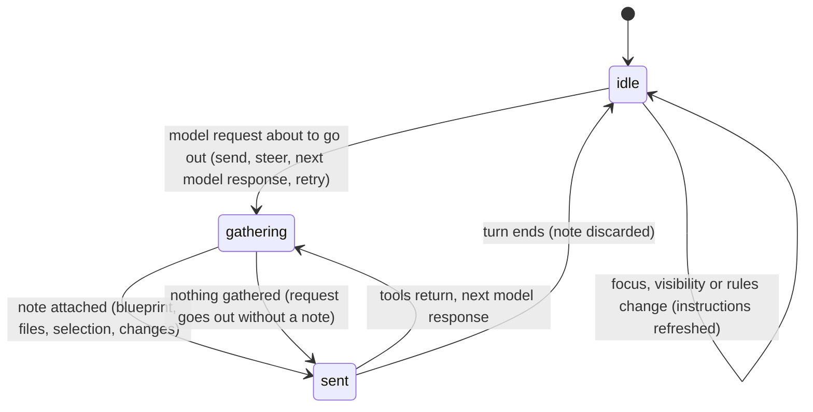

# Auto-context

## Summary

[Auto-context](../glossary.md#the-workbook) is what Pi tells the model about the workbook without the user asking, so that "what's wrong with this formula?" works without a tool call first. Before every model request, Pi gathers a short note and attaches it, unseen, to the conversation: a structural blueprint of the workbook, the current selection with the rows around it, the cells that changed since the previous request, and, when there are any, a summary of relevant files in the Files workspace. The user never sees the note: it is not in the transcript, not saved with the session and not in exports, and there is no setting to turn it off. Its effects are what the user notices: Pi knows which cell is selected, knows the sheet names, and mentions edits the user just made. It works the same while the tab is busy (it is gathered again before every model response in a turn), on Excel desktop and on the web, and needs Excel: in the taskpane opened alone in a browser, every part is silently skipped. Separately, Pi's standing instructions (rules, conventions, the execution mode) are refreshed when the taskpane regains focus; that is described here only as far as timing goes.

## The simple case

The user clicks cell D7 on the Summary sheet, which holds `=SUM(D2:D6)` and shows `#VALUE!`, and asks "why is this broken?". No tool card appears before Pi starts answering; Pi already knows that the selection is Summary!D7, what the five rows above and below contain, the formula in D7, and that D7 shows an error. It answers directly, perhaps then reading more with a tool.

The user then types new numbers into D3 and D4 in the grid, comes back to the taskpane and asks "and now?". Pi's next request carries "User changes since last message: Summary: D3, D4" along with the new selection, so Pi can say it sees the edits.

Nothing in the transcript shows that any of this was sent.

Confirmed in Excel on the web: with D7 selected and a new value typed into B4 in the grid, "Without using any tools: which cell is selected, and which cells did I change since my last message?" was answered "Selected: Sheet1!D7; changed: Sheet1!B4." with no tool card.

## The interaction, event by event

### What is gathered

Pi gathers the note immediately before each request to the model: the first model response of a turn, every model response after a batch of tool results, the model response after a steer or follow-up, and the retry after an overflow. Each part has its own rule:

| Part | Content | When it is included |
| --- | --- | --- |
| Workbook blueprint | The workbook's name; each sheet in order with its visibility, used size ("120 rows × 8 cols" or "empty"), up to eight header labels from its first row, its tables, and counts of charts, pivot tables and shapes; the visible named ranges with their formulas. The same overview the **Overview** tool produces. | Every request. Built once per workbook the first time it is needed and reused until Pi itself makes a structural change (rows, columns, sheets), which rebuilds it for the next request. |
| Files workspace summary | A summary of files in the [Files workspace](../files/the-files-workspace.md) that are relevant to this workbook: notes, files under imports, and files tagged with this workbook. A file dropped onto the composer is saved at the top level, untagged, and does not count (confirmed in Excel on the web). | The first request in a tab after the taskpane opens, if there are relevant files; and the first request after the set of files changes. Not in other requests. |
| Selection | The selected range's address; the block of the used range from five rows above to five rows below the selection, across the used columns (at most 20), as a table of values; the formulas in the selection; and any error values in that block ("Errors nearby: …"). On an empty sheet, just the address and "(sheet is empty)". | Every request, read fresh. |
| Changes since the last request | "User changes since last message:" and the changed addresses grouped by sheet, up to ten per sheet then "… (+{n} more)". Repeated edits to one address count once. | The first request after any change; then cleared. |

Each part has a time limit: about 1.2 seconds to identify the workbook, 2.5 seconds to build the blueprint, 1.5 seconds to read the selection. A part that is too slow or fails is left out of that request without any message. A blueprint that was too slow keeps building and is used from the next request.

### Ends at once

The request goes out with no note at all when every part is empty or failed: no Excel connection, the selection cannot be read (for example a chart or shape is selected, or Excel is in cell-edit mode), no edits, no relevant files, and the blueprint not ready. Nothing tells the user; Pi simply has to read the workbook with tools.

Nothing is recorded in either case.

### Sent

The note is attached to the request as an extra message placed just before the user's most recent message, so the model reads it as context for what the user just asked. It is attached to that one request only. It is never added to the transcript, never saved, and the next request gets a freshly gathered note.

From the user's point of view the only lasting effects are what the model did with it. The [context meter](context-and-compaction.md#the-meter) counts the note's tokens once the provider has reported the size of a request that contained it.

> Technical note: the note is added by the agent's context transform (`createContextInjector` in `src/taskpane/context-injection.ts`, installed as `transformContext` in `src/taskpane/init.ts`). Because the note sits just before the latest user message and changes with every request (selection, edits), the provider's prompt cache can reuse everything before that message but not after it. The user would notice this only as cost or latency, not in behavior.

### While Pi is busy

Within a turn the note is rebuilt before every model response. The selection is read again, so if the user moves the selection while Pi works, the next model response sees the new one. Edits the user makes while Pi works are reported once, at the next model request, and not after that. Pi's standing instructions do not change in the middle of a turn.

### Finishes

When the turn ends, nothing about auto-context remains: no message, no saved state. The cache of blueprints lives as long as the taskpane does.

### Standing instructions

Separately from the note, Pi's instructions include the user's and the workbook's [rules](../guidance/rules.md), [conventions](../guidance/conventions.md), the [execution mode](../workbook/confirm-mode-and-approvals.md), installed skills and active connections. They are rebuilt for every tab when the taskpane gains focus, when it becomes visible again, when rules are saved, and when connections, integrations or experimental features change. This is also when Pi re-identifies the workbook (for example after Save As), which matters for the workbook link of sessions and for workbook rules. A change takes effect from the next turn. The blueprint is not rebuilt at these moments.

### Tools offered to the model

Every request offers the model Pi's full set of tools, in the same order. Pi does not narrow the tool list by what the user asked, so any tool can appear in any turn. The set changes only when the user changes it: installing or removing an extension, connecting web search or MCP, enabling an experimental feature. None of this is visible in the default configuration.

## Modifiers

| Modifier | Set before | Changed while busy |
| --- | --- | --- |
| Model and provider | The same note goes to every model. Small context windows feel its size more (the meter counts it). | Model change refused while busy. |
| Thinking level | No effect. | No effect. |
| Execution mode | The mode is part of Pi's standing instructions, not the note. | The running turn keeps the instructions it started with. |
| Files in the workspace, or an overlay open | Relevant files add a workspace summary to the first request. An overlay has no effect. | A change to the relevant files adds a "files changed" summary to the next request (confirmed in Excel on the web with a new note); a file dropped onto the composer does not. |
| Tab state (new, restored, another tab busy) | Every tab gathers its own note. Edits since the last request are reported to whichever tab makes the next request, in any tab; another tab's request can take them first. A restored tab gets the blueprint again on its first request. | Same. |
| Host (desktop or web) | Same on Excel desktop and on the web. Without Excel (the taskpane alone in a browser) every part is skipped. | No difference. |

A modifier changed mid-turn affects the next model request's note at the earliest.

## Cancel and interrupt

| Event | Before sent | While busy |
| --- | --- | --- |
| Stop (button or Escape) | Not applicable: gathering starts only once a request is about to go out. | Stopping during gathering drops the request; edits already taken for it are not reported again. |
| The user sends something else | Each send leads to a fresh note at its request. | A steer or follow-up gets a fresh note at the request that delivers it. |
| Tab switched, created, closed or reopened | No effect. | The note is gathered for the tab that makes the request, whichever tab is active. |
| An overlay or menu opens | No effect. | No effect. |
| Model or thinking level changes | No effect. | No effect. |
| The provider fails | No effect on gathering. | Edits included in the failed request are not reported again. |
| The taskpane goes away | Pending edits since the last request are forgotten. | Same. The blueprint cache is rebuilt after reopening. |
| The workbook changes underneath | Edits are reported at the next request; a selection change is seen at the next request. | Same, at the next model response within the turn. |
| Focus moves to the grid or another window | No effect on the note. Returning focus refreshes standing instructions. | Same. |
| The context window fills | The note is not part of the saved history, so compaction neither summarizes nor removes it. | Same. |

After any interrupt, the next request simply gathers a new note.

## Interactions with other systems

**Persistence.** None. The note is never saved, so reopening a session does not replay old selections or edits.

**Workbook changes and recovery.** Reading the selection and building the blueprint only read the workbook; they do not take the workbook lock and create no backups. Every change in the workbook, including Pi's own writes, is collected as a "change" for the next request.

**Other tabs and sessions.** One list of changes is shared by all tabs in a taskpane: the first request from any tab takes it. The blueprint cache is shared by all tabs on the same workbook.

**Execution mode and approvals.** See the Modifiers row.

**Models and providers.** No interaction beyond token usage.

**Offline and provider errors.** Gathering does not need the network.

**Notifications.** None. Auto-context never shows a toast, banner or card.

**Settings and preferences.** None; auto-context cannot be turned off. The debug-only context pill, which shows what was sent, is out of scope (see [experimental features](../extensions/experimental.md)).

**Host differences.** None known between Excel desktop and Excel on the web.

**Language.** The note is always English, whatever the UI language; the user never sees it.

**Accessibility and keyboard.** Not applicable; there is nothing to interact with.

## Edge cases

- Selecting a whole column or the whole sheet makes the "selection block" the entire used range (up to 20 columns), sent with every request until the selection changes.
- A multi-area selection (Ctrl/Cmd+click) cannot be read as one range, so the selection part is left out of the note. Confirmed in Excel on the web: with A1:A2 and C3:C4 selected, the note had the blueprint and no selection.
- Only the last 50 change events are kept between requests; older ones are dropped silently.
- Edits on sheets added after the taskpane opened, and on sheets that were hidden when it opened, are not reported. A sheet renamed after the taskpane opened is reported under its old name.
- Changes report addresses only, never values.
- Structural changes the user makes by hand (a new sheet, inserted rows) do not refresh the blueprint; the model keeps seeing the old structure until Pi makes a structural change itself or the taskpane is reopened.
- The very first request in a taskpane may go out without a blueprint if building it takes longer than 2.5 seconds on a large workbook.

## Open questions and verification

- Pi's own writes are reported to the model as "User changes since last message": the change tracker records every `onChanged` event without checking where it came from (`src/context/change-tracker.ts:45-57`; no check of the event's trigger source). Confirmed in Excel on the web: after Pi wrote Sheet1!G1 with `write_cells`, the next request in the same turn carried "User changes since last message: Sheet1: G1". Looks like a bug, or at least a mislabel.
- One change tracker is shared by every tab (`src/taskpane/init.ts:222`, passed to each tab's injector at `src/taskpane/init.ts:920`), so edits are reported to whichever tab sends the next request. Confirmed in Excel on the web: an edit made while one tab was active was reported in the next request from another tab, and the first tab's next request had no changes. Probably a bug.
- The blueprint is invalidated only by Pi's own structural writes (`src/taskpane/init.ts:860-863`); manual structural edits leave it stale for the life of the taskpane (`src/context/blueprint.ts:50-66`). Confirmed in Excel on the web: a sheet added outside Pi after the blueprint was built was missing from the next request's blueprint. Probably a bug.
- The refresh decision assumes earlier notes are still in the history (`src/taskpane/context-refresh-decision.ts`, `historyHasWorkbookContextRefresh` in `src/taskpane/context-injection.ts:53-68`), but the note is never stored, so the blueprint is re-sent with every request labelled "context missing from history", and the Files summary is sent only once and then never again until files change (`src/taskpane/context-injection.ts:150-171`). The file comment says the blueprint is injected "only on first send and when invalidated". Confirmed in Excel on the web for the blueprint: the first request of the taskpane carried "[Workbook context refresh: initial]" and every later request "[Workbook context refresh: context missing from history]" with the full blueprint; the effect on the blueprint is harmless, the effect on the Files summary looks like a bug. Confirmed in Excel on the web for the Files summary too: after a note was added, one request carried "[Workspace files refresh: files changed]" and the next none; a new tab's first request carried "[Workspace files refresh: initial]" and its second none.
- The selection block is not capped in rows (`src/context/selection.ts:63-64`); a whole-column selection on a large sheet could add a very large note to every request. Read from code.
- Focus, visibility and rules updates refresh Pi's instructions but not the blueprint; whether that was intended is unknown.
- No part of the note is visible in the product without the debug UI. The checks above read the note by wrapping the tab's context transform from the console of the taskpane in Excel on the web (observation only; the requests were otherwise unchanged). They also confirmed that the note is rebuilt before every model response (three times in a turn with two tool batches), carries the selection with five rows on either side and the used columns, the selection's formulas and "Errors nearby", and reports a grid edit once and then not again. The Files workspace summary, the time limits and the 50-event cap were not exercised.

Verified against pi-for-excel commit `ec453df`.
