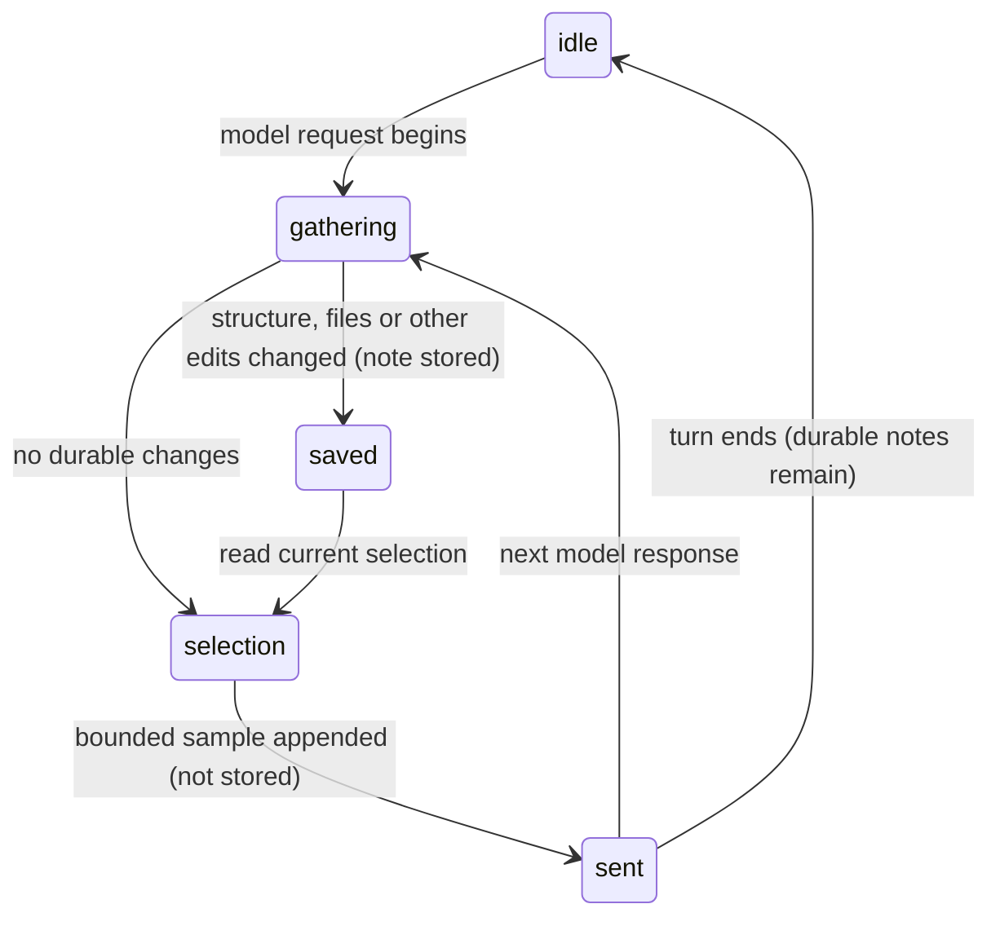

# Auto-context

## Summary

Pi learns about the workbook without the user asking it to read first. Workbook structure, relevant Files and edits by other people or chats become saved conversation notes when they change. The current selection is different: Pi reads a bounded sample afresh before every model request, adds it at the end of that request, and never stores that transient selection. These notes are not ordinary chat bubbles. There is no switch to turn auto-context off.

## The simple case

Select Summary!D7 and ask why its formula is broken. Pi receives the exact selection address and dimensions, a small labelled sample around it, selected formulas and nearby errors without a tool card. If the user edits D3, the next request receives an edit note. That note stays available on later model responses rather than disappearing after one request.

## The interaction, event by event

### What is gathered

| Part | Content | When included |
| --- | --- | --- |
| Workbook structure | Workbook name, sheets, used sizes, headers, tables, object counts and visible names. | Initially, on a changed blueprint or workbook identity, and when compaction removed its earlier note. |
| Files workspace | Relevant notes, imports and workbook-tagged files. | Initially when relevant files exist, then when the summary changes, including removal. |
| Other edits | Addresses grouped by sheet and attributed to Excel users, co-authors or Pi outside this chat. | Each runtime reads the shared edit log from its own cursor. Its own writes are excluded. |
| Selection | Exact address and dimensions, used range, labelled displayed-value sample, formulas and errors. | Every request, as a trailing transient message. |

Selection sampling has budgets of 240 cells, 20 columns and 4,000 table characters. Tall windows show their first 15 and last 5 rows with an omission notice; short windows may be shown whole. Whole-column and whole-sheet selections are clipped to used data, not loaded whole. Outside-used-range and unreadable selections are stated explicitly.

Each source has a short timeout. A failed source is logged and omitted rather than blocking the model indefinitely. Selection reports an unreadable state where possible; auto-context does not wait through Excel cell-edit mode as a requested tool does.

### Ends at once

Without Excel, workbook sources cannot supply context. Pi can still answer and use other capabilities. No workbook mutation or backup is made by gathering context.

### Sent

Durable notes are inserted before a new prompt, or after tool results mid-turn, and saved with the conversation. They survive reload and remain available to subsequent requests. Fresh selection is appended after the cached conversation, so moving it does not rewrite the preceding tool history.

### While Pi is busy

Each model response gets the current selection and newly observed changes. A structural change made by this chat is already described by its tool result; its refreshed blueprint waits until the next turn rather than arriving as a fresh instruction to repeat the change. Other chats and users can cause new notes mid-turn.

### Finishes

Durable notes remain. Old selections do not accumulate in saved history. Compaction can summarize notes; a missing current structure or Files note is sent again afterwards.

### Standing instructions

Rules, conventions, skills and enabled integrations refresh all runtimes when changed, including across taskpanes through shared notifications and on focus/visibility refresh. They are standing instructions, not selection context. Workbook identity is rechecked for workbook-scoped rules and sessions.

### Tools offered to the model

Tools are not narrowed according to the user's wording. Changes to enabled integrations and extensions refresh the offered capabilities without a reload; ordering remains deterministic.

## Modifiers

| Modifier | Set before | Changed while busy |
| --- | --- | --- |
| Model and provider | Same context; smaller windows feel its size more. | Model changes wait for idle. |
| Thinking level | No effect. | No effect. |
| Execution mode | Standing instructions describe mode. | Subsequent gated calls use mode rules. |
| Files in the workspace, or an overlay open | Relevant Files add a note. | Changes add a new note; overlays do not pause gathering. |
| Tab state (new, restored, another tab busy) | Each runtime has its own edit cursor and saved notes. | Another tab cannot consume this tab's edits. |
| Host (desktop or web) | Requires an Excel connection. | Host failures can omit a source. |

## Cancel and interrupt

| Event | Before sent | While busy |
| --- | --- | --- |
| Stop (button or Escape) | Cancels the pending request. | Stored notes remain; transient selection is not saved. |
| The user sends something else | Context gathered at request time. | Steer/follow-up gets fresh context on delivery. |
| Tab switched, created, closed or reopened | Each has its own notes. | Background request uses its own runtime. |
| An overlay or menu opens | No effect. | No effect. |
| Model or thinking level changes | Same sources. | Same sources. |
| The provider fails | Gathering does not need it. | Saved notes remain available. |
| The taskpane goes away | Unsampled edit events can be lost. | Saved notes return, live event tracking restarts. |
| The workbook changes underneath | Change tracking invalidates structure and records edits. | Next request sees the changed state. |
| Focus moves to the grid or another window | No effect. | Returning refreshes capabilities and identity. |
| The context window fills | Selection is bounded. | Compaction can replace durable notes; current notes are reintroduced if absent. |

## Interactions with other systems

**Persistence.** Durable notes save with the session; selection does not. **Workbook changes and recovery.** Gathering reads only. **Other tabs and sessions.** Per-runtime cursors; other-chat edits are attributed separately. **Execution mode and approvals.** No approval for gathering. **Models and providers.** Notes use context tokens. **Offline and provider errors.** Gathering itself is local to Excel and Files. **Notifications.** No ordinary chat card. **Settings and preferences.** No auto-context toggle. **Host differences.** API failures may limit available context. **Language.** Agent-facing context stays English. **Accessibility and keyboard.** The user selects cells in Excel; nothing new must be operated in Pi.

## Edge cases

- Sampling is not a full read. Pi must use tools for omitted rows, columns or formulas.
- Edits describe addresses, not a complete value-by-value audit log.
- The bounded edit log can lose old events; it is not co-authoring isolation or a workbook lock.
- A slow blueprint can be absent from the first request and appear later.

## Open questions and verification

Code reviewed at `1f51cf8`. A real GPT-6 Luna Excel-web turn confirmed stored initial structure and an attributed outside-chat edit note, with no redundant note after this chat's own formula write. Desktop and real remote co-author events were not exercised in this pass.

Verified against pi-for-excel commit `1f51cf8`.
