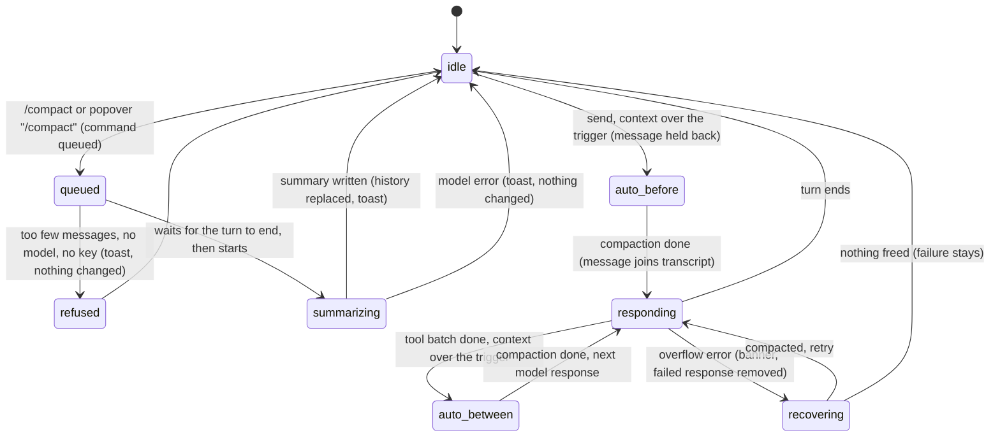

# Context and compaction

## Summary

Every model has a [context window](../glossary.md#models-and-providers), and every message, tool result and summary in a session counts against it. This document covers how the user sees that budget and what happens when it runs out: the [context meter](../glossary.md#models-and-providers) in the status bar ("12% / 200k"), its tooltip and popover, the `/compact` command, [compaction](../glossary.md#models-and-providers) itself and what it leaves in the transcript, auto-compaction before a prompt and between model responses, and the single compact-and-retry after a [context overflow](../glossary.md#endings). The meter is always visible for the active tab. `/compact` can be typed in the composer or chosen from the meter's popover; it is allowed while the tab is busy and is always queued. Compaction needs a connected provider for the tab's model, because the summary is written by that model. Everything here behaves the same on Excel desktop and on the web.

## The simple case

The meter at the right of the status bar reads "45% / 200k", in yellow. Hovering it shows "How much of Pi's memory (context window) this conversation is using.", "90,112 / 200,000 tokens" and "Context 45% full. Consider using /compact to free space or /new to start fresh."

The user clicks the meter. A popover titled "Context usage" repeats the description, the token count and the warning, and offers two actions: "/compact · Summarize earlier messages to free space." and "/new · Open a fresh tab with empty context." The user clicks "/compact". The working indicator shows "Compacting context…" with the hint "Send messages and Pi will see them after compaction", and a toast says "Compacting to free up context". After some seconds a toast says "Summarized 38 messages". The transcript now begins with a card "Show earlier messages · 38 chat messages", then a card "Summarized 61,420 tokens", then the most recent messages unchanged. The meter drops, typically to a few percent.

The user carries on in the same tab. Pi sees the summary and the recent messages, not the older ones.

## The interaction, event by event

### The meter

The meter shows two numbers: the share of the context window in use, rounded to a whole percent, and the window size ("200k", "1M"). If the model does not declare a window, 200,000 tokens is assumed. The percentage is coloured by fixed thresholds that are the same for every model:

| Percent | Colour | Warning (tooltip and popover) |
| --- | --- | --- |
| 0–40% | default | none |
| 41–60% | yellow | "Context {pct}% full." |
| 61–100% | red | "Context {pct}% full — responses may become less reliable." |
| over 100% | red | "Context is full — the next message will fail." |

The tooltip adds an action line after the warning: "Consider using /compact to free space or /new to start fresh." for yellow, "Use /compact to free space or /new to start fresh." for red. The popover shows the warning without the action line, and offers the two actions as buttons instead. Confirmed in Excel on the web with the window shrunk in memory: 54% of 40k was yellow with "21,639 / 40,000 tokens" and "Context 54% full." plus the yellow action line; 84% of 30k was red with "— responses may become less reliable."; 128% of 20k read "Context is full — the next message will fail."

The count is an estimate. Pi takes the size the provider reported for the last successful model response and adds about one token per four characters for every message since. With no reported size yet (a new tab), and right after a compaction, it estimates everything at four characters per token. Auto-context sent with each request (see [auto-context](auto-context.md)) is included only once the provider has reported a size.

The meter belongs to the active tab and is redrawn when that tab's state changes: a message completes, a turn starts or ends, the model changes, the tab switches. While the pointer is over the status bar, or focus is in it, redrawing waits until 180 ms after the pointer or focus leaves, so a tooltip that is open does not change under the user.

### Starting a compaction

Compaction starts in one of four ways:

- **`/compact`** typed in the composer, optionally followed by text: `/compact keep the Q3 numbers` adds "keep the Q3 numbers" as extra focus for the summary.
- **"/compact" in the meter's popover**, which runs `/compact` with no text.
- **Auto-compaction before a prompt.** When the user sends a message and the estimate, plus about one token per four characters of the new message, is over the trigger for the model (table below), Pi compacts first. The tab must have at least four messages.
- **Auto-compaction between model responses.** After a batch of tool results comes back and before the next model response, the same check runs on the estimate alone.

| Model's context window | Auto-compaction trigger |
| --- | --- |
| 200,000 tokens or more | 85% of the window (170,000 of 200k; 850,000 of 1M) |
| 128,000 to 199,999 | the smaller of 88% and the window minus 16,384 (111,616 of 128k) |
| under 128,000 | the window minus 16,384, or minus half the window if that is smaller (49,152 of 64k; 16,384 of 32k) |

Auto-compaction is on by default and has no control in Settings; a stored preference read when the taskpane opens can turn it off (see [turns](../foundations/turns.md#interactions-with-other-systems)). The meter's colours do not follow these triggers: at 200k the meter is red from 61%, and auto-compaction only starts above 85%.

`/compact` is always queued, even when the tab is idle; when idle it starts at once. While the tab is responding it appears in the [queue strip](../glossary.md#the-taskpane) as "/compact" and starts after the turn ends (confirmed in Excel on the web). It is one of the commands allowed while busy; see [steering and the queue](steering-and-the-queue.md).

### Ends at once

The compaction ends without changing anything, with a toast, when:

- the session has fewer than four messages, not counting Pi's own instructions or archived history (an earlier summary counts as one): "Too few messages to compact";
- everything since the last summary fits in the part that is kept verbatim: "Nothing to compact";
- the tab has no usable model: "No model configured for compaction";
- there is no credential for the provider: Pi asks for one with the connection dialog; if the user dismisses it, "No API key available for {provider}. Use /login or /settings."

Nothing is saved and the transcript is unchanged. For auto-compaction before a prompt, the message is then sent as usual (confirmed in Excel on the web: the toast "Nothing to compact" and the turn went ahead).

### Summarizing

The tab is busy from the moment the compaction starts. Pi keeps the most recent part of the conversation as it is (about 20,000 tokens by its estimate, less for windows under about 36k tokens), never starting the kept part on a tool result, and sends everything older (since the last summary) to the tab's model with a request for a structured summary: goal, constraints and preferences, progress, key decisions, next steps, critical context. If a summary already exists, the model updates it instead of starting over. The summary is written with the provider's "high" reasoning setting, whatever the tab's thinking level, and is limited to about 13,000 tokens.

What the user sees depends on how it started:

- **`/compact`, and auto-compaction before a prompt or during overflow recovery:** the working indicator shows "Compacting context…" and "Send messages and Pi will see them after compaction". The send button stays (it does not become Stop). Enter, and Alt/Option+Enter alike, queue the text ("Queued"). A toast says "Compacting to free up context" and stays for up to a minute or until the next toast. Confirmed in Excel on the web: indicator, send button, toast, and a prompt sent meanwhile waiting as "Queued" and starting when the compaction ended.
- **Auto-compaction between model responses:** the tab is still responding, so the working indicator keeps its usual rotating phrases and the Stop button stays. Only the toasts show that a compaction is running. Confirmed in Excel on the web (context window shrunk in memory to 8k).
- **Auto-compaction before a prompt** holds the user's message back: it has left the composer and the queue strip but has not joined the transcript. It appears when the compaction ends and the turn starts. Confirmed in Excel on the web (context window shrunk in memory to 20k): composer empty, nothing in the transcript or the queue strip, then the message appeared after "Summarized 3 messages".

If any of the older user messages contain a request to remember something ("remember this", "don't forget", "keep this in mind", "for future reference", "make a note", "please save"), a toast shows for 12 seconds: "Compaction reminder: found {count} memory {cue} in older messages. Save durable facts to notes/ (rules via instructions) if needed." ("cue" or "cues"). Those passages are also pointed out to the summarizing model.

If the provider says the summary request itself is too long, the toast "Compaction input too large — retrying with stronger truncation" appears and Pi tries once more with shorter excerpts and a larger kept part.

### After compaction

On success, the tab's history is replaced in one step, and the toast says "Summarized {count} messages" (user and assistant messages; tool results are not counted). The transcript, top to bottom:

1. **"Show earlier messages · {n} chat messages"**, a collapsed card. Expanding it shows "Archived history (UI only)" and every message ever compacted away in this session, with their tool cards. The archive is kept with the session for the user's reference and is never sent to the model. Each later compaction adds to the same card.
2. **"Summarized {n} tokens"**, a collapsed card (the count is Pi's estimate of the text that was summarized). Expanding it shows "Summary" and the summary as markdown, or "(No summary)". A later compaction replaces this card with a new one that carries the earlier summary forward. Confirmed in Excel on the web: "Summarized 34 messages", then "Show earlier messages · 34 chat messages" and "Summarized 3,034 tokens" at the top of the transcript.
3. The kept messages, unchanged.

The meter is meant to be recalculated from the new history; in Excel on the web it kept showing the old figure ("17% / 500k") after "Summarized 6 messages", even after the pointer moved, and showed the new one ("6% / 500k") only after a tab switch (see [Open questions](#open-questions-and-verification)). Queued prompts start next; a prompt held back by auto-compaction is sent.

On failure, the history is unchanged and a red toast says "Compact failed: {reason}" (the reason is the provider's message, or "Compaction failed"). A failed auto-compaction does not stop the turn: the prompt or the next model response goes ahead with the full history, and may overflow.

### Overflow recovery

When a model response fails because the provider says the request does not fit the model's context window, and the failure came from the tab's current model:

1. The turn ends as failed. If the tab is active, the error banner says "Context window exceeded — Pi will try compacting older history and retrying once. If this error persists, run /compact, scope your request to a smaller range, or use a larger-context model."
2. The failed model response is removed from the transcript, and Pi compacts ("Compacting context…").
3. If the compaction freed something, Pi continues the turn from where it stopped: a new model response streams, the tab is responding again, and when it finishes without error the banner disappears.
4. If the compaction freed nothing or failed, the failed model response is put back and stays in the transcript with its "Error:" line, and the banner stays.

Confirmed in Excel on the web with an overflow error simulated by making the request throw "Your input exceeds the context window of this model.": the banner appeared, the indicator showed "Compacting context…" with the send button (not Stop), the toast said "Summarized 1 messages", a new model response streamed, and the banner disappeared when it finished; the failed response was gone from the transcript.

This happens at most once per message the user sent; a second overflow in the retry is final. Overflow recovery needs auto-compaction on. With it off, the banner says "Context window exceeded. Run /compact to free up context, scope your request to a smaller range, or use a larger-context model." and nothing is retried.

## Modifiers

| Modifier | Set before | Changed while busy |
| --- | --- | --- |
| Model and provider | The model's window sets the meter's denominator and the auto-compaction trigger. The tab's model writes the summary, so compacting costs a request to that provider. An overflow from a different model than the current one is not recovered. | Model change refused while busy; a queued `/compact` uses the model the tab has when it runs. |
| Thinking level | No effect: summaries always use the "high" setting. Reasoning text in earlier responses counts towards the window. | No effect. |
| Execution mode | No effect. Compaction never touches the workbook. | No effect. |
| Files in the workspace, or an overlay open | No effect from files. The popover cannot be opened while an overlay covers the status bar; `/compact` cannot be typed while an overlay holds focus. | Compaction keeps running behind an overlay. |
| Tab state (new, restored, another tab busy) | A new tab shows a low estimate based on Pi's instructions alone, and refuses `/compact` ("Too few messages to compact"). A restored tab shows its estimate from the saved history, including any earlier summary and archive cards. Another tab being busy does not matter. | Each tab compacts independently. Its "Compacting context…" indicator, however, is drawn on whichever tab is active (see [Open questions](#open-questions-and-verification)). |
| Host (desktop or web) | No difference. | No difference. |

A variant changed during a compaction applies to the next request after it.

## Cancel and interrupt

| Event | Before sent | While busy |
| --- | --- | --- |
| Stop (button or Escape) | A queued `/compact` is dropped by Escape and kept by the Stop button (see [stopping](stopping.md)). | Compaction cannot be stopped: while only compaction runs there is no Stop button and Escape does nothing. During auto-compaction between model responses, Stop is available but does not cancel the summary request; the compaction completes and the turn then ends as aborted. |
| The user sends something else | Enter while `/compact` waits in the queue queues the text after it. | Enter queues the text ("Queued"); it is sent after the compaction. Steers and follow-ups only exist while responding. |
| Tab switched, created, closed or reopened | A `/compact` waiting in a busy tab's queue compacts whichever tab is active when it starts. | The compaction continues in its tab. Closing that tab stops its queue; the summary request may still complete but its result is discarded with the tab. |
| An overlay or menu opens | No effect. | No effect. |
| Model or thinking level changes | Model change refused while busy. | Same. |
| The provider fails | Not applicable. | "Compact failed: {reason}"; the history is unchanged. |
| The taskpane goes away | Nothing is lost. | The compaction is lost. A compaction that finished but was not followed by a completed message is also lost: the session reopens with its full uncompacted history. |
| The workbook changes underneath | No effect. | No effect on the compaction. Edits are reported to Pi at its next request. |
| Focus moves to the grid or another window | No effect. | Compaction continues. |
| The context window fills | This is what auto-compaction responds to. | An overflow during a turn triggers the one compact-and-retry above. |

After a compaction, the user stays in the same tab with the composer as it was.

## Interactions with other systems

**Persistence.** The compacted history, including the archive and summary cards, is saved the next time a message completes in the tab; compaction does not save by itself. See [persistence and restore](../cross-cutting/persistence-and-restore.md). The [resume picker](../sessions/resuming-a-session.md) preview of a compacted session begins with its summary.

**Workbook changes and recovery.** No interaction. Backups made before compaction remain in the Backups dialog.

**Other tabs and sessions.** Compaction affects one tab. Toasts appear whichever tab is active.

**Execution mode and approvals.** No interaction.

**Models and providers.** Compaction uses the tab's own model and credentials. A model with a larger window makes compaction rarer; switching to one is the remedy the overflow banner suggests.

**Offline and provider errors.** Offline, compaction fails with "Compact failed: {reason}". See [provider errors and offline](../cross-cutting/provider-errors-and-offline.md).

**Notifications.** Toasts listed above, the working indicator, the queue strip row "/compact", and the overflow banner. Only one toast shows at a time; "Summarized …" replaces the memory reminder if it is still showing.

**Settings and preferences.** None visible. The stored preference `compaction.enabled` turns off auto-compaction and overflow recovery, not `/compact`.

**Host differences.** None.

**Language.** The meter's tooltip and popover, the toasts, the working-indicator text, and the card titles are translated, except "chat message(s)" on the archive card. The overflow banners are English in every language.

**Accessibility and keyboard.** The meter is a button named "Context usage {pct}% of {label}"; the popover's actions are buttons named "Compact conversation: Summarize earlier messages to free space." and "Start new chat: Open a fresh tab with empty context."; Escape closes the popover. The archive and summary cards toggle from their header buttons. `/compact` is the keyboard path.

## Edge cases

- Compacting twice in a row with nothing new since gives "Nothing to compact" or "Too few messages to compact".
- The kept part can be most of a short session: on a 200k model, a session under about 20,000 tokens has nothing to summarize.
- A single very large tool result in the kept part is kept whole; compaction cannot shrink it.
- After compaction, the meter's estimate counts the summary and kept messages at four characters per token, so it can differ noticeably from the provider's count after the next response.
- The "full" warning says "the next message will fail", but with auto-compaction on, the next message compacts first and usually succeeds.
- Images in older messages are archived with them; the summary describes them in words only.

## Open questions and verification

- A queued `/compact` compacts the tab that is active when it runs, not the tab it was queued in: the command looks up the active tab at execution time (`src/commands/builtins/export.ts:714`), while the queue runs it after the original tab's turn (`src/taskpane/action-queue.ts:112`). If the user has switched to a tab that is responding, its history is rewritten mid-turn. Confirmed in Excel on the web twice: `/compact` queued behind a turn in one tab, then the user switched to another tab; when the turn ended, the compaction ran on the tab now active ("Nothing to compact" on an older tab, "Too few messages to compact" on a new empty one), and the original tab was never compacted. Bug.
- The "Compacting context…" indicator is set on the one shared sidebar (`src/taskpane/action-queue.ts:72-79,107-114`, `src/taskpane/init.ts:991-997`), so a background tab's compaction shows on the active tab, and clears that tab's own indicator when it ends. Read from code; in the runs above the label appeared over the active tab, but that is also the tab the command ran on. Bug.
- Compaction rewrites the history without saving (`src/commands/builtins/export.ts:686-696`); the session is saved only on the next `message_end` (`src/taskpane/sessions.ts:344-352`). A reload right after `/compact` restores the uncompacted session. Confirmed in Excel on the web: after "Summarized 6 messages" a reload brought back the earlier history and the previous summary card ("Summarized 30 tokens").
- During auto-compaction before a prompt, the user's message is visible nowhere: it has been taken off the queue (`src/taskpane/action-queue.ts:134-136`) and is not yet in the transcript. Confirmed in Excel on the web; probably worth a visible placeholder.
- Auto-compaction between model responses shows no indicator because the working indicator ignores the busy label while responding (`src/ui/pi-sidebar.ts:726-730`). Confirmed in Excel on the web.
- The meter's colour thresholds (41% and 61%, `src/taskpane/status-context.ts:38-70`) ignore the per-model soft-warning budget that `getCompactionThresholds` computes (`softWarningTokens`, `src/compaction/defaults.ts:116-127`), which nothing in the UI uses. On 200k models the meter is red long before anything happens. A product call.
- The pre-prompt minimum of four messages counts Pi's own system messages (`src/compaction/auto-compaction.ts:51`), while `/compact` excludes them (`src/commands/builtins/export.ts:515-521`). Minor.
- Stop during a mid-turn compaction does not cancel the summary request (`runCompactCommand` takes no abort signal). Confirmed in Excel on the web: Stop while the toast "Compacting to free up context" showed left the Stop button up, the compaction finished ("Summarized 8 messages"), and the turn then ended with "Error: signal is aborted without reason".
- What the model sees as overflow depends on each provider's error text; tested in `agent-overflow-recovery.test.ts` for a LiteLLM message only.
- The context meter is not redrawn after a compaction: it kept "17% / 500k" after `/compact` succeeded and changed to "6% / 500k" only on a tab switch. Confirmed in Excel on the web; the cause was not traced (compaction replaces the messages without an event the status bar listens to, presumably). Looks like a bug.
- The success toast does not agree in number: "Summarized 1 messages" (overflow recovery in Excel on the web); `export.toast.compact.summarized` has no singular form (`src/language/locales/en.json:181`, used at `src/commands/builtins/export.ts:696`). A copy slip.

Verified against pi-for-excel commit `ec453df`.
