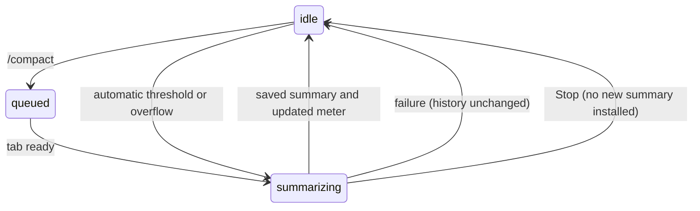

# Context and compaction

Meter and inline-error behaviour as of [PR #803](https://github.com/tmustier/pi-for-excel/pull/803), for CC-03 / CC-01 / CL-05. The budgets and summarizer prompt are unchanged.

## Summary

The context meter shows the active tab's estimated conversation usage. `/compact` summarizes older history while keeping recent work and a user-visible archive. Automatic compaction runs before a prompt or between model responses; overflow recovery can compact and retry once. All compaction belongs to its originating tab, can be stopped and saves immediately.

## The simple case

Click the meter and choose **Summarize now**, or type `/compact`, optionally with a focus such as `/compact keep the Q3 numbers`. It queues in that tab. The working line says "Compacting context…". On success a summary card and archived-history card replace older visible history, recent messages stay, the meter redraws and queued prompts continue.

## The interaction, event by event

### The meter

Usage is estimated from provider-reported tokens plus new messages, or text size when no provider count is available. It shows the share of the model's window and its size; unknown windows use 200k.

With auto-compaction on, the meter stays neutral and above the soft-warning budget says "Pi will summarize older messages automatically soon." It neither tells the user to /compact nor predicts that the next message will fail. With automatic compaction off, yellow begins above 75% of the soft-warning budget, red above that budget, and manual recovery advice remains relevant. The popover offers **Summarize now** and **New chat**, with `/compact` and `/new` as secondary command labels.

### Starting a compaction

Manual `/compact` queues even when idle, then starts immediately if nothing precedes it. Automatic checks use the conversation plus pending prompt before send, and tool results between responses. A minimum history is required.

| Window | Automatic trigger |
| --- | --- |
| At least 200k | 85% of window, bounded by answer reserve |
| 128k–199,999 | Smaller of 88% and window minus 16,384 |
| Below 128k | Window minus the smaller of 16,384 and half the window |

Auto-compaction defaults on; its stored setting is not a normal Settings control. Manual compaction remains available when automatic compaction is disabled.

### Ends at once

Too little history gives "Too few messages to compact"; no older slice gives "Nothing to compact". Missing model/login or failed summary reports the reason. History stays unchanged. A pre-prompt automatic attempt that frees nothing can still proceed with the prompt and encounter overflow.

### Summarizing

The model summarizes older history into goals, constraints, progress, decisions, next steps and critical context, keeping roughly 20k recent tokens (less for small windows). Answered requests are labelled answered and include a later final reply when needed to interpret the cut. The summary is instructed to put finished work under Done, never request its tools again as unfinished work.

Large answered tool results over 8,000 characters in the kept tail can become model-facing previews. Their full card output remains stored. Results for an unanswered request stay whole. The usual summary request uses high reasoning and a bounded output; an oversized summary input can retry once with stronger truncation.

Every compaction phase has its own tab's fixed activity label and Stop. A prompt held during pre-send compaction remains visible as Queued. Further prompts wait; switching tabs does not move compaction or its indicator. Memory cues in old messages can prompt a reminder to save durable facts to notes/rules.

### After compaction

History replacement, immediate save and meter redraw happen on success. The transcript begins with "Show earlier messages" (UI-only archived history), then "Summarized {n} tokens" (expandable summary), then kept messages. Archives and full cards remain for inspection, but only summary/kept model-facing content goes to the model. Reload preserves the compaction without requiring a later answer.

Failure leaves history unchanged. Stop says "Compaction stopped", cancels the summary and holds unused prompt text separately as Not sent. A summary completed before Stop is not rolled back.

### Overflow recovery

One provider context overflow can remove the failed response, compact and continue the same request. If nothing is freed or summary fails, the failure remains inline with Retry, a fix action and collapsed diagnostic Details. There is no separate run-error banner. A second overflow is final and its notice does not promise another automatic attempt. With automatic compaction disabled there is no overflow retry.

## Modifiers

| Modifier | Set before | Changed while busy |
| --- | --- | --- |
| Model and provider | Window sets budget; tab's model summarizes. | Model picker read-only. |
| Thinking level | Summary uses high reasoning. | No effect on summary. |
| Execution mode | No workbook change or approval. | No effect. |
| Files in the workspace, or an overlay open | Modal owns focus. | Compaction continues behind it. |
| Tab state (new, restored, another tab busy) | New history may be too short; restored history can compact. | Background compaction stays in its tab. |
| Host (desktop or web) | Same contract. | Same contract. |

## Cancel and interrupt

| Event | Before sent | While busy |
| --- | --- | --- |
| Stop (button or Escape) | Cancels queued command with notice. | Cancels summary; held prompt becomes Not sent. |
| The user sends something else | Queue ordering applies. | Prompts queue until compaction finishes. |
| Tab switched, created, closed or reopened | Command keeps its tab. | Closing asks confirmation, stops and saves settled state. |
| An overlay or menu opens | Keeps command/draft. | No pause; modal owns keys. |
| Model or thinking level changes | Queued compaction uses tab's model when run. | Model blocked; level has no effect. |
| The provider fails | Login may be needed. | Failure toast; original history kept. |
| The taskpane goes away | Saved history remains. | In-flight summary lost; completed compaction already saved. |
| The workbook changes underneath | No workbook change by compaction. | Later model request gets fresh context. |
| Focus moves to the grid or another window | No effect. | Compaction continues. |
| The context window fills | Triggers automatic compaction. | One overflow recovery only. |

## Interactions with other systems

**Persistence.** Summary/archive save immediately. **Workbook changes and recovery.** Backups remain. **Other tabs and sessions.** Summary, meter and activity belong to one tab. **Execution mode and approvals.** No mutation. **Models and providers.** Uses that tab's credentials/model. **Offline and provider errors.** Failure preserves history. **Notifications.** Compaction, memory and result notices use stacking toasts. **Settings and preferences.** Stored automatic preference, manual command always available. **Host differences.** None in compaction. **Language.** UI notices translate; summary follows the model. **Accessibility and keyboard.** Meter actions and summary/archive headers are buttons; Escape goes first to open surfaces.

## Edge cases

Short sessions can have nothing to summarize. Current unanswered results stay whole. After summary the estimate can differ from the next provider count. Full cards in archives are not evidence that the model still sees full results.

## Open questions and verification

Read from merged action queue, summary request, tail selection, history shaping and context-health code at `1f51cf8`. Historical wrong-tab, unsaved-summary and repeated-finished-work findings are not current expectations. A real large-session compaction was not rerun in this pass.

Verified against pi-for-excel commit `1f51cf8`.
