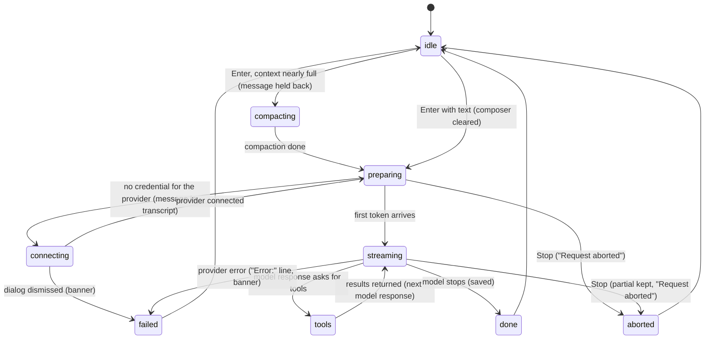

# Sending and the response

## Summary

Sending turns a draft into a [turn](../foundations/turns.md): the user's message joins the transcript, Pi gathers what it needs to know about the workbook, asks the model, and streams the answer back until it is finished, stopped or failed. This document owns the simple turn from the moment Enter is pressed in an idle tab to the moment the tab is idle again: the user message appearing, the waits before the request goes out (auto-compaction, a missing login), the streaming answer, the working indicator, how the transcript scrolls, the finished response, and the failure path with its error banner. Tool cards, thinking blocks, steering and Stop are owned by [tool calls](tool-calls.md), [thinking](thinking.md), [steering and the queue](steering-and-the-queue.md) and [stopping](stopping.md). A send is reached by Enter or the send button in the [composer](the-composer.md). While it runs, the tab shows a busy dot, the send button is a Stop button, and the working indicator sits above the composer. It needs a connected provider for the tab's model, but sending without one is allowed: Pi asks for a login after the message is sent. It works the same on Excel desktop and Excel on the web.

## The simple case

The user types "Summarize Sheet1" and presses Enter in an idle tab. The composer clears. The message appears at once at the bottom of the transcript, right-aligned. The send button becomes a Stop button, a dot appears on the tab, and a line above the composer reads "Working…" on the left with a hint such as "Press Esc to stop" on the right.

A moment later a blinking cursor appears under the user's message, and Pi's answer starts to stream into it, left-aligned and rendered as markdown: headings, lists and tables form as the text arrives. After about a second the "Working…" text changes to a playful phrase ("Reconciling…", "Herding cells into alignment…"), and keeps changing every few seconds; the hint changes too. The transcript follows the new text down.

When the answer is complete, the cursor and the working line disappear, the Stop button turns back into the send button, and the tab's dot goes away. The conversation is saved. Focus is still in the composer, ready for the next message.

## The interaction, event by event

`preparing`, `streaming` and `tools` are *responding*; `compacting` is busy but not responding.

### Pressing Enter

Enter in an idle tab, with text that does not start with `/`, sends; [the composer](the-composer.md#sending) owns what counts as sendable. At that instant the draft is trimmed, the composer clears, the transcript is set to follow new content, and any error banner is cleared. The message is handed to the tab's action queue, which is empty, so it starts at once.

Before the message goes to the model, Pi checks whether the conversation plus the new message would overflow the model's context window. If it would, and the session has enough history to summarize, Pi compacts first (see [context and compaction](context-and-compaction.md)). During this pre-prompt compaction:

- The working line shows a fixed pill with a spinner, "Compacting context…", and the hint "Send messages and Pi will see them after compaction". The phrases and hints do not rotate.
- The send button stays; there is no Stop button and Escape does not stop it. The tab is busy but not responding.
- The message the user just sent is not visible anywhere: the composer is empty, the queue strip does not list it, and it has not joined the transcript yet. It appears when compaction finishes.
- Further messages sent now are *queued* behind it (see [steering and the queue](steering-and-the-queue.md#queued-prompts-and-commands)).

The tab model, thinking level and execution mode are read when the request is built, after any compaction.

### Ends at once

Nothing is sent, added or saved when the draft is empty, starts with `/`, or there is no active tab; see [the composer](the-composer.md#ends-at-once). Once the message is handed to the queue, there is no "ends at once" any more: the only ways out are finishing, Stop, or failure.

### Sent

The turn is committed when the user message appears in the transcript. From that moment:

- The tab is *responding*: the Stop button replaces send, the composer placeholder is "Redirect reply (↵) · New question (⌥↵)", the tab shows a busy dot, and the working indicator runs (see [The working indicator](#the-working-indicator)).
- The message is part of the conversation. It cannot be edited, removed or recalled.
- Under the message, a blinking cursor marks where the answer will appear.

Then, before any text can arrive, Pi does two things the user can see only as a pause:

1. **Auto-context.** Pi reads the workbook's structure, the current selection and the cells the user changed since the last turn, and adds them to the request; see [auto-context](auto-context.md). On a large workbook this can take a noticeable moment.
2. **Credentials.** If the tab's provider has no usable login or API key, a dialog titled "Connect {provider}" opens over the taskpane ("This model needs a login or API key to continue.") with that provider's login or key entry already expanded. The turn waits on it, still responding. Connecting continues the turn as if nothing had happened, and clears the error banner. Closing the dialog (its close button, the backdrop, or Escape) shows the banner "API key required for {provider}." and the turn then fails (see [Finishes](#finishes)). Providers supplied by an extension never open the dialog; the banner says "No API key available for provider "{provider}"." instead.

The request then goes out. Rate-limit retries that the provider asks for happen inside it, without any visible change; see [provider errors and offline](../cross-cutting/provider-errors-and-offline.md).

### Streaming

The answer streams into the streaming area below the last message. Text is rendered as markdown as it arrives, updated at most once per screen frame, with the blinking cursor after the last character. If the model reasons first, a thinking block opens before the text ([thinking](thinking.md)); if it calls tools, tool cards appear in order with the text ([tool calls](tool-calls.md)). When a model response asks for tools, the tools run and the next model response streams into the same area, so a long turn reads as one continuous answer with cards in it. Messages the user steers in appear as user messages between model responses ([steering and the queue](steering-and-the-queue.md)).

While streaming, the user can scroll, switch tabs, open overlays, change the thinking level, steer, follow up and stop. Changing the model is refused ("Wait for this tab to finish before changing models").

**Scrolling.** The transcript follows new content: every time the content grows, it scrolls to the bottom. Scrolling up by more than 32 px from the bottom stops this, so the user can read earlier messages while Pi keeps writing below. Scrolling back to within 20 px of the bottom resumes it. Sending a new message always resumes it; steering does not. Confirmed in Excel on the web: 30 px up kept following, 34 px stopped it, 25 px and 21 px stayed stopped, 19 px resumed it. Anything that makes the composer taller (a multi-line draft, messages restored with Alt/Option+Up) also stops it, because the transcript loses height; after an Alt/Option+Up restore and a steer, the rest of the turn streamed below the visible area. Inside the streaming answer, an expanded thinking block or tool card body that has its own scroll area follows its own bottom in the same way, independently of the transcript: scrolling up inside one stops it following until the user scrolls back to its bottom.

### The working indicator

The line between the transcript and the composer, shown while the active tab is responding or running a labeled queued action.

- **Left text.** Starts as "Working…". One second later it changes to a playful phrase picked at random from 127 (short verbs such as "Schlepping…" or "Calculating…", longer ones such as "Consulting the void…" or "Hunting for the missing penny…"), then every 6 seconds to another, never repeating the one just shown. Each change fades out and in.
- **Right text.** A hint picked at random when the indicator starts, then a different random one every 4.5 seconds: "Press Esc to stop", "⇧Tab to adjust reasoning depth", "Type / for commands", "⌃O to collapse tool details", "Press Enter to redirect Pi".
- **Fixed mode.** When the active tab is busy but not responding and a labeled action runs (compaction), the line instead shows a pill with a spinner and fixed text, "Compacting context…", with the hint "Send messages and Pi will see them after compaction". Nothing rotates. When compaction happens *between model responses* the tab is responding, so the normal rotating line is shown instead of the label.

The indicator starts fresh ("Working…") each time the active tab goes from idle to responding. Confirmed in Excel on the web: the first phrase replaced "Working…" about 1.25 seconds after the send, and the first hint varied between turns ("Press Esc to stop", "Type / for commands", "⇧Tab to adjust reasoning depth", "⌃O to collapse tool details"). It belongs to the active tab: switching to a responding tab shows it, switching to an idle tab hides it.

### Finishes

A turn ends in one of three ways; [turns](../foundations/turns.md#finishes) defines them. What the user sees:

- **Done.** The last model response asked for no tools and nothing was waiting. The streaming area empties and the answer stands as an ordinary assistant message in the transcript; the cursor and working indicator disappear, the Stop button becomes send, the busy dot goes away, the placeholder rotates again, and steer and follow-up rows (if any were left) leave the queue strip. If the active tab's last run had left an error banner, it is cleared. Each completed message has been saved as it completed; see [persistence and restore](../cross-cutting/persistence-and-restore.md).
- **Aborted.** The user pressed Stop. The partial answer stays, followed by the grey marker "Request aborted". A response stopped before any text shows only the marker. No banner. See [stopping](stopping.md).
- **Failed.** The model response ends with a red line "Error: {reason}" under whatever had streamed. If the tab is the active tab when the run ends, the error banner appears at the top of the taskpane, above the tab strip:
    - a context overflow: "Context window exceeded — Pi will try compacting older history and retrying once. If this error persists, run /compact, scope your request to a smaller range, or use a larger-context model." Pi then compacts and retries once; see [context and compaction](context-and-compaction.md). With auto-compaction turned off: "Context window exceeded. Run /compact to free up context, scope your request to a smaller range, or use a larger-context model.";
    - a network failure that looks like a blocked cross-origin request ("Failed to fetch", "Load failed", "NetworkError", "CORS"): "Network error (likely CORS). If you're using OAuth, enable /settings → Proxy with {proxy URL} and retry. Guide: {docs link}";
    - anything else: "LLM error: {reason}".

  An error whose text contains "abort" or "cancel" is treated as an abort and shows no banner. The banner has no close button. It is cleared when a user message starts in the active tab, when the user sends, and when a later run in the active tab ends without error. It is not cleared by switching tabs, and a tab that fails in the background never shows one. Confirmed in Excel on the web with simulated provider errors.

If a queued prompt or command is waiting in the tab's action queue when the turn ends, it starts next and the tab stays busy.

## Modifiers

| Modifier | Set before | Changed while busy |
| --- | --- | --- |
| Model and provider | Used for every model response in the turn. With no credential, the connection dialog opens after the message is in the transcript. A small context window makes pre-prompt compaction likelier. | Refused: "Wait for this tab to finish before changing models". |
| Thinking level | Applies to the turn's model responses; a reasoning model shows a thinking block before text. | Applies from the next turn ("Thinking: {level} (next turn)"). |
| Execution mode | In Confirm, a mutation pauses the turn on an [approval](../workbook/confirm-mode-and-approvals.md); streaming stops until it is answered. | Applies from the next mutation. |
| Files in the workspace, or an overlay open | Files are not sent with the message; Pi reads them with tools if it decides to. An open overlay holds focus, so the send comes after it closes. | Overlays opened during the turn do not pause it, except the connection dialog and approvals, which the turn waits on. |
| Tab state (new, restored, another tab busy) | A new tab's first answer creates its saved session. A restored tab sends its whole history. Another tab being busy does not delay this one, except at the [workbook lock](../foundations/the-workbook.md). | Switching away does not pause the turn. On return, the transcript shows everything so far; the indicator restarts from "Working…" if the tab switched from was idle, and keeps its current phrase if it was responding too. |
| Host (desktop or web) | Some providers need the [CORS proxy](../setup/the-proxy.md) in the taskpane's webview; without it the turn fails with the CORS banner. | No effect. |

Changes made while busy take effect at the next model response or mutation, never in the middle of one.

## Cancel and interrupt

| Event | Before sent | While busy |
| --- | --- | --- |
| Stop (button or Escape) | During pre-prompt compaction there is no Stop and Escape only blurs the composer; the message is sent when compaction ends. | The answer ends "Request aborted". Escape and the button treat waiting items differently; see [stopping](stopping.md). |
| The user sends something else | A second Enter during pre-prompt compaction queues the new text behind the first. | Enter steers, Alt/Option+Enter follows up; see [steering and the queue](steering-and-the-queue.md). |
| Tab switched, created, closed or reopened | Not applicable: the send starts at once. | The turn continues in the background; its dot stays. Closing it asks "Stop and close this tab?". The error banner of a background failure is never shown. |
| An overlay or menu opens | Not applicable. | The turn continues behind it. The connection dialog and approval dialogs are overlays the turn waits for. |
| Model or thinking level changes | Applies to this send. | Model refused; thinking level from the next turn. |
| The provider fails | Not applicable. | The turn fails: "Error:" in the answer, banner if active. A context overflow is compacted and retried once. |
| The taskpane goes away | Not applicable. | Completed messages are saved; the answer that was streaming is lost. In a session Pi had never answered, nothing is saved. See [persistence and restore](../cross-cutting/persistence-and-restore.md). |
| The workbook changes underneath | Edits made before Enter are picked up by auto-context. | Edits made during the turn are seen by the next request's auto-context, which runs before each model response. |
| Focus moves to the grid or another window | Not applicable. | The turn keeps streaming. |
| The context window fills | Pre-prompt compaction runs first. | Auto-compaction runs between model responses; an overflow is compacted and retried once. |

After the turn, the user is in the same tab with the composer focused, unless they moved.

## Interactions with other systems

**Persistence.** Each message is saved when it completes, once the session has had its first answer. The streaming answer is saved only when it completes, is stopped or fails. See [persistence and restore](../cross-cutting/persistence-and-restore.md).

**Workbook changes and recovery.** A plain text answer changes nothing. Tool calls during the turn may; each mutation has an [automatic backup](../workbook/backups-and-revert.md).

**Other tabs and sessions.** Turns in different tabs stream independently. They share the error banner and the working indicator element; see [Open questions](#open-questions-and-verification).

**Execution mode and approvals.** In Confirm mode the turn pauses on each mutation's approval.

**Models and providers.** The tab's model and thinking level are read for each model response. A missing credential opens "Connect {provider}". See [models and providers](../foundations/models-and-providers.md).

**Offline and provider errors.** Offline, the request fails with the provider's network error, usually shown as the CORS banner because browsers report both the same way. See [provider errors and offline](../cross-cutting/provider-errors-and-offline.md).

**Notifications.** The busy dot, the working indicator, the Stop button and the error banner. There is no sound, badge or system notification when a turn ends, in the active tab or in a background one.

**Settings and preferences.** Auto-compaction is on by default and has no Settings control. Nothing else in Settings changes the shape of a turn.

**Host differences.** None in the turn itself. Whether the CORS proxy is needed depends on the provider and host; see [host differences](../cross-cutting/host-differences.md).

**Language.** The working phrases, hints, "Request aborted", "Error:", "LLM error: {reason}" and the connection dialog are translated. The context-overflow and CORS banners and "API key required for {provider}." are hard-coded English. The key glyphs in the hints (⇧, ⌃) are the same on every platform.

**Accessibility and keyboard.** The whole turn is keyboard-driven. Neither the working indicator, the streaming text nor the error banner is a live region, so screen readers are not told that Pi is working, has answered or has failed. The Stop button is labeled "Stop".

## Edge cases

- A model response with no text and no tools (an empty answer) leaves an assistant message with nothing in it; the turn ends normally.
- A very fast answer can finish before the first phrase rotation, so the user only ever sees "Working…".
- The working hint at the start is random; "Press Esc to stop" is not guaranteed to appear first.
- If the user has scrolled up, new content does not pull them down, and nothing tells them more has arrived until they scroll back.
- Typing a multi-line draft or restoring queued messages with Alt/Option+Up while Pi is writing makes the transcript stop following, though the user never scrolled.
- Switching tabs does not reset the scroll-follow state: a tab switched to while the user had scrolled up in another tab may not jump to its bottom.
- Sending while an error banner is showing clears it immediately, before the new turn has a result.
- An error banner from one tab stays visible after switching to a tab that is fine.
- A turn that the provider retries for a rate limit simply streams later; there is no "retrying" message.

## Open questions and verification

- The message sent while pre-prompt compaction runs is invisible until compaction ends (the action is removed from the queue display before compaction starts, `src/taskpane/action-queue.ts:134-151`). Read from code. A user could think the message was lost; probably worth showing it.
- The compaction label is shown on whatever tab is active, not on the tab that is compacting: every tab's action queue is created with the one shared sidebar (`src/taskpane/init.ts:340`, `:991-993`), and `setBusyIndicator` sets taskpane-wide state (`src/ui/pi-sidebar.ts:259-263`). A background tab compacting would show "Compacting context…" above an idle active tab, and finishing one tab's compaction clears another's label. Read from code; looks like a bug.
- After the connection dialog is dismissed, the banner first says "API key required for {provider}." (`src/taskpane/init.ts:986`); when the run then ends with the provider's own error ("No API key for provider: …"), the end-of-run handler replaces it with "LLM error: …" (`src/taskpane/init.ts:1059`). Which text the user is left with has not been confirmed.
- The connection dialog opens after the user message is already in the transcript and while the tab is responding: the loop emits the user message (`node_modules/@earendil-works/pi-agent-core/dist/agent-loop.js`, `runAgentLoop`) before the first request resolves the credential (`streamAssistantResponse` calls `getApiKey`). [Turns](../foundations/turns.md#sent) lists the missing login as a wait *before* the message joins the transcript; this document follows the code. Read from code.
- Mid-turn compaction (between model responses) shows the normal rotating line instead of "Compacting context…", because the fixed label is only used when the tab is not responding (`src/ui/pi-sidebar.ts:726-730`). Read from code; probably unintentional.
- The error banner is one per taskpane and sits above the tab strip (`#error-root` in `src/taskpane.html:35`), so it is not visually tied to a tab. Read from code.
- The working-indicator source comment says hints start with "escape to interrupt", but the first hint is random (`src/ui/working-indicator.ts:86`). Read from code.
- The rotation timings (1 s, 6 s, 4.5 s, 250 ms fade) are read from code; in Excel on the web the first phrase appeared about 1.25 s after the send (1 s plus the fade). The stop-before-any-text case ("Request aborted" alone) was confirmed in Excel on the web.
- Growing the composer turns off auto-follow. With the transcript at its bottom, five Shift+Enter lines in the composer left the transcript 97 px above its bottom with following off; Alt/Option+Up restoring two messages did the same mid-turn. The scroll listener (`src/ui/pi-sidebar.ts:524-528`) evidently sees the shrink as the user scrolling up; the exact sequence was not traced. Looks like a bug: the user did nothing to ask for it, and the steer that follows does not turn following back on.
- Confirmed in Excel on the web: the user message appears, the Stop button, busy dot and "Redirect reply (↵) · New question (⌥↵)" placeholder appear at once, and all go when the turn ends; a provider error (simulated by making the request throw) shows "Error: {reason}" in red in the transcript and "LLM error: {reason}" above the tab strip; sending clears the banner.
- Taking the network away (CDP offline emulation for 8 s) during a streaming answer did not fail it: the answer finished normally. The ChatGPT provider in use may stream over a connection the emulation does not cut. What a real network loss does was not checked.

Verified against pi-for-excel commit `ec453df`.
