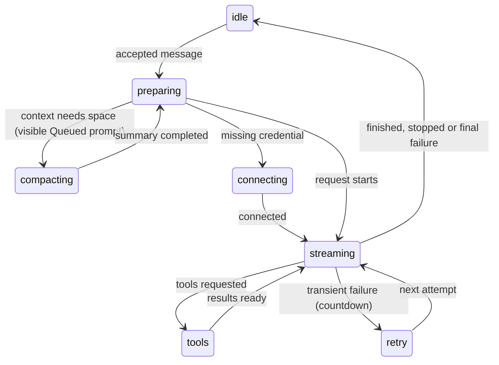

# Sending and the response

## Summary

An accepted message starts work in its tab. Pi streams text, reasoning and tool calls until it answers, is stopped or fails. Each tab owns its activity and error state, so background work cannot put a compaction line or error on an unrelated tab.

## The simple case

Press Enter with a question. The composer clears; the user message, Stop button, busy dot and "Working…" line appear. The answer streams as markdown, with tool cards where Pi acts. At completion the answer stays, activity disappears and Send returns. Focus stays where the user left it.

## The interaction, event by event

### Pressing Enter

Enter and Send share the [composer's dispatch](the-composer.md#ends-at-once). An accepted message clears its tab's draft/error and resumes transcript follow. If compaction must run first, the message stays visible as Queued; Stop can cancel compaction and keep the prompt Not sent.

### Ends at once

Empty input does nothing. Slash commands stay local, with unknown/refused text retained for correction. No active session reports a toast.

### Sent

The user message becomes conversation history and saves immediately, even in an unanswered first turn. Auto-context prepares changed durable notes and fresh selection. A missing login opens "Connect {provider}"; connecting continues, dismissing leaves the specific API-key-required notice rather than replacing it with a generic loop error.

### Streaming

Only the currently streaming response occupies the streaming area. At response completion it moves to the stable transcript in the same update, so it is never drawn twice while tools run. Each tool card finishes when that tool returns, not when the slowest parallel call finishes.

The transcript follows new content unless the user deliberately scrolls up; scrolling back near the bottom or sending resumes follow. Composer growth preserves an existing follow choice. Expanded card bodies can scroll independently. Thinking stops saying "Thinking…" when reasoning ends, not when the whole response finishes.

### The working indicator

Ordinary work starts with "Working…", then playful phrases and keyboard hints rotate. Compaction, including mid-turn compaction, has its own fixed label in its own tab. Retryable failures show a countdown for up to three attempts after 2, 4 and 8 seconds. Cell-edit waits have a distinct waiting label. Switching tabs shows only that tab's state.

### Finishes

Done keeps the final answer. Stop keeps the partial answer with "Request aborted" and no error banner. Final failure keeps the partial text and reason, with a dismissible tab-owned banner below the tabs. Offline, unavailable proxy, blocked loopback access, missing login and overflow have distinct guidance. Error text merely containing "cancel" or "abort" is not a deliberate Stop.

As of [PR #808](https://github.com/tmustier/pi-for-excel/pull/808) (CL-01),
each ending also shows a typed receipt when the turn changed the workbook:
changed ranges, a total, **Review** and **Undo this turn**. Stopped and failed
receipts are emphasized. Review shows counts and backup ids; Undo restores
available backups newest first, asks before overwriting later edits and keeps
ordinary inverse backups. Missing backup coverage is explicit. The receipt
saves with the session but is not sent back to the model. See
[turn recovery](../workbook/backups-and-revert.md#review-and-undo-a-turn-cl-01).

An Office.js-only turn still shows a notice that its code is not covered by
Undo this turn, with `/backup` guidance. A mixed turn shows the same notice
alongside the recoverable core changes; the receipt never implies full
coverage of arbitrary code (PR #808).

One overflow can compact-and-retry; a second is final. Ordinary eligible transient errors retry with visible countdowns. Undelivered text becomes separate Not sent rows; stopped commands are cancelled and named. Nothing leaks unasked into the next turn.

## Modifiers

| Modifier | Set before | Changed while busy |
| --- | --- | --- |
| Model and provider | Starting model serves the turn. | Picker read-only. |
| Thinking level | Starting level serves all model responses. | Applies next turn. |
| Execution mode | Confirm pauses changes for approval. | Subsequent gates use current mode. |
| Files in the workspace, or an overlay open | Files are not attachments; modal owns focus. | Work continues behind overlays except required approvals/login. |
| Tab state (new, restored, another tab busy) | First message saves; restored history used. | Other tabs run independently. |
| Host (desktop or web) | Networking restrictions may differ. | Submitted Excel work cannot be recalled. |

## Cancel and interrupt

| Event | Before sent | While busy |
| --- | --- | --- |
| Stop (button or Escape) | Idle Escape keeps draft. | Cancels turn, retries and compaction; holds unused text. |
| The user sends something else | Normal dispatch. | Steer/follow-up or queued prompt. |
| Tab switched, created, closed or reopened | Per-tab draft swaps. | Work/error belongs to original tab; closing stops and settles it. |
| An overlay or menu opens | Keeps draft. | Topmost modal/menu owns keys; work continues. |
| Model or thinking level changes | Used at start. | Model blocked, thinking next turn. |
| The provider fails | Login may be requested. | Retry if eligible, otherwise classified error. |
| The taskpane goes away | Saved draft returns. | Saved messages return; in-flight text may be lost. |
| The workbook changes underneath | Auto-context gathers it. | Next model request sees changed notes/sample. |
| Focus moves to the grid or another window | Keeps draft. | Work continues. |
| The context window fills | Pre-prompt compaction. | Mid-turn compaction or one overflow recovery. |

## Interactions with other systems

**Persistence.** Saves from first user message; streaming is not continuously saved. **Workbook changes and recovery.** Tool changes remain after failure or Stop. **Other tabs and sessions.** Activity and errors are per tab. **Execution mode and approvals.** Approvals queue before the lock. **Models and providers.** Missing credential prompts after delivery. **Offline and provider errors.** [Failure classification](../cross-cutting/provider-errors-and-offline.md). **Notifications.** Working line, queue, tab state, banner and toasts; no system notification. **Settings and preferences.** Auto-compaction on by default. **Host differences.** Provider/proxy access varies. **Language.** UI notices translate. **Accessibility and keyboard.** Stop and queue controls are named; modal shortcuts do not reach the covered taskpane.

## Edge cases

An empty model answer can finish normally. A fast turn may show only "Working…". New sends clear only their own tab's error. A failure in a background tab is shown when that tab is selected. A larger draft does not count as a user scroll.

## Open questions and verification

Code reviewed at `1f51cf8`. A real GPT-6 Luna turn in Excel on the web read a grid, wrote a formula, returned a verified value and backup, and finished normally. Desktop timing and real quota/rate-limit exhaustion were not exercised.

Verified against pi-for-excel commit `1f51cf8`.
