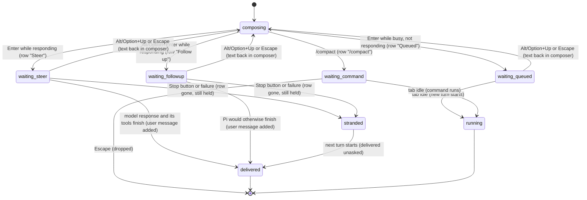

# Steering and the queue

## Summary

Steering and the queue let the user keep talking to Pi while it is busy instead of waiting for it to finish. A message sent while Pi is responding becomes a *steer* (Enter), delivered as soon as the current model response and its tools finish so it changes what Pi does next, or a *follow-up* (Alt/Option+Enter), delivered only when Pi would otherwise have finished. A message sent while the tab is busy but not responding (for example during `/compact`) becomes a *queued* prompt that starts as its own turn afterwards, and `/compact` itself always waits in the same queue. Everything waiting is listed in the *queue strip* just above the composer, and Alt/Option+Up takes it back into the composer for editing. The definitions of these words belong to [turns](../foundations/turns.md#while-pi-is-busy); this document owns how each one behaves from the moment it is sent until it is delivered, restored or lost. Everything here acts on the active tab only. No provider is needed to queue, but delivery needs one; it works the same on Excel desktop and Excel on the web.

## The simple case

Pi is partway through answering "Clean up the Sales sheet" and has just started reading the sheet. The user realises they want the totals kept. They type "Keep the totals row" in the composer, whose placeholder reads "Redirect reply (↵) · New question (⌥↵)", and press Enter. The composer clears and a strip appears above it:

> **Steer** Keep the totals row
> ↳ Press Alt+↑ to edit queued message

The read finishes, and before Pi writes its next words the user's message appears in the transcript as an ordinary user message and the strip disappears. Pi's next model response takes the instruction into account.

Had the user pressed Alt/Option+Enter instead, the row would have said **Follow up**, and it would have stayed in the strip until Pi finished the clean-up; then the message would have joined the transcript and Pi would have answered it in the same turn.

## The interaction, event by event

### What Enter means while busy

What a send becomes depends on the active tab's state at the instant of the key press, and on the modifier:

| Tab state | Enter | Alt/Option+Enter | Shift+Enter |
| --- | --- | --- | --- |
| Idle | Send (starts a turn) | Send | Newline |
| Responding | Steer | Follow-up | Newline |
| Busy, not responding (compaction) | Queued prompt | Queued prompt | Newline |

Ctrl/Cmd+Enter behaves like Enter in every state. The send button behaves like Enter when it is shown; while responding it is the Stop button, so steering and following up are keyboard-only.

Slash text is decided first. If the draft starts with `/` and names a known command, the [command busy policy](../commands/the-command-menu.md) applies whatever the modifier: busy-allowed commands run (`/compact` is queued), others are refused with "Can't run /{command} while Pi is busy". A refused command typed as one word loses the draft, because the command menu is open and empties the composer before running it (confirmed in Excel on the web with `/model`; see [the composer](the-composer.md#ends-at-once)). If it names no known command, it is steered or followed up as ordinary text while responding, and nothing happens while busy but not responding. If the command menu is open, Enter runs the highlighted command instead.

The text is trimmed. Empty text does nothing in every state.

### Ends at once

Nothing is queued and nothing is recorded when:

- the draft is empty or only whitespace;
- the draft is a slash command that runs at once or is refused;
- Alt/Option+Up finds nothing to restore: the toast says "No queued messages to restore".

### Sent into the queue

The moment Enter is pressed, the draft leaves the composer and is committed to the tab's queue:

- **Steer and follow-up** are handed to Pi's own queues for the running turn and get a row in the queue strip labeled "Steer" or "Follow up".
- **Queued prompts and commands** go into the tab's action queue and get a row labeled "Queued" or with the command's name ("/compact", followed by its arguments if any).

From then on the text is no longer in the composer. It can be taken back with [restore queued](#restoring-queued-messages) or Escape until it is delivered; after that it is an ordinary user message and cannot be changed.

### While items wait

**The queue strip.** Shown just above the composer (below the working indicator) whenever the active tab has anything waiting. Each row has a coloured label, drawn in capitals ("STEER", "FOLLOW UP", "QUEUED", "/COMPACT"), and the text. Steer and follow-up rows come first, in the order they were sent, then queued prompts and commands in queue order. Text longer than 50 characters is cut to its first 47 characters and "…" (confirmed in Excel on the web with a 60-character steer); the full text is not shown anywhere (no tooltip). The last line is always "↳ Press Alt+↑ to edit queued message" ("⌥↑" on macOS), even when the only rows are commands, which Alt/Option+Up does not take back. The strip belongs to the tab: switching tabs shows the new active tab's strip, or none.

**Delivery of steers.** Pi checks for a waiting steer at three points: when a turn begins, after each model response and all of its tool calls have finished, and after any compaction Pi runs between model responses. At each check it takes *one* steer, adds it to the transcript as a user message, and starts the next model response with it. So:

- a steer never interrupts streaming text or a running tool, and waits for every tool in the current batch, including one waiting on an approval;
- a steer sent while Pi is writing its last answer still arrives: the turn continues with one more model response instead of ending;
- several steers are delivered one per model response, oldest first. Three steers mean at least three more model responses.

**Delivery of follow-ups.** Pi checks for a follow-up only when it would otherwise end the turn: the last model response asked for no tools and no steer is waiting. It takes *one*, adds it as a user message, and carries on (tools and all) until it would end again, then takes the next. Steers sent meanwhile go first at every check. Follow-ups are always delivered before anything in the action queue, because the action queue waits for the turn to end.

**Delivery of queued prompts and commands.** The action queue starts its next item only when the tab is idle, one at a time, in order. A queued prompt starts a new turn exactly as if the user had sent it then, including its own pre-prompt compaction check; see [sending and the response](sending-and-the-response.md#pressing-enter). A queued `/compact` runs with the "Compacting context…" indicator. Typing `/compact` in an idle tab also goes through the queue, so it starts at once.

#### Queued prompts and commands

A queued prompt exists only while the tab is busy but not responding, which in the default configuration means `/compact` (manual or automatic) is running. Prompts sent during that time wait as "Queued" rows; the first one starts when compaction ends, and the rest wait behind it, each as its own turn. While a queued prompt's turn is responding, the prompts behind it stay "Queued" rows, and Enter now steers that turn instead of adding to the queue.

A queued `/compact` behind a running turn waits until the turn (including all its steers and follow-ups) ends.

#### How rows disappear

- A **steer or follow-up row** disappears when a user message with exactly the same text starts in the transcript. Only the first matching row goes, whatever its label.
- **All remaining steer and follow-up rows** disappear when the run ends, whether it finished, was stopped or failed. Rows that disappear this way were not delivered; see [Finishes](#delivered-restored-or-stranded).
- A **queued prompt or command row** disappears when that item starts.
- Restore queued and Escape remove the rows they take back.

### Delivered, restored or stranded

**Delivered.** The message is in the transcript as an ordinary user message, saved with the session when the next message completes, and part of the conversation from then on.

#### Restoring queued messages

Alt/Option+Up takes waiting messages back into the composer. It works with focus in the composer or anywhere else in the taskpane except another text field (an overlay's input, a search box). Holding the keys down does not repeat it. Where the host turns Alt/Option+Up into PageUp, Alt/Option+PageUp does the same.

It takes, in this order, every steer and follow-up row and every queued prompt, and puts their text in the composer above anything already typed there, each separated by a blank line. Focus moves to the composer with the caret at the end. Queued commands are left in the queue. The toast says "Restored 1 queued message to editor" or "Restored {count} queued messages to editor". The restored text is not sent again by itself: pressing Enter sends it all as one message, which is a steer if the tab is still responding. Confirmed in Excel on the web: a steer and a follow-up came back as "Then say BANANA.", a blank line, "Then say MANGO." with "Restored 2 queued messages to editor", and Enter made them one "Steer" row.

Restoring also empties Pi's own steer and follow-up queues, so nothing restored is delivered behind the user's back.

**Stopping.** Stop affects waiting items, and the Stop button and Escape do it differently: Escape restores steers, follow-ups and queued prompts as above and drops queued commands; the Stop button leaves them. See [stopping](stopping.md#what-stop-does-to-waiting-items).

**Stranded.** When a turn ends early (the Stop button, or a provider error), steers and follow-ups that had not been delivered vanish from the queue strip but stay in Pi's own queue. They are delivered, unasked, in the next turn the user starts in that tab: the oldest steer joins the transcript straight after the new message and before Pi's first answer, the rest one per model response, and the follow-ups at the end. Because the stale steer arrives before Pi has answered, the new message may never get an answer of its own: in the run observed, "Reply with just OK." was followed by the stranded "Then say BANANA.", and Pi replied only "BANANA". Confirmed in Excel on the web; see [Open questions](#open-questions-and-verification).

## Modifiers

| Modifier | Set before | Changed while busy |
| --- | --- | --- |
| Model and provider | Steers and follow-ups are answered by the tab's model. | Refused while busy. |
| Thinking level | No effect on queuing. | A change applies from the next turn, so a steer delivered in the running turn is still answered at the old level. |
| Execution mode | No effect on queuing. In Confirm, a steer waits for the pending approval like any tool. | Applies from the next mutation. |
| Files in the workspace, or an overlay open | No effect. An overlay holds focus, so Enter cannot steer until it closes. | No effect. |
| Tab state (new, restored, another tab busy) | Queues are per tab. A restored tab starts with empty queues. Another tab being busy does not affect this tab's queue. | Switching tabs leaves this tab's items waiting; they are delivered in the background. The strip shows only the active tab's items. |
| Host (desktop or web) | The strip's hint says "Alt+↑" or "⌥↑" by platform; the composer placeholder always says "⌥↵". Some hosts turn Alt/Option+Up into PageUp, which is handled. | No effect. |

Items keep their kind once queued: a steer does not become a follow-up if the turn reaches its end first, and a queued prompt does not become a steer when its turn starts.

## Cancel and interrupt

| Event | Before sent | While busy |
| --- | --- | --- |
| Stop (button or Escape) | Not applicable: nothing is queued while idle. | The Stop button strands steers and follow-ups and lets queued prompts and commands run next; Escape restores steers, follow-ups and queued prompts into the composer and drops queued commands. See [stopping](stopping.md). |
| The user sends something else | Not applicable. | Each send adds a row. Mixed steers and follow-ups are delivered by the rules above, not in send order. |
| Tab switched, created, closed or reopened | Not applicable. | Items stay with their tab and are delivered there. Closing a responding tab stops it ("Stop and close this tab?"); its waiting items are discarded with it. |
| An overlay or menu opens | Not applicable. | Items keep waiting and are delivered behind the overlay. |
| Model or thinking level changes | Not applicable. | Model refused; thinking level applies to later model responses. |
| The provider fails | Not applicable. | The turn ends; undelivered steers and follow-ups are stranded and leak into the next turn. Queued prompts start next. |
| The taskpane goes away | Not applicable. | Every waiting item is lost; none is saved. |
| The workbook changes underneath | Not applicable. | No effect on the queue. The next request after delivery sees fresh [auto-context](auto-context.md). |
| Focus moves to the grid or another window | Not applicable. | Items keep waiting and are delivered. |
| The context window fills | Not applicable. | Auto-compaction between model responses delays delivery; a steer sent during it is picked up right after. |

After any interrupt, items that were not delivered are either back in the composer (restore, Escape), stranded (Stop button, failure), or gone (closing the tab or the taskpane).

## Interactions with other systems

**Persistence.** Waiting items are never saved; a reload loses them. A delivered steer or follow-up is saved like any user message. See [persistence and restore](../cross-cutting/persistence-and-restore.md).

**Workbook changes and recovery.** No direct interaction. A steer can change what Pi writes next, but cannot undo a mutation already made; that is [revert](../workbook/backups-and-revert.md).

**Other tabs and sessions.** Each tab has its own steer, follow-up and action queues and its own strip. Alt/Option+Up and Escape act only on the active tab.

**Execution mode and approvals.** A steer sent while an approval dialog is open waits for the answer; the dialog holds focus, so the steer must have been sent before it opened.

**Models and providers.** Delivered messages are answered by the tab's model at the thinking level current at that model response.

**Offline and provider errors.** A failure strands waiting steers and follow-ups; see [Open questions](#open-questions-and-verification).

**Notifications.** The queue strip and the restore toasts. There is no toast when a steer is delivered, when a queued command is dropped by Escape, or when stranded items vanish.

**Settings and preferences.** No interaction. Pi delivers one steer and one follow-up at a time; there is no setting to change it.

**Host differences.** Only the key glyphs and the PageUp fallback differ.

**Language.** The labels "Steer", "Follow up" and "Queued", the hint and the toasts are translated. Command labels ("/compact") are not.

**Accessibility and keyboard.** Steering, following up and restoring are keyboard-only; there are no buttons for them. The queue strip is not a live region and its rows are not focusable, so a screen-reader user is not told what is waiting.

## Edge cases

- Sending the same text twice as two steers shows two rows; when the first is delivered, one row disappears and the other stays until it is delivered too.
- A steer and a follow-up with the same text: delivering either removes the first matching row, which may be the other one.
- A queued prompt whose text matches a waiting steer row removes that row when the prompt's turn starts, even though the steer itself is still waiting.
- Pressing Enter in the brief moment after Stop, while the Stop button is still shown, is accepted as a steer, and is stranded at once.
- Text longer than 50 characters is shown truncated; text of 48 to 50 characters is shown whole.
- Restoring several items joins them with blank lines into one draft; sending it makes one message, not several.
- Alt/Option+Up with only `/compact` queued shows "No queued messages to restore" although the strip shows a row and the hint.
- Alt/Option+Up after a Stop-button stop finds no rows and does not clear the stranded items.
- `/compact` sent while idle shows its row for an instant before it starts.

## Open questions and verification

- Stranded steers and follow-ups leak into the next turn. The Stop button (`sidebar.onAbort`, `src/taskpane/init.ts:1734-1739`) only aborts; the queue display clears its rows on `agent_end` (`src/taskpane/queue-display.ts:399-401`) but nothing clears the agent's `steeringQueue`/`followUpQueue`, which the next run polls at its start (`agent-loop.js`, `runLoop`, initial `getSteeringMessages`). The same happens after a provider error, because the loop returns on an error or aborted response before polling. Confirmed in Excel on the web: a steer "Then say BANANA." and a follow-up "Then say MANGO." were waiting when Stop was clicked; the strip emptied but the agent still held both; the next prompt "Reply with just OK." was answered with "BANANA" and then, after the follow-up was added, "MANGO". This is a bug.
- Failure stranding (as opposed to Stop): confirmed in Excel on the web with a provider error simulated by making the request throw while a steer and a follow-up waited. The banner appeared, the strip emptied, and the agent still held one steer and one follow-up. Their delivery in a later turn was not observed (the taskpane was reloaded before the next send in that tab, which discards them).
- Row removal matches on text only (`src/taskpane/queue-display.ts:389-395`), which causes the mismatches listed in Edge cases. Read from code.
- The strip shows the Alt/Option+Up hint when only commands are queued, though the shortcut cannot restore them (`src/taskpane/queue-display.ts:336-339`). Minor; a product call.
- The composer placeholder says "⌥↵" on Windows too, while the strip's hint is platform-aware. Read from code.
- The browser test `tests/browser/composer.browser-test.ts` covers Alt+Up restoring two queued prompts behind a blocked `/compact`. Steer and follow-up delivery order is read from the agent loop and confirmed in Excel on the web: the steer row left the strip and joined the transcript after the current model response, the follow-up after the next one.
- Also confirmed in Excel on the web: Alt/Option+Up with only `/compact` queued says "No queued messages to restore" while the strip still shows the row and the hint; Alt/Option+Up after a Stop-button stop says the same and leaves the stranded items held; a prompt sent during `/compact` waits as "Queued" and starts when compaction ends; Escape during that compaction only moves focus and keeps the queued row; a steer sent while a tool runs waits for the tool.

Verified against pi-for-excel commit `ec453df`.
