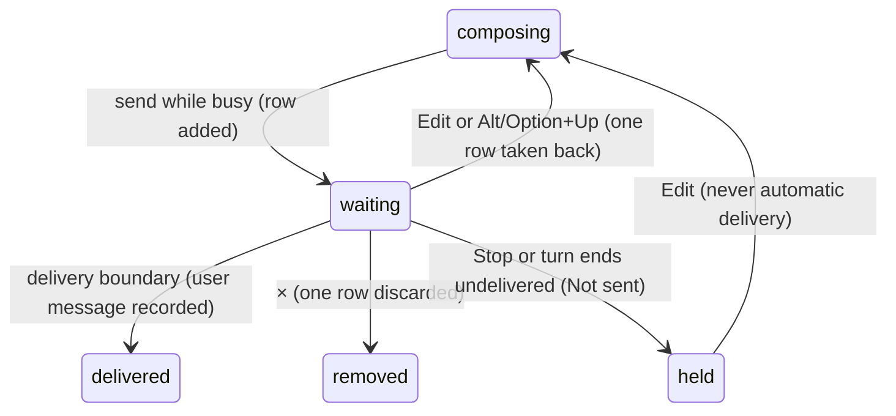

# Steering and the queue

## Summary

Messages sent while Pi works wait in the active tab's queue. Enter steers after the current model response and its tools; Alt/Option+Enter follows up when Pi would otherwise finish. During compaction, messages queue as new turns. Each row can be edited or removed separately. Text never delivered is kept as "Not sent", not silently sent next time.

## The simple case

While Pi cleans a sheet, type "Keep the totals row" and press Enter. The composer clears and a Steer row appears. It joins the transcript after the current response and tools, before the next model response. With Alt/Option+Enter it is a Follow up row and waits until Pi would otherwise finish.

## The interaction, event by event

### What Enter means while busy

| Tab state | Enter | Alt/Option+Enter | Shift+Enter |
| --- | --- | --- | --- |
| Idle | New turn | New turn | Newline |
| Responding | Steer | Follow-up | Newline |
| Busy, not responding | Queued prompt | Queued prompt | Newline |

Slash commands use the [busy policy](../commands/the-command-menu.md) first; a refused or unknown command keeps its text. Neither keyboard nor Send leaks slash text to the model.

### Ends at once

Empty text does nothing. A local command is not a user message. Alt/Option+Up with no editable row reports "No queued messages to restore"; commands cannot be edited back into a message.

### Sent into the queue

Text leaves the draft and gets its own row. Steer and follow-up belong to the running turn; queued prompts and `/compact` belong to the tab's ordered action queue. Delivery commits an ordinary user message to the transcript.

### While items wait

The queue strip shows held Not sent rows, waiting messages and queued actions. Each message has Edit and ×. Its full text is in the row and title, expanding on hover or focus; it is not cut out of storage. Commands have Remove but no Edit. The shortcut hint is shown only when a message can be edited.

Steers are delivered one per model response, after all tools in that response settle. Follow-ups are delivered one at a time when the agent would otherwise stop. Neither interrupts a running write or jumps ahead of a pending tool approval. Queued prompts start one at a time when the prior action ends. A queued `/compact` always compacts its own tab, even if the active tab changes.

#### Queued prompts and commands

Messages sent during compaction wait as Queued rows. A message held for pre-send compaction is visible too. Stop cancels queued commands and holds prompt text; it never starts the next queued item merely because Stop was clicked.

#### How rows disappear

A delivered message removes its own row by message identity, not by matching text. Identical texts remain independent. Editing removes just that row from its delivery queue and puts it above the current draft; × removes it without sending.

### Delivered, restored or stranded

Delivered messages persist as conversation history. There are no stranded messages that secretly survive inside the agent after their rows disappear.

#### Restoring queued messages

Alt/Option+Up edits the newest editable message row (queued prompt, waiting steer/follow-up, or held text). Only that message returns to the composer, above the existing draft. Other rows and commands stay. Edit on a particular row does the same for that row.

Stop, Escape when unclaimed, closing a busy tab, and a turn ending before messages are delivered all keep remaining text as separate Not sent rows. They survive session restore and are never sent unasked. The notice says "Pi didn't get to N queued messages; kept above the composer, not sent". Queued commands cancelled by Stop are named in a separate notice.

## Modifiers

| Modifier | Set before | Changed while busy |
| --- | --- | --- |
| Model and provider | Tab's model answers delivered text. | Model switching refused while busy. |
| Thinking level | Does not change queue order. | Current turn keeps its starting level. |
| Execution mode | Approvals can delay delivery. | Applies at subsequent gated calls. |
| Files in the workspace, or an overlay open | Modal owns focus. | Queue continues behind ordinary overlays. |
| Tab state (new, restored, another tab busy) | Queue belongs to this tab; restore brings saved Not sent rows. | Switching shows the other tab's queue. |
| Host (desktop or web) | Platform shortcut wording; Alt/Option+PageUp fallback where needed. | Same delivery rules. |

## Cancel and interrupt

| Event | Before sent | While busy |
| --- | --- | --- |
| Stop (button or Escape) | No queued item. | Undelivered text held separately; commands cancelled. |
| The user sends something else | Adds a separate message. | Steers take precedence over follow-ups at their boundaries. |
| Tab switched, created, closed or reopened | Draft stays per tab. | Queue runs in its own tab; closing holds text before saving. |
| An overlay or menu opens | Holds focus. | Does not pause delivery, except tool approval. |
| Model or thinking level changes | Normal model rules. | Model blocked; thinking applies next turn. |
| The provider fails | No request yet. | Unused text becomes Not sent, never delivered behind the next prompt. |
| The taskpane goes away | Saved draft returns. | Saved held rows return, not a live provider request. |
| The workbook changes underneath | No queue change. | Next request gets fresh selection and new edit notes. |
| Focus moves to the grid or another window | No queue change. | Waiting work continues. |
| The context window fills | Compaction may precede send. | Delivery waits for compaction; Stop still works. |

## Interactions with other systems

**Persistence.** Drafts and Not sent rows persist by session; active provider work is not resumed on reload. **Workbook changes and recovery.** A steer cannot undo an applied mutation. **Other tabs and sessions.** Queues and edit controls target their own tab. **Execution mode and approvals.** Waiting tool calls must settle before a steer is delivered. **Models and providers.** Delivery uses the tab's model. **Offline and provider errors.** Failure holds unused text. **Notifications.** Queue additions/delivery are announced politely. **Settings and preferences.** No delivery-order preference. **Host differences.** Only key routing/glyphs. **Language.** Labels and notices translate. **Accessibility and keyboard.** Rows form a labelled list; Edit/Remove are focusable and named with their message text.

## Edge cases

- Two identical messages are distinct rows, and removing one cannot remove the other.
- Commands alone produce no misleading edit hint.
- Editing several messages requires separate actions; they are not merged into a single draft without the user choosing it.

## Open questions and verification

Read from the merged action queue, queue display and draft store. Live acceptance is separate from the historical pre-fix runs linked by the checklists.

Verified against pi-for-excel commit `1f51cf8`.
