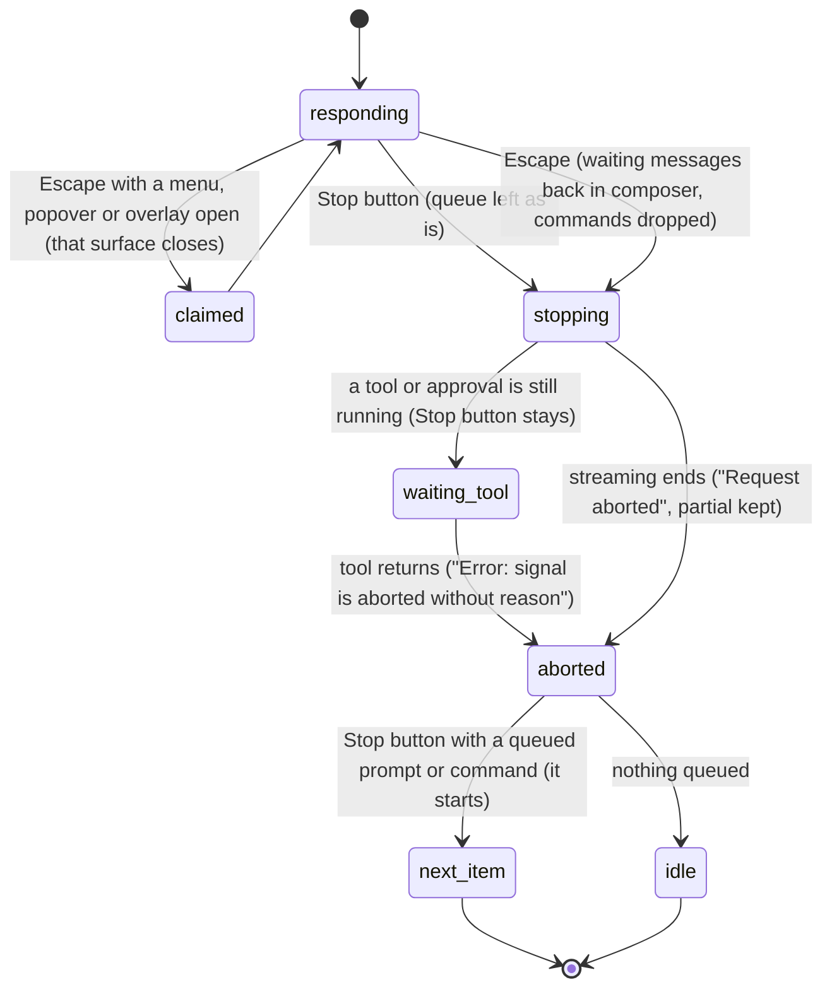

# Stopping

## Summary

Stopping is how the user ends a turn early: Pi stops writing at once, keeps what it had written, and the tab becomes idle (or moves on to the next queued item). [Turns](../foundations/turns.md#stop) defines Stop and its two triggers; this document owns what Stop does at every stage of a turn, which surfaces take Escape for themselves, and what happens to everything waiting in the queue. The triggers are the Stop button, a square in the composer that replaces the send button while the active tab is [responding](../glossary.md#the-turn), and Escape, pressed anywhere in the taskpane while the active tab is responding and no surface that claims Escape is open. Stop acts only on the active tab; a background tab can be stopped only by switching to it, or by closing it ("Stop and close this tab?"). Compaction that runs while the tab is not responding cannot be stopped at all. Stop needs no provider connection and works the same on every host.

## The simple case

Pi is writing a long answer. The user sees it is going the wrong way and clicks the Stop button (or presses Escape). The text stops growing at once and a grey "Request aborted" appears under it. The working indicator disappears, the Stop button turns back into the send button, and the tab's busy dot goes away. There is no error banner.

Everything Pi wrote so far stays in the transcript and is saved. Any change Pi had already made to the workbook stays made. The user is in the same tab with focus in the composer, and can send a corrected message straight away.

## The interaction, event by event

### Choosing to stop

**The Stop button** is shown only while the active tab is responding: from the moment the user message joins the transcript until the turn ends. It is not shown while the tab is busy but not responding (a queued `/compact`, or the compaction Pi runs before sending a message). Clicking it does not move focus. While any overlay is open (settings, the Files workspace, an approval, a confirm dialog), the overlay's backdrop covers the button, and clicking the backdrop closes the overlay instead.

**Escape** stops the turn when the active tab is responding, wherever focus is in the taskpane (the composer, the transcript, the tab strip), unless one of these is open or has focus, in which case Escape goes to it and the turn continues:

- the [command menu](../commands/the-command-menu.md) (Escape closes it);
- the [utilities menu](../ui/the-utilities-menu.md) and the [status-bar popovers](../ui/the-status-bar.md) (thinking level, execution mode, context);
- any overlay: settings, the model picker, the resume picker, the Files workspace, the Backups dialog, confirm and approval dialogs, text-input dialogs, the "Connect {provider}" dialog, the welcome screen. Escape first leaves a text field inside the overlay, then closes the overlay. Confirmed in Excel on the web with the Files workspace (opened with `/files` while Pi was responding, focus still in the composer): Escape closed it and Pi kept responding;
- an extension widget shown above the composer.

The [tab context menu](../glossary.md#the-taskpane) does not claim Escape: Escape with it open stops the turn and leaves the menu open; a second Escape closes it. Confirmed in Excel on the web, as was the thinking-level popover claiming Escape (it closed and Pi kept responding). Escape with focus in the Excel grid goes to Excel, not to Pi.

A second Escape after a claiming surface has closed stops the turn.

### Ends at once

Stop does nothing, and nothing is recorded, when:

- **The tab is idle.** There is no Stop button. Escape with focus in the composer moves focus to the tab strip and keeps the draft; elsewhere it closes the open menu or overlay, or does nothing.
- **The tab is compacting without responding** (a queued `/compact`, or pre-prompt compaction). There is no Stop button, and Escape only moves focus out of the composer. Compaction runs to the end; see [context and compaction](context-and-compaction.md).
- **A claiming surface is open.** Escape closes that surface instead.

### Stopped

The moment Stop is triggered, the turn is committed to ending:

- The model request is cancelled. Nothing more streams, and no further model response starts in this turn.
- A tool that is running is asked to cancel; see [At each stage](#at-each-stage).
- Waiting items are handled according to the trigger; see [What Stop does to waiting items](#what-stop-does-to-waiting-items).

Stop cannot be undone. The stopped model response is not resumed; to continue, the user sends a new message (for example "continue"), which Pi answers with the partial response in its history.

### At each stage

| Stage when Stop is triggered | What the user sees |
| --- | --- |
| Before the first token (auto-context, request in flight) | The answer area under the user message shows only "Request aborted". Confirmed in Excel on the web. |
| While text streams | The text stops where it was, followed by "Request aborted", within a fraction of a second (about 350 ms in Excel on the web). Confirmed again with Escape. |
| While thinking | The thinking block keeps what had streamed, followed by "Request aborted"; see [thinking](thinking.md). |
| While the model is writing a tool call | The tool never runs. Its card is shown as failed with no output. |
| While a tool runs | Pi waits for the tool. Reads and writes already handed to Excel complete; the Stop button and working indicator stay until the tool returns. Other tool calls of the same batch that had not started are marked failed ("Operation aborted"). Then a new, empty answer appears with the red line "Error: signal is aborted without reason", not "Request aborted"; there is no banner. Confirmed in Excel on the web with a 12-second Office.js call, with the Stop button and with Escape: the card kept its result, and the error line appeared about 11 s after the stop. A write that completed stays in the workbook and has an [automatic backup](../workbook/backups-and-revert.md). |
| While an approval dialog is open (Confirm mode) | The Stop button is under the dialog's backdrop and Escape closes the dialog, both of which decline the change: the tool call fails with "Mutation cancelled by user (Confirm mode).", Pi sees the failure, and the turn **continues** (confirmed in Excel on the web with Escape). Press Escape (or Stop) again to stop. See [confirm mode and approvals](../workbook/confirm-mode-and-approvals.md). |
| While the "Connect {provider}" dialog is open | Same: Escape or the backdrop closes the dialog, the banner says "API key required for {provider}.", and the turn fails instead of being stopped. |
| While Pi compacts between model responses | The Stop button is shown, but compaction is not interrupted: the turn ends "Request aborted" only after compaction finishes. |
| While a queued `/compact` or pre-prompt compaction runs | Cannot be stopped (see [Ends at once](#ends-at-once)). |

#### What Stop does to waiting items

| Waiting item | Stop button | Escape |
| --- | --- | --- |
| Steers and follow-ups | Their rows leave the queue strip when the turn ends, but Pi keeps them and delivers them, unasked, in the next turn the user starts in this tab. Confirmed in Excel on the web. If Stop came while a tool was running, the oldest steer is added to the transcript just before the ending, unanswered (confirmed in Excel on the web). | Put back into the composer, oldest first, above the draft, separated by blank lines, and removed from Pi's queue. Confirmed in Excel on the web. No toast. |
| Queued prompts | Stay queued; the first starts as soon as the stopped turn has ended, as a new turn (and picks up any stranded steers). | Put back into the composer after the steers and follow-ups. |
| Queued commands (`/compact`) | Stay queued and run next (confirmed in Excel on the web: "Nothing to compact" right after the stop). | Dropped, with no toast (confirmed in Excel on the web). |
| Text in the composer | Unchanged. | Kept, below the restored text; focus moves to the composer if anything was restored. |

See [steering and the queue](steering-and-the-queue.md#delivered-restored-or-stranded) for what "stranded" means and how restored text is sent.

### After stopping

The stopped model response stays in the transcript, as far as it got, with "Request aborted" under it (or, after a stop during a tool, an empty response with "Error: signal is aborted without reason"). Tool cards that finished keep their results; tool cards with no result are shown as failed. No error banner is shown, and a banner left from an earlier run is not cleared by the stop. The tab is idle unless a queued prompt or command was left to run (Stop button). The stopped response is saved like any completed message once the session has had a first answer; see [persistence and restore](../cross-cutting/persistence-and-restore.md).

**Stopping a background tab.** Stop and Escape act on the active tab only. To stop a tab that is responding in the background, switch to it and stop it there, or close it: its close button (or Ctrl/Cmd+W when it is active) asks "Stop and close this tab?" ("Pi is still responding in this tab. Stop and close it?") with "Stop and close" and "Keep open". "Stop and close" stops the turn like the Stop button, saves the session and closes the tab, with the usual "Closed {title} · Undo" toast. A tab whose write currently holds the [workbook lock](../foundations/the-workbook.md) cannot be closed: its close button is disabled, with the tooltip "Wait for workbook changes to complete" (Ctrl/Cmd+W shows "Wait for workbook changes to finish before closing this tab", read from code), so a tab in the middle of a write can only be stopped by switching to it. Confirmed in Excel on the web: clicking × during a held write did nothing, and "Stop and close" on a responding background tab closed it with "Closed Chat 5 · Undo"; Undo brought it back (as "Chat 6") with the user message and "Request aborted", although Pi had never answered in it. A tab that is busy only compacting closes without asking.

## Modifiers

| Modifier | Set before | Changed while busy |
| --- | --- | --- |
| Model and provider | No effect on Stop. How fast the provider acknowledges the cancel varies; the transcript stops updating at once either way. | Refused while busy. |
| Thinking level | No effect. | No effect on Stop. |
| Execution mode | In Confirm, Stop during an approval first declines the change (see [At each stage](#at-each-stage)). In Auto, a write in progress completes. | A change applies to later mutations; it does not affect a stop. |
| Files in the workspace, or an overlay open | No effect from files. Any open overlay takes Escape and covers the Stop button: close it first. | Same. |
| Tab state (new, restored, another tab busy) | Stop affects only the active tab. A stopped first turn in a new tab still saves the session. | Other tabs keep running. A background tab is stopped only by switching to it or closing it. |
| Host (desktop or web) | Behavior is the same. Escape must reach the taskpane; with focus in the grid it goes to Excel. | No effect. |

## Cancel and interrupt

| Event | Before sent | While busy |
| --- | --- | --- |
| Stop (button or Escape) | Stop is the interaction. A second Stop while the tab is still stopping (waiting for a tool) does nothing more. | Not applicable: once stopped, the turn is ending. |
| The user sends something else | Before Stop, sends are steers, follow-ups or queued prompts. | While the Stop button is still shown (stopping, or waiting for a tool), Enter is still accepted as a steer, and is stranded at once. |
| Tab switched, created, closed or reopened | Switching away leaves the turn running; Stop is then out of reach until the user switches back. | The stop completes in the background. |
| An overlay or menu opens | An open overlay or menu takes Escape; the Stop button is under overlays. | No effect on the stop. |
| Model or thinking level changes | Model changes are refused while busy. | Same. |
| The provider fails | If the failure arrives first, the turn ends as failed with a banner. | A stop that races a provider error is treated as a stop: no banner. |
| The taskpane goes away | The turn ends without being marked aborted; the streaming answer is lost. | Same. |
| The workbook changes underneath | No effect on Stop. | No effect. |
| Focus moves to the grid or another window | Escape goes to Excel; use the Stop button. | No effect. |
| The context window fills | Stop during compaction between model responses waits for compaction to finish; the turn then ends with "Error: signal is aborted without reason", not "Request aborted" (confirmed in Excel on the web). | Same. |

After a stop the user is in the same tab, idle or running the next queued item, with the composer holding whatever Escape restored plus the draft.

## Interactions with other systems

**Persistence.** The stopped response is saved, marked aborted. Stranded steers and follow-ups are not saved and are lost on reload. See [persistence and restore](../cross-cutting/persistence-and-restore.md).

**Workbook changes and recovery.** Stop never undoes a change. A write already sent to Excel completes and has an automatic backup; use [revert](../workbook/backups-and-revert.md) to undo it.

**Other tabs and sessions.** Stop affects only the active tab. Closing a responding tab stops it after confirmation.

**Execution mode and approvals.** Escape on an approval declines it rather than stopping the turn. Choosing "Allow once" after a stop does not apply the change: the tool checks for the stop before writing.

**Models and providers.** No interaction beyond cancelling the request.

**Offline and provider errors.** A stop is never shown as an error. An error message containing "abort" or "cancel" is also treated as a stop and shows no banner.

**Notifications.** "Request aborted" in the transcript is the only sign. There is no toast for a stop, for restored items (Escape) or for dropped commands.

**Settings and preferences.** No interaction.

**Host differences.** None known.

**Language.** "Request aborted", the close confirmation and its buttons are translated.

**Accessibility and keyboard.** Escape is the keyboard path. The Stop button is labeled "Stop". "Request aborted" is not announced.

## Edge cases

- Pressing Escape twice quickly: the first may close a claiming surface, the second stops.
- Stopping a turn whose only remaining work is a long-running tool keeps the tab responding until the tool ends; to the user it looks as if Stop did not work.
- A turn stopped with steers waiting, followed by a new message, gets an answer to the stale steer too. Using Escape instead of the Stop button avoids this.
- A queued prompt that starts right after a Stop-button stop runs with whatever steers were stranded.
- Escape during a stop that is waiting for a tool restores waiting items and is otherwise harmless.
- Closing a tab with "Stop and close" saves the session immediately; whether the "Request aborted" marker is part of that save depends on whether the stop has completed by then.

## Open questions and verification

- The Stop button strands steers and follow-ups (`sidebar.onAbort`, `src/taskpane/init.ts:1734-1739`, only calls `agent.abort()`; Escape calls `restoreQueuedMessagesToEditor` first, `src/taskpane/keyboard-shortcuts.ts:258-265`). Confirmed in Excel on the web: after Stop with a steer and a follow-up waiting, the next turn delivered both. This is a bug; [steering and the queue](steering-and-the-queue.md#open-questions-and-verification) has the details.
- Generic overlay dialogs do claim Escape: `createOverlayDialog` gives every overlay the class `pi-welcome-overlay` and `data-claims-escape="true"` (`src/ui/overlay-dialog.ts:192`, `src/ui/overlay-escape.ts:31`), which matches the first selector in `src/utils/escape-guard.ts:9`. Settings uses the same class (`src/ui/settings-shell.ts:280`). Confirmed in Excel on the web with the Files workspace. This contradicts the established note in `goal.md` and the Stop table in [turns](../foundations/turns.md#stop), which say generic overlays do not claim Escape. Only the tab context menu does not.
- With the Stop button during a running tool, the loop polls one steer after the tool batch and adds it to the transcript before the aborted response (`agent-loop.js`, `runLoop`: `getSteeringMessages` after `turn_end`, then `streamAssistantResponse` with the aborted signal). Confirmed in Excel on the web: "Then say BANANA." joined the transcript after the Office.js card, followed by the error line.
- A stop during a running tool ends with "Error: signal is aborted without reason" (`stopReason: "error"`, red) instead of "Request aborted": the loop's next request is made with the already-aborted signal and the provider rejects it with the browser's abort error (`agent-loop.js`, `runLoop`, then `streamAssistantResponse`). The banner is suppressed only because the text contains "abort". Confirmed in Excel on the web with both triggers. Looks like a bug: a deliberate stop reads as an error.
- A stop during an approval waits for the dialog; the dialog itself has no cancel tied to the stop (`requireMutationApprovalIfNeeded` in `src/tools/with-workbook-coordinator.ts:118-137` takes no signal, and `throwIfAborted` runs after approval). Read from code.
- Compaction ignores Stop: `runCompactCommand` is called without the agent's abort signal (`src/taskpane/action-queue.ts:85-92`, `:71-81`). Confirmed in Excel on the web for `/compact` and for auto-compaction before a prompt: no Stop button, and Escape only moved focus to the tab strip. An Escape pressed just as that compaction ends reaches the turn that starts and stops it. Stop during a mid-turn auto-compaction keeps the Stop button up until the summary is done, then ends the turn with "Error: signal is aborted without reason" (confirmed in Excel on the web).
- Whether a write already sent to Excel completes after Stop has not been confirmed by hand; the coordinator checks for a stop only before starting the write (`src/tools/with-workbook-coordinator.ts:173-183`).
- Closing a tab that is busy only compacting does not ask for confirmation (`src/taskpane/init.ts:1321`, which checks only `isStreaming`); what happens to the compaction has not been checked.
- Confirmed in Excel for Mac: Escape stops a response when focus is in the composer, and does nothing to Pi when focus is in the grid (Excel keeps it), as the Modifiers table says (STOP-15). Windows has not been checked.

Verified against pi-for-excel commit `ec453df`.
