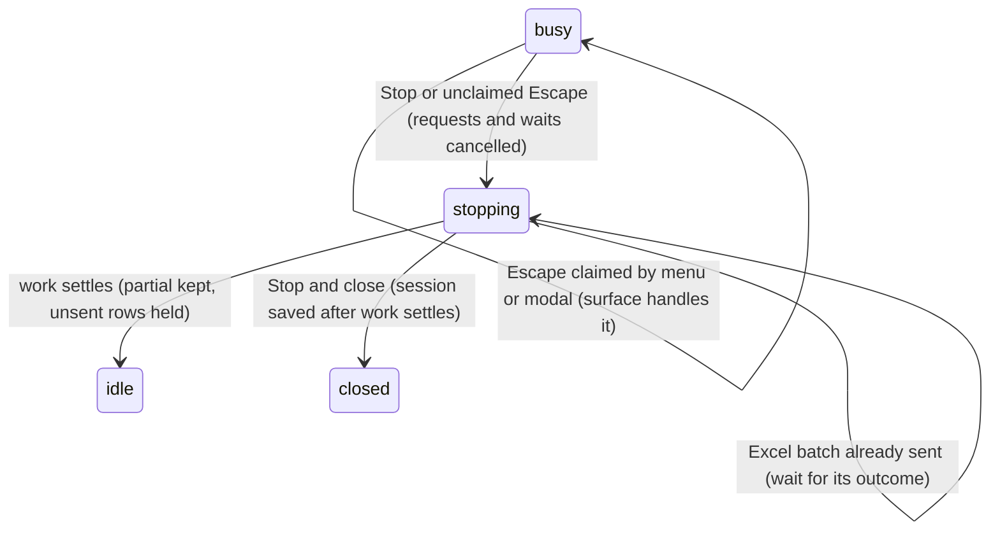

# Stopping

## Summary

Stop ends the active tab's work early without undoing workbook changes. The composer Stop button, Escape when no surface claims it, and "Stop and close" use the same cancellation path. It covers model requests, retry waits and compaction. Other tabs keep running.

## The simple case

While Pi writes, click Stop or press Escape. Text stops, the partial response stays with "Request aborted", and no error banner is raised for the deliberate stop. Undelivered messages stay above the draft as separate "Not sent" rows, never delivered in a later turn without the user's action.

## The interaction, event by event

### Choosing to stop

Stop is available for the active tab's running turn or compaction. Escape goes first to the topmost menu, status popover or modal, including the command menu, resume picker and tab menu. It handles only that surface; it does not also stop Pi. Escape with focus in the Excel grid goes to Excel.

### Ends at once

An idle tab has no work to stop. Escape in its composer moves focus to the tab strip without discarding the draft. A surface that claims Escape handles it without affecting the running turn.

### Stopped

Pi cancels the request, retry timer and compaction signal, clears the agent's waiting queues, and holds undelivered text separately. Stop cannot recall a batch already sent to Excel or undo a completed change.

### At each stage

| Stage | Outcome |
| --- | --- |
| Before tokens, while streaming or thinking | Request cancelled; partial text/reasoning stays with "Request aborted". |
| Tool call still being composed | No completed call is started after abort. |
| Waiting for the workbook lock | Stop is checked before the write starts; nothing new is written. |
| Excel read running | The read can finish; after a short grace Pi stops waiting. The host request itself cannot be cancelled. |
| Checked write/fill running | Stop is checked between chunks. The result says which rows landed or whether the outcome is unknown; applied rows stay. |
| Other mutation running | Pi gives the call time to settle, then reports an unknown outcome if Excel has not answered. A late host change is still possible. |
| Approval open | The dialog offers "Stop Pi". Stop withdraws outstanding approvals; it does not pretend the user clicked Decline. Escape follows the approval dialog's own close policy. |
| Retry countdown | Timer cancelled; no next retry. |
| Pre-prompt, manual or mid-turn compaction | Summary request cancelled; no completed summary is installed after cancellation. |

#### What Stop does to waiting items

| Item | Stop button, unclaimed Escape, Stop and close |
| --- | --- |
| Steers, follow-ups, queued prompts | Separate Not sent rows above the unchanged draft; saved with the session. |
| Queued commands | Cancelled; a toast names them. |
| Existing draft | Kept, not joined to the held rows. |

Each message has Edit and ×; Alt/Option+Up edits only the newest editable row. See [steering and the queue](steering-and-the-queue.md#delivered-restored-or-stranded).

### After stopping

The tab returns to idle once its work settles. Completed cards retain their results; the aborted response does not turn into a raw provider abort error. A new send starts a new turn, without stale queued text.

As of [PR #808](https://github.com/tmustier/pi-for-excel/pull/808) (CL-01),
a stopped turn that changed the workbook keeps a typed, amber-accented change
receipt under its partial answer. **Review** lists ranges, counts and backup
ids; **Undo this turn** restores available backups newest first. It checks
for later edits like `/revert` and saves ordinary inverse backups. Stop itself
still does not undo anything. Changes without backups are explicitly marked.
See [turn recovery](../workbook/backups-and-revert.md#review-and-undo-a-turn-cl-01).

Closing a busy tab asks "Stop and close this tab?". If a write has already reached Excel, closing waits for it to settle, saves the session, then closes. Reopen restores the tab's stable label and held text. Closing does not undo the write.

## Modifiers

| Modifier | Set before | Changed while busy |
| --- | --- | --- |
| Model and provider | Stop needs no provider connection. | Model switching stays unavailable until idle. |
| Thinking level | No effect. | Does not change cancellation. |
| Execution mode | Confirm may be paused at approval; Auto may already have applied a change. | No change to Stop. |
| Files in the workspace, or an overlay open | Modal owns Escape; close it or use its Stop Pi action. | External work already sent may still finish. |
| Tab state (new, restored, another tab busy) | Stop targets this tab only. | Other tabs continue. |
| Host (desktop or web) | Escape must reach the taskpane. | Office cannot cancel a submitted batch. |

## Cancel and interrupt

| Event | Before sent | While busy |
| --- | --- | --- |
| Stop (button or Escape) | Idle Escape keeps the draft. | Repeated Stop is harmless; it does not undo more. |
| The user sends something else | Normal [send rules](the-composer.md). | Text not delivered before the stop settles is held, not leaked into a later turn. |
| Tab switched, created, closed or reopened | Draft stays with its tab. | Cancellation finishes in the original tab; close waits for its work. |
| An overlay or menu opens | Topmost surface owns Escape. | Does not resume cancelled work. |
| Model or thinking level changes | No effect. | Model unavailable while busy; thinking does not restart a stop. |
| The provider fails | No request yet. | An actual abort is distinguished from a provider error containing "cancel". |
| The taskpane goes away | Saved draft returns. | Completed messages return; streaming text may be lost. |
| The workbook changes underneath | No effect. | Applied changes remain; read back an unknown outcome before retrying. |
| Focus moves to the grid or another window | Escape belongs there. | Cancellation continues. |
| The context window fills | Compaction can be stopped. | Stop cancels summary/retry work too. |

## Interactions with other systems

**Persistence.** First user messages, completed responses, drafts and Not sent rows are saved; half-streamed text is not guaranteed. **Workbook changes and recovery.** Stop is not revert; [Backups](../workbook/backups-and-revert.md) owns recovery. **Other tabs and sessions.** Cancellation is per tab. **Execution mode and approvals.** Stop withdraws queued approvals; Decline remains an explicit user action. **Models and providers.** Cancels provider work. **Offline and provider errors.** A deliberate stop raises no failure banner. **Notifications.** Aborted marker, held-message and cancelled-command notices. **Settings and preferences.** No Stop preference. **Host differences.** Host batches may outlive cancellation. **Language.** UI notices translate. **Accessibility and keyboard.** Escape acts only on the topmost surface; approval has an explicit Stop Pi control.

## Edge cases

- A timeout or stop is not evidence that Excel refused the change: read back an unknown outcome.
- Checked writes report Stop themselves and wait for their current batch's bounded Excel timeout; the generic write grace period does not cut their result short.
- Compaction completed before Stop remains completed; Stop does not restore the earlier history.

## Open questions and verification

Read from `action-queue.ts`, `with-workbook-coordinator.ts`, checked write/fill paths and `excelRun`. Historical runs in verification describe the pre-fix bugs, not this contract. Desktop keyboard and late-host completion acceptance remain host-specific.

Verified against pi-for-excel commit `1f51cf8`.
