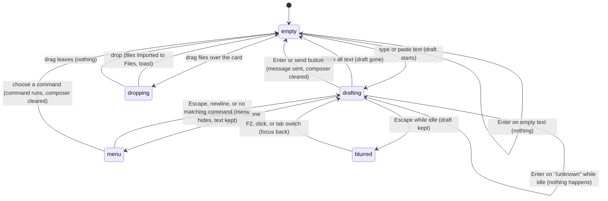

# The composer

## Summary

The composer is where every turn begins. It holds the text the user is writing (the *draft*), decides at Enter what that text becomes (a message, a steer, a follow-up, a queued prompt or a slash command), and offers two ways to put files in front of Pi: the Files button and dropping files onto it. It is the card at the bottom of the taskpane, above the [status bar](../ui/the-status-bar.md): a Files button on the left, an auto-growing text area labeled "Chat message" in the middle, and a send button on the right that becomes a Stop button while the active tab is [responding](../glossary.md#the-turn). It has keyboard focus when the taskpane opens, after a tab switch and after most overlays close; F2 brings focus back from anywhere in the taskpane and Escape (while idle) moves it out. The composer is always usable: while the tab is busy, with no provider connected, and on every host. What Enter does while busy is owned by [steering and the queue](steering-and-the-queue.md); what happens after a message is sent is owned by [sending and the response](sending-and-the-response.md).

## The simple case

The user clicks into the composer (or it already has focus) and types "Which sheets have totals?". The placeholder ("Ask about this workbook…" or one of its rotating siblings) disappears, and the send button, which looked dimmed while the composer was empty, becomes active. The text area grows line by line as the text wraps. Shift+Enter starts a new line without sending.

The user presses Enter. The composer clears, the send button turns into a Stop button, and the placeholder changes to "Redirect reply (↵) · New question (⌥↵)" while Pi responds. Focus stays in the composer, so the user can keep typing; see [steering and the queue](steering-and-the-queue.md) for what Enter does now.

When Pi finishes, the Stop button turns back into the send button, the rotating placeholder returns, and the composer is ready for the next message.

## The interaction, event by event

### Writing a draft

The text area accepts plain text of any length. There is no character limit and no counter. Typing, pasting and deleting all count as edits; each edit resizes the text area once.

- **Auto-grow.** The text area starts one line high (at least 40 px; 34 px in a pane 520 px tall or less) and grows with its content up to 40% of the taskpane's height, or 28% in a pane 520 px tall or less. Past that it stops growing and scrolls inside itself. It shrinks again as text is deleted.
- **Placeholders.** While the composer is empty and the tab is not responding, the placeholder cycles through four prompts, in this order, one every 8 seconds: "Ask about this workbook…", "Type / for commands…", "Have Pi edit this workbook…", "Summarize this workbook…". It does not advance while the composer has any text, even only spaces, or while the tab is responding; it resumes from where it was at the next 8-second tick. While the active tab is responding the placeholder is fixed at "Redirect reply (↵) · New question (⌥↵)". A tab that is busy but not responding (for example during `/compact`) shows the rotating placeholders.
- **The send button.** Shown dimmed (and announced as disabled) when the draft is empty or only whitespace; full colour as soon as it contains a visible character. It is never truly disabled: clicking it while dimmed does nothing because there is nothing to send.
- **Shift+Enter** inserts a newline. Enter with any other modifier (Ctrl/Cmd, Alt/Option) is treated as Enter while the tab is idle.
- **Paste.** Pasting text inserts it as typed text, newlines included. Pasting an image or a file does nothing: the composer has no attachments, and nothing pasted becomes an attachment or a file in the Files workspace. Images reach Pi only through tools and the [Files workspace](../files/the-files-workspace.md).
- **The slash prefix.** When the draft starts with `/` and has no newline, the [command menu](../commands/the-command-menu.md) opens above the composer, filtered by what follows the slash. From then until it closes, the command menu owns the arrow keys, Enter, Tab and Escape. It closes when the draft gains a newline, stops starting with `/`, or matches no command.

> Technical note: the composer is one element shared by every tab. Its text is not stored per tab. See [Edge cases](#edge-cases) and [Open questions](#open-questions-and-verification).

### Ends at once

Enter (or the send button) ends without sending anything when:

- **The draft is empty or whitespace.** Nothing happens. The whitespace stays in the composer.
- **The draft starts with `/` and names a known command.** The command runs locally (or is queued, for `/compact`) and the composer clears. If the command is refused because the tab is busy ("Can't run /{command} while Pi is busy"), the draft is kept. See [the command menu](../commands/the-command-menu.md).
- **The draft starts with `/` and names no known command, and the tab is idle.** Nothing happens and the draft stays, with no toast. (While the tab is responding the same text is steered to Pi as ordinary text; see [steering and the queue](steering-and-the-queue.md).)
- **There is no active tab.** The toast says "No active session" and the composer clears. This only happens during startup or teardown.

The leading slash check is on the raw text: a draft that starts with a space before the slash (" /model") is not a command and is sent to Pi as a message.

Escape while the tab is idle and focus is in the composer is not a cancel: it moves focus out of the composer to the active tab in the tab strip and leaves the draft as it was. If the command menu is open, the first Escape closes the menu and keeps focus; the second moves focus out.

### Sending

Enter with a non-empty draft that does not start with `/`, in an idle tab, sends it. So does clicking the send button. At that instant:

- The text is trimmed of leading and trailing whitespace (inner newlines are kept) and handed to the tab's action queue.
- The composer clears and shrinks back to one line.
- The transcript is set to follow new content again even if the user had scrolled up (see [sending and the response](sending-and-the-response.md#streaming)).
- The error banner, if one was showing, is cleared.

What happens next (the message joining the transcript, the Stop button, the working indicator) is owned by [sending and the response](sending-and-the-response.md). If the tab was busy but not responding, the text is queued instead; see [steering and the queue](steering-and-the-queue.md#queued-prompts-and-commands).

### While the tab is busy

The composer stays enabled. The user can type, paste, edit and drop files at any time. Enter and Alt/Option+Enter change meaning while the tab is responding; [steering and the queue](steering-and-the-queue.md) owns that. Escape while responding stops the turn instead of moving focus; [stopping](stopping.md) owns that. The Stop button occupies the send button's place; it is always active while it is shown.

**The Files button** (a document icon, labeled "Browse files") opens the [Files workspace](../files/the-files-workspace.md) overlay. It works while busy. Clicking it does not take focus away from the text area first, so the draft and caret are where they were when the overlay closes.

**Dropping files.** Dragging one or more files from the computer over the composer card highlights it and shows "Drop files to import to file workspace" over the text area. Dragging text or anything that is not a file does nothing. Dropping imports every file into the Files workspace, not into the message: the draft is untouched, nothing is sent, and Pi only sees the files through its tools from then on. A toast reports the result: "Imported 1 file into Files." (or "Imported {n} files into Files."), "No files were imported.", or "Import failed: {error}". A file with the same name as an existing workspace file replaces it. Dropping onto any other part of the taskpane is not handled by Pi; what happens is up to the host's webview.

### After sending

The composer is empty and keeps focus. When the turn ends, the placeholder resumes rotating and the Stop button turns back into the send button. Nothing about the draft is saved: there is no history of sent drafts, no Up-arrow recall of the last message, and no edit for a sent message. The only recall is for messages still waiting in the queue ([restore queued](steering-and-the-queue.md#restoring-queued-messages)).

## Modifiers

| Modifier | Set before | Changed while busy |
| --- | --- | --- |
| Model and provider | No effect on the composer. With no connected provider the composer still sends; the connection dialog appears afterwards (see [sending and the response](sending-and-the-response.md#sent)). | No effect on the draft. |
| Thinking level | No effect. | No effect. Shift+Tab in the composer changes the thinking level instead of moving focus; see [thinking](thinking.md). |
| Execution mode | No effect. | No effect. |
| Files in the workspace, or an overlay open | Files in the workspace are not attached to the message. An open overlay holds focus; the composer underneath keeps its draft. F2 still moves focus into the composer behind an overlay. | Dropping files during a turn imports them at once; tools that start afterwards can read them. |
| Tab state (new, restored, another tab busy) | The draft is not tied to a tab: switching or creating tabs leaves the same text in the composer. A restored tab starts with an empty composer only because a reload empties it. | Another tab being busy has no effect on this composer, except that a background tab's compaction label can appear above it (see [sending and the response](sending-and-the-response.md#open-questions-and-verification)). |
| Host (desktop or web) | The streaming placeholder and working hints use macOS key glyphs (⌥, ⌃, ⇧) on every host. Dropping files from the desktop works wherever the host webview delivers file drops; not confirmed on desktop Excel. | No effect. |

Changing a variant while drafting never touches the draft.

## Cancel and interrupt

| Event | Before sent | While busy |
| --- | --- | --- |
| Stop (button or Escape) | There is no Stop button while idle. Escape with focus in the composer moves focus to the tab strip and keeps the draft; with the command menu open it closes the menu first. | Escape and the Stop button stop the turn; Escape also puts waiting steers, follow-ups and queued prompts back above the draft. See [stopping](stopping.md). |
| The user sends something else | A known slash command runs and clears the composer. Clicking a starter hint replaces the whole draft with the hint's prompt, without sending. | Enter steers, Alt/Option+Enter follows up, Enter in a busy-but-not-responding tab queues. See [steering and the queue](steering-and-the-queue.md). |
| Tab switched, created, closed or reopened | The draft stays in the composer and now belongs to whichever tab is active: pressing Enter sends it in the new tab. Confirmed in Excel on the web. | Same. The placeholder and send/Stop button follow the newly active tab's state. |
| An overlay or menu opens | The draft stays. Closing most overlays returns focus to the composer with the caret at the end. | Same. |
| Model or thinking level changes | No effect on the draft. | No effect on the draft. |
| The provider fails | Not applicable. | No effect on the draft. The error banner appears above the transcript. |
| The taskpane goes away | The draft is lost. It is never saved. | The draft is lost. |
| The workbook changes underneath | No effect. | No effect. |
| Focus moves to the grid or another window | The draft stays. Keys typed in the grid go to Excel. Pi does not move focus back to the composer when the taskpane regains focus; click it or press F2. | Same. |
| The context window fills | No effect on the draft. | No effect on the draft. |

After any interrupt the draft is where it was, unless the taskpane was reloaded or closed.

## Interactions with other systems

**Persistence.** The draft is never persisted: not per tab, not per workbook. A reload, a crash or closing the taskpane loses it. See [persistence and restore](../cross-cutting/persistence-and-restore.md).

**Workbook changes and recovery.** No interaction. The composer never reads or changes the workbook; the selection and recent edits are gathered later, when the message is sent ([auto-context](auto-context.md)).

**Other tabs and sessions.** One composer serves all tabs, so a draft typed in one tab is still there after switching to another, and is sent to whichever tab is active when Enter is pressed. Confirmed in Excel on the web.

**Execution mode and approvals.** No interaction. An approval dialog is an overlay; the draft waits behind it.

**Models and providers.** No interaction until send.

**Offline and provider errors.** No interaction. The composer works offline; sending fails later.

**Notifications.** Toasts for dropped files ("Imported {n} file(s) into Files.", "No files were imported.", "Import failed: {error}"), for "No active session", and for commands refused while busy.

**Settings and preferences.** No interaction. There is no setting for the send key, placeholders or auto-grow.

**Host differences.** Behavior is the same on every host. The webview decides whether file drops from the desktop reach the taskpane and how IME composition reports Enter; see [Open questions](#open-questions-and-verification).

**Language.** The placeholders, the drop hint, the accessible names and the toasts are translated. The streaming placeholder's key glyphs are fixed. Typing in Chinese uses the system IME; see [Edge cases](#edge-cases).

**Accessibility and keyboard.** The text area's accessible name is "Chat message"; the buttons are "Browse files", "Send" (with `aria-disabled` while the draft is empty) and "Stop". F2 focuses the composer from anywhere in the taskpane and puts the caret at the end; Escape while idle moves focus to the active tab; Shift+Enter is a newline. Placeholder changes are not announced. The whole composer can be used without a pointer except for dropping files.

## Edge cases

- A draft of only spaces and newlines keeps the send button dimmed and stops the placeholder from rotating, but Enter does nothing.
- A draft that starts with `/` and contains a newline does not open the command menu. Enter still treats it as a command: everything before the first space is the command name and everything after it (including later lines) is the arguments. With no space before the newline, the name includes the newline, matches nothing, and Enter does nothing while idle.
- Clicking the send button with a draft that starts with `/` sends the text to Pi as an ordinary message instead of running the command, even while the command menu is open. Confirmed in Excel on the web (intercepted before it reached the model). Enter does not do this.
- F2 while an overlay is open moves focus to the composer behind it; Enter there sends a message while the overlay stays open, and Escape then blurs the composer instead of closing the overlay.
- A long draft scrolls inside the text area; the caret may be out of view after F2 until the user types.
- Dropping a folder imports the files the webview exposes for it, with their relative paths; a drop that yields no files shows "No files were imported."
- Dropping files while a tab is responding imports them for every tab: the Files workspace is shared.
- Clicking a starter hint discards the existing draft without asking.

## Open questions and verification

- The draft is shared across tabs instead of being per tab. Confirmed in Excel on the web: text typed in Chat 1 was still in the composer after creating Chat 2, and text edited in Chat 2 was there after switching back. This contradicts the glossary's "Session tab" entry and [turns](../foundations/turns.md#cancel-and-interrupt) ("switching tabs swaps it"). The cause is that `PiSidebar` renders a single `<pi-input>` and `bindRuntimeSidebar` (`src/taskpane/runtime-sidebar-binding.ts:23-34`) swaps only the agent. Either the documents or the product should change; a draft typed for one tab can be sent to another by accident, so it may be worth treating as a bug.
- The send button sends slash text to the model. `_send()` in `src/ui/pi-input.ts:173-177` checks only for empty text, while Enter goes through `shouldSendOnEnter` (`src/ui/pi-input-behavior.ts:14`), which refuses a leading `/`. Clicking Send with "/compact" dispatched `pi-send` with "/compact" in Excel on the web. Looks like a bug.
- IME composition is not handled. `src/ui/pi-input.ts:95-101` and `src/taskpane/keyboard-shortcuts/editor-actions.ts:215` do not check `isComposing`, unlike the model picker (`src/ui/model-selector-dialog.ts:224`). Chromium-based webviews report the committing Enter as "Process", so they are probably unaffected; WKWebView (Excel on macOS) reports "Enter" with `isComposing`, which would send the draft (or steer) when the user commits a Chinese or Japanese candidate. Not confirmed; likely a bug on macOS.
- Whether desktop Excel's webviews deliver file drops from the Finder or Explorer to the taskpane has not been checked. What a drop outside the composer card does is up to the webview.
- Pasting an image does nothing; read from code (no paste handler; attachments are never created, `src/messages/attachments.ts:8-12`). Not tried by hand.
- The draft is lost on reload; read from code.

Verified against pi-for-excel commit `ec453df`.
