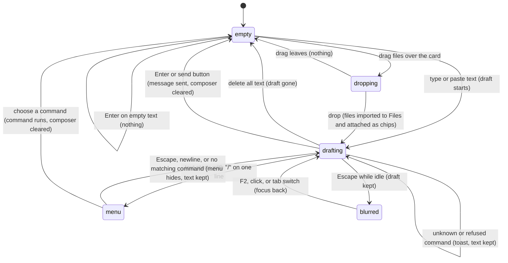

# The composer

Dropped-file attachments and no-provider draft retention revised for SE-09/02 in [PR #811](https://github.com/tmustier/pi-for-excel/pull/811).

Turn controls and hints revised for CL-03 / CC-01 in [PR #803](https://github.com/tmustier/pi-for-excel/pull/803). Enter remains steer, not interruption; Alt/Option+Enter remains follow-up.

## Summary

The composer is where every turn begins. It holds the text the user is writing (the *draft*), decides at Enter what that text becomes (a message, a steer, a follow-up, a queued prompt or a slash command), and offers two ways to put files in front of Pi: the Files button and dropping files onto it. It is the card at the bottom of the taskpane, above the [status bar](../ui/the-status-bar.md): a Files button on the left, an auto-growing text area labeled "Chat message" in the middle, and a send button on the right that becomes a Stop button while the active tab is [responding](../glossary.md#the-turn). It has keyboard focus when the taskpane opens, after a tab switch and after most overlays close; F2 brings focus back from anywhere in the taskpane and Escape (while idle) moves it out. The composer is always usable: while the tab is busy, with no provider connected, and on every host. What Enter does while busy is owned by [steering and the queue](steering-and-the-queue.md); what happens after a message is sent is owned by [sending and the response](sending-and-the-response.md).

## The simple case

The user clicks into the composer (or it already has focus) and types "Which sheets have totals?". The placeholder ("Ask about this workbook…" or one of its rotating siblings) disappears, and the send button, which looked dimmed while the composer was empty, becomes active. The text area grows line by line as the text wraps. Shift+Enter starts a new line without sending.

The user presses Enter. The composer clears, Stop appears, and the placeholder changes to "Enter to steer · Alt+Enter for a follow-up" (Option+Enter on Mac). Focus stays in the composer. Typing another draft reveals Send beside Stop; Send steers through the same submission path as Enter. See [steering and the queue](steering-and-the-queue.md).

When Pi finishes, the Stop button turns back into the send button, the rotating placeholder returns, and the composer is ready for the next message.

## The interaction, event by event

### Writing a draft

The text area accepts plain text of any length. There is no character limit and no counter. Typing, pasting and deleting all count as edits; each edit resizes the text area once.

- **Auto-grow.** The text area starts one line high (at least 40 px; 34 px in a pane 520 px tall or less) and grows with its content up to 40% of the taskpane's height, or 28% in a pane 520 px tall or less. Past that it stops growing and scrolls inside itself. It shrinks again as text is deleted. The limit is recomputed only when the text changes, not when the pane is resized. Confirmed in Excel on the web: in a 662 px pane the composer stopped at 265 px (40%) and scrolled; in a 492 px pane the limit was 138 px (28%).
- **Placeholders.** While idle and empty, four prompts rotate every 8 seconds: "Ask about this workbook…", "Type / for commands…", "Have Pi edit this workbook…", "Summarize this workbook…". Rotation pauses while there is draft text. While responding the fixed hint is "Enter to steer · Alt+Enter for a follow-up" (Option on Mac), consistent with the Shortcuts page.
- **The send button.** Shown dimmed (and announced as disabled) when the draft is empty or only whitespace; full colour as soon as it contains a visible character. It is never truly disabled: clicking it while dimmed does nothing because there is nothing to send.
- **Shift+Enter** inserts a newline. Enter with any other modifier (Ctrl/Cmd, Alt/Option) is treated as Enter while the tab is idle. Confirmed in Excel on the web: Shift+Enter between two lines, then Alt+Enter, sent both lines as one message.
- **Paste.** Pasting text inserts it as typed text, newlines included. Pasting an image or file still does not attach it; attachments here are created by dropping files. Pi reads attached files through the [Files workspace](../files/the-files-workspace.md).
- **The slash prefix.** When the draft starts with `/` and has no newline, the [command menu](../commands/the-command-menu.md) opens above the composer, filtered by what follows the slash. From then until it closes, the command menu owns the arrow keys, Enter, Tab and Escape. It closes when the draft gains a newline, stops starting with `/`, or matches no command.

Each tab has its own composer draft. Switching tabs swaps drafts and caret state; a saved draft is restored after reload or reopening its session.

### Ends at once

Enter (or the send button) ends without sending anything when:

- **The draft is empty or whitespace and has no attachments.** Nothing happens. With attachment chips, an attachment-only message can be sent.
- **No provider is connected.** The welcome provider choices reopen; the draft and chips remain, and no turn starts.
- **The draft starts with `/` and names a known command.** The command runs locally (or queues, for `/compact`) and clears the composer only if accepted. A busy-refused command keeps the draft, whether chosen by click or keyboard. Local commands remain available while busy; model choices apply to the next turn. See [the command menu](../commands/the-command-menu.md).
- **The draft starts with `/` and names no known command.** Pi reports the unknown command and keeps the text for correction; neither Enter nor Send quietly turns it into a model message.
- **There is no active tab.** The toast says "No active session" and the composer clears. This only happens during startup or teardown.

The leading slash check is on the raw text: a draft that starts with a space before the slash (" /model") is not a command and is sent to Pi as a message.

Escape while the tab is idle and focus is in the composer is not a cancel: it moves focus out of the composer to the active tab in the tab strip and leaves the draft as it was (confirmed in Excel on the web; F2 brought focus back). If the command menu is open, the first Escape closes the menu and keeps focus; the second moves focus out.

### Sending

Enter with a non-empty draft that does not start with `/`, in an idle tab, sends it. So does clicking the send button. At that instant:

- The text is trimmed of leading and trailing whitespace (inner newlines are kept) and handed to the tab's action queue.
- The composer clears and shrinks back to one line.
- The transcript is set to follow new content again even if the user had scrolled up (see [sending and the response](sending-and-the-response.md#streaming)).
- A final failed turn is shown inline, not in a separate run-error banner; see [provider errors and offline](../cross-cutting/provider-errors-and-offline.md).

What happens next (the message joining the transcript, the Stop button, the working indicator) is owned by [sending and the response](sending-and-the-response.md). If the tab was busy but not responding, the text is queued instead; see [steering and the queue](steering-and-the-queue.md#queued-prompts-and-commands).

### While the tab is busy

The composer stays enabled. The user can type, paste, edit and drop files at any time. Enter and the visible Send button steer; Alt/Option+Enter follows up. A steer waits for the current response/tools instead of interrupting them. Stop stays beside Send while a draft exists. Once cancellation is requested, Stop is disabled and the working line says "Stopping…" until the work settles. [Stopping](stopping.md) owns cancellation; Shift+Tab retains normal reverse-focus navigation.

**The Files button** (a document icon, labeled "Browse files") opens the [Files workspace](../files/the-files-workspace.md) overlay. It works while busy. Clicking it does not take focus away from the text area first, so the draft and caret are where they were when the overlay closes.

**Dropping files.** Dragging over the composer highlights it and shows "Drop files to attach to this message". A drop imports files to Files and adds removable attachment chips to this tab's draft; it does not send immediately. Same-name imports keep both files, adding a suffix such as ` (2)` before the extension; the chip carries the actual renamed path. Each chip's remove button is labelled "Remove attachment {path}". Removing a chip detaches it without deleting the library file. The toast says "Attached {count} file(s) to this message" or reports a failure. Dropping while another tab becomes active keeps the attachments with the originating draft. Drops outside the composer are handled by the host.

On accepted message submission, the text names the attached Files paths and explicitly asks Pi to read them as part of the message. Chips then clear. A refused send keeps them, and a slash command does not consume them. Attachment paths are saved per session alongside the draft and survive reload or reopening; ordinary Files imports outside the composer do not attach themselves.

### After sending

The composer clears after an accepted send and keeps focus. When the turn ends, the placeholder resumes rotating and Stop turns back into Send. Unsent drafts are saved per session, as are separate Not sent rows for queued messages Pi never received. There is no edit for an already sent message. Alt/Option+Up edits one waiting message ([restore queued](steering-and-the-queue.md#restoring-queued-messages)).

## Modifiers

| Modifier | Set before | Changed while busy |
| --- | --- | --- |
| Model and provider | With no connected provider, send opens welcome choices and retains text and chips. | No effect on the draft. |
| Thinking level | No effect. | Ctrl+Alt/Option+T cycles from the composer; Shift+Tab only moves focus. See [thinking](thinking.md). |
| Execution mode | No effect. | No effect. |
| Files in the workspace, or an overlay open | Dropped files attach to this message; library files alone do not. A modal holds focus; the composer keeps its draft. | Imports remain available to tools; only attached paths are named in this send. |
| Tab state (new, restored, another tab busy) | Each tab keeps its own draft; a new tab starts empty and a restored tab loads its saved draft. | Another tab's activity, compaction and draft stay in that tab. |
| Host (desktop or web) | The busy placeholder says Alt on Windows/Linux, Option on Mac. Dropping files depends on the host delivering file drops. | No effect. |

Changing a variant while drafting never touches the draft.

## Cancel and interrupt

| Event | Before sent | While busy |
| --- | --- | --- |
| Stop (button or Escape) | While idle Escape moves focus to the tab strip and keeps the draft; an open command menu takes Escape first. | Both triggers keep undelivered messages as separate Not sent rows above the unchanged draft. See [stopping](stopping.md). |
| The user sends something else | An accepted slash command clears the composer. A starter hint appends its prompt without sending; Ctrl/Cmd+Z undoes the insertion. | Enter steers, Alt/Option+Enter follows up, Enter during compaction queues. See [steering and the queue](steering-and-the-queue.md). |
| Tab switched, created, closed or reopened | The draft stays with its tab. The newly active composer shows that tab's draft. | Placeholder and Send/Stop follow only the newly active tab's state. |
| An overlay or menu opens | The draft stays. Closing most overlays returns focus to the composer with the caret at the end. | Same. |
| Model or thinking level changes | No effect on the draft. | No effect on the draft. |
| The provider fails | Not applicable. | No effect on the draft. The error banner appears above the transcript. |
| The taskpane goes away | The saved per-session draft returns on restore; the newest edit can be lost before its short save delay. | Same; Not sent rows are saved too. |
| The workbook changes underneath | No effect. | No effect. |
| Focus moves to the grid or another window | The draft stays. Keys typed in the grid go to Excel. Pi does not move focus back to the composer when the taskpane regains focus; click it or press F2. | Same. |
| The context window fills | No effect on the draft. | No effect on the draft. |

After an interrupt the draft remains with its tab; reopening loads the last saved draft.

## Interactions with other systems

**Persistence.** Draft and Not sent rows are saved with the session, with a short delay after edits. See [persistence and restore](../cross-cutting/persistence-and-restore.md).

**Workbook changes and recovery.** No interaction. The composer never reads or changes the workbook; the selection and recent edits are gathered later, when the message is sent ([auto-context](auto-context.md)).

**Other tabs and sessions.** Switching tabs swaps the composer; text typed for one tab is not sent from another.

**Execution mode and approvals.** No interaction. An approval dialog is an overlay; the draft waits behind it.

**Models and providers.** No interaction until send.

**Offline and provider errors.** No interaction. The composer works offline; sending fails later.

**Notifications.** Toasts for dropped files ("Attached {count} file(s) to this message", "No files were imported.", "Import failed: {error}"), for "No active session", and for commands refused while busy.

**Settings and preferences.** No interaction. There is no setting for the send key, placeholders or auto-grow.

**Host differences.** Behavior is the same on every host. The webview decides whether file drops from the desktop reach the taskpane and how IME composition reports Enter; see [Open questions](#open-questions-and-verification).

**Language.** Placeholders, drop hints, accessible names and toasts are translated; the busy modifier follows the platform. Chinese input uses the system IME; see [Edge cases](#edge-cases).

**Accessibility and keyboard.** The text area is "Chat message"; buttons are "Browse files", "Send" and "Stop". F2 focuses the composer unless a modal owns focus; idle Escape moves to the active tab. Shift+Enter is a newline. Enter during IME composition, including the composition-ending key event, does not send. Placeholder changes are not announced.

## Edge cases

- A draft of only spaces and newlines keeps the send button dimmed and stops the placeholder from rotating, but Enter does nothing.
- A draft that starts with `/` and contains a newline does not open the command menu. Enter still treats it as a command: everything before the first space is the command name and everything after it (including later lines) is the arguments. With no space before the newline, the name includes the newline, matches nothing, and Enter does nothing while idle.
- Send and Enter share command dispatch; a leading slash never bypasses the command policy through a pointer click.
- A modal traps focus and disables taskpane shortcuts beneath it; F2 does not move into the covered composer.
- A long draft scrolls inside the text area; the caret may be out of view after F2 until the user types.
- Dropping a folder imports the files the webview exposes for it, with their relative paths; a drop that yields no files shows "No files were imported."
- Dropping files while a tab is responding imports them for every tab: the Files workspace is shared.
- A starter hint appends to the draft and can be undone with Ctrl/Cmd+Z.
- Growing the draft preserves auto-follow when already following; scrolling up deliberately still pauses it.

## Open questions and verification

- Read from merged code and browser regression coverage: per-tab drafts, command dispatch from Send, unknown-command retention, and IME composition guards (including keyCode 229). Real macOS IME acceptance is separate from this orb pass.
- Whether desktop Excel's webviews deliver file drops from the Finder or Explorer to the taskpane has not been checked. What a drop outside the composer card does is up to the webview.
- Pasting an image does nothing (no paste handler; attachments are never created, `src/messages/attachments.ts:8-12`). Confirmed in Excel on the web.
- Growing the composer preserves auto-follow when the transcript was already following; deliberately scrolling up still pauses follow.

Verified against pi-for-excel commit `1f51cf8` (code review; older live observations above apply only where unchanged).
