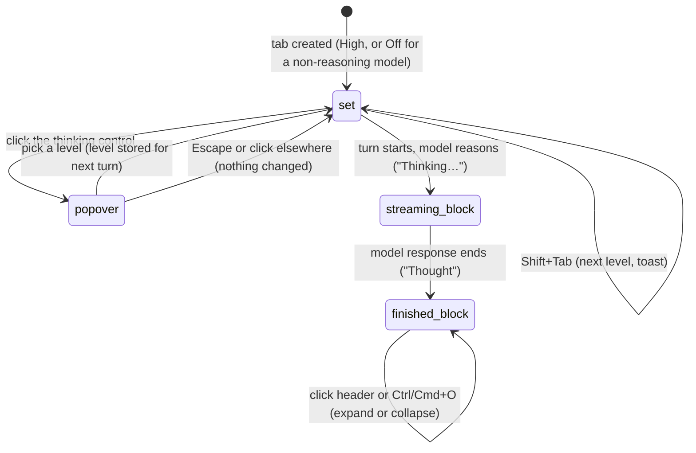

# Thinking

## Summary

The [thinking level](../glossary.md#models-and-providers) sets how much the model reasons before it answers, trading speed for thoroughness. Each tab has its own level, saved with its session. The level is shown in the status bar next to the model, with a brain icon ("High"); the user changes it by clicking that control and picking from a popover, or by pressing Shift+Tab to step to the next level. What the model reasons, when the provider returns it, appears in the transcript as a [thinking block](../glossary.md#the-turn): a collapsible card labelled "Thinking…" while the model response streams. Changing the level is allowed at any time, including while the tab is busy and with no provider connected; it takes effect from the next turn. Models that do not reason offer only "Off". The control and the blocks behave the same on every host.

## The simple case

The status bar reads "High". The user clicks it. A small popover titled "Thinking level" opens above it, explaining "How deeply Pi reasons before answering — higher is slower but more thorough. Click to select, or press ⇧Tab to cycle." and listing the levels the model supports, each with a hint ("Off · Fastest — no reasoning step", "Low · Fast — moderate reasoning", …), the current one ticked. The user picks "Low". The popover closes and the status bar reads "Low". The next message the user sends is answered at that level.

From the keyboard, Shift+Tab does the same thing one step at a time: the status-bar control flashes in the level's colour, a thin coloured line sweeps along the bottom of the taskpane, and a toast says "Thinking: Low (next turn)".

When the model reasons, its answer starts with a block labelled "Thinking…" with a spinner. The block stays collapsed; clicking it shows the reasoning as it streams. Once the model response is finished, the block reads "Thought".

## The interaction, event by event

### Choosing a level

There are seven levels. Their labels and popover hints are:

| Level | Label | Hint |
| --- | --- | --- |
| off | "Off" | "Fastest — no reasoning step" |
| minimal | "Min" | "Quick — light reasoning" |
| low | "Low" | "Fast — moderate reasoning" |
| medium | "Medium" | "Balanced — solid reasoning" |
| high | "High" | "Slow — thorough reasoning" |
| xhigh | "Extra high" | "Very slow — extra-high reasoning" |
| max | "Max" | "Slowest — maximum reasoning" |

Which levels a model offers comes from the model registry bundled with Pi:

- A model that does not reason offers only "Off".
- A reasoning model offers "Off", "Min", "Low", "Medium" and "High", minus any level the registry marks as unavailable for that model.
- "Extra high" and "Max" are offered only by models the registry says support them.

The popover and Shift+Tab both act on the active tab only. Shift+Tab moves to the next offered level and wraps from the last back to "Off". If the tab's current level is not one the model offers (for example the tab was on "High" and the model was switched to one that does not reason), Shift+Tab goes to the first offered level and the popover shows no tick.

A new tab starts at "High" if its model reasons and "Off" if not; it does not copy the active tab's level. A [duplicated or forked](../sessions/tabs.md) tab copies its source's level. A tab whose model is replaced because it disappeared from the provider gets "High" or "Off" by the same rule.

### Ends at once

- **Picking the level that is already set** closes the popover and changes nothing.
- **Escape**, or a click anywhere outside the popover, closes it without a change. The popover claims Escape, so Escape does not also stop a responding tab.
- **No active tab** (only during startup or teardown): clicking the control shows the toast "No active session". Shift+Tab does nothing and moves focus as it normally would.

Nothing is saved in these cases.

### The level is set

Picking a level or pressing Shift+Tab changes the tab's level immediately: the status bar shows the new label at once. The popover gives no other feedback; Shift+Tab adds the flash and the toast "Thinking: {level} (next turn)" for 1.5 seconds.

The new level is used from the next turn: the next message the user sends, or the next queued prompt. A turn that is already running keeps the level it started with for all of its model responses, including those after steers and follow-ups, as the toast's "(next turn)" says.

> Technical note: pi-agent-core reads the model and thinking level once when a run starts (`createLoopConfig` in `agent.js`) and Pi's between-response hook does not change them. Observed in a harness: changing the level during the first model response left the second at the old level.

The level is passed to the provider as a request for that much reasoning. Providers map it onto their own settings and, where a model does not support the requested level, use the nearest one it does; the status bar keeps showing the stored level.

### While the model reasons

When the model returns its reasoning, the model response begins with a thinking block. While the model response streams, the block's label is "Thinking…" with a spinning icon and a shimmer, and it stays that way after the reasoning has ended: through the text, through any tool calls that follow, until the next model response starts streaming or the turn ends. The block is collapsed; clicking its header expands it and the reasoning streams inside, scrolling to keep the newest line in view.

The thinking level control stays usable throughout. The working indicator's rotating hints include "⇧Tab to adjust reasoning depth".

Some providers return no readable reasoning even at a high level (only a summary, or nothing). An empty reasoning block is not shown at all; the user sees the answer with no thinking block.

### The block after the model response

Once the model response has finished, the block's label is "Thought". It stays collapsed. Clicking the header toggles it; Ctrl/Cmd+O expands or collapses every thinking block and tool card on screen (see [tool calls](tool-calls.md#showing-and-hiding-details-with-ctrlcmdo)). In "Details hidden" mode thinking blocks also lose their card border and their header is dimmed.

The label is meant to read "Thought for {duration}" ("Thought for 12s", "Thought for 1m 5s") when the user watched the block stream. In practice the finished block is a new element that never streamed, so it always reads "Thought". See [Open questions](#open-questions-and-verification). Blocks in restored sessions also read "Thought".

## Modifiers

| Modifier | Set before | Changed while busy |
| --- | --- | --- |
| Model and provider | Decides which levels are offered and whether reasoning is returned and shown. Switching model does not change the stored level. | Model change refused while busy. |
| Thinking level | This is the feature. | Changing it is allowed; the running turn keeps its level, the next turn uses the new one. |
| Execution mode | No effect. | No effect. |
| Files in the workspace, or an overlay open | No effect from files. With an overlay or a text field in an overlay focused, Shift+Tab still cycles the thinking level instead of moving focus backwards. | Same. |
| Tab state (new, restored, another tab busy) | New tab: "High" or "Off". Restored tab: its saved level. Another tab being busy does not matter. | Switching tabs shows the new active tab's level; Shift+Tab and the popover act on the active tab only. |
| Host (desktop or web) | No difference. | No difference. |

A level change never affects a model response or turn already running.

## Cancel and interrupt

| Event | Before sent | While busy |
| --- | --- | --- |
| Stop (button or Escape) | Escape closes the popover if it is open. | Stop ends the turn; the partial thinking block stays, labelled "Thought". With the popover open, Escape closes the popover and does not stop. |
| The user sends something else | The next turn uses whatever level is set when it starts. | Steers and follow-ups join the running turn at its original level. |
| Tab switched, created, closed or reopened | Each tab keeps its own level. Clicking another tab closes the popover. Switching tabs from the keyboard leaves it open, still listing the previous tab's levels; picking one then sets it on the tab where the popover was opened. | The running turn keeps its level in its own tab. |
| An overlay or menu opens | Opening the other status popover closes this one. | No effect on the running turn. |
| Model or thinking level changes | Applies to the next turn. | Model refused; level applies to the next turn. |
| The provider fails | No effect on the stored level. | The turn fails; a partial thinking block stays in the transcript. |
| The taskpane goes away | A level changed since the last saved message is lost; the session reopens with its saved level. | The streaming thinking block is lost with its model response. |
| The workbook changes underneath | No effect. | No effect. |
| Focus moves to the grid or another window | Shift+Tab in the grid is Excel's; the popover stays open until the next click in the taskpane. | No effect. |
| The context window fills | No effect. Compaction always summarizes with the "high" reasoning setting, whatever the tab's level. | Reasoning text counts towards the context window like any other text. |

After any interrupt the tab keeps whatever level it had.

## Interactions with other systems

**Persistence.** The level is saved with the session each time a message completes, and restored when the session is reopened or resumed. Changing the level does not save the session by itself; see [persistence and restore](../cross-cutting/persistence-and-restore.md). Thinking blocks are saved as part of their model response.

**Workbook changes and recovery.** No interaction.

**Other tabs and sessions.** Each tab has its own level. Two tabs on the same model can run at different levels.

**Execution mode and approvals.** No interaction. Pressing Shift+Tab redraws the status bar as if the mode were Auto and no tab held the workbook lock, until the next update; see [Open questions](#open-questions-and-verification).

**Models and providers.** The offered levels come from the model; see [models and providers](../foundations/models-and-providers.md). Higher levels make responses slower and use more tokens.

**Offline and provider errors.** No interaction.

**Notifications.** Shift+Tab: toast and flash. The popover: none.

**Settings and preferences.** There is no default thinking level in Settings.

**Host differences.** None.

**Language.** Level labels, hints, the popover title, the toast, "Thinking…", "Thought for {duration}" and "Thought" are translated.

**Accessibility and keyboard.** The status-bar control is a button with the accessible name "Thinking level {level}"; the popover's levels are buttons. Shift+Tab is listed on the shortcuts page as "Cycle thinking depth". Shift+Tab is taken by Pi everywhere in the taskpane, so it never moves focus backwards while a tab exists, including inside dialogs. The thinking block's header is not a button: it cannot be reached with Tab or toggled from the keyboard except through Ctrl/Cmd+O.

## Edge cases

- With a model that offers only "Off", the popover lists one item and Shift+Tab keeps showing "Thinking: Off (next turn)".
- A tab left on "High" after switching to a non-reasoning model still shows "High" in the status bar; the request asks for no reasoning because the provider maps it down.
- Several thinking blocks can appear in one turn, one per model response.
- Pressing Shift+Tab rapidly cycles through levels; each press replaces the previous toast.
- The thinking flash uses one colour per level (grey for Off through magenta for Max); the colours are decorative and carry no other meaning.

## Open questions and verification

- The "Thought for {duration}" label is never shown after a live response; the finished block always reads "Thought". Observed in a harness with the real `<pi-sidebar>` and `Agent`. Cause: the duration is measured inside the streaming element (`src/ui/messages/thinking-block.ts:52-68`), but the finished model response is rendered by a new element in `message-list.ts` that never streamed, and the streaming element is removed at `agent_end` in the same update that sets `isStreaming` to false (`src/ui/pi-sidebar.ts:357-362`). Bug.
- The streaming block says "Thinking…" until the next model response starts or the turn ends, not when the reasoning ends, because it takes the tab's streaming flag (`src/ui/messages/messages.ts:107-110`). Probably unintended.
- `foundations/turns.md` says a thinking-level change takes effect from the next model response. It takes effect from the next turn (see [The level is set](#the-level-is-set)); the toast's "(next turn)" is accurate.
- Shift+Tab calls `updateStatusBarForAgent(agent)` with its defaults (`src/taskpane/keyboard-shortcuts.ts:162`, `src/taskpane/status-bar.ts:181-187`), which redraws the mode badge as "Auto" and drops the lock badge until the next status update. In Confirm mode the status bar shows "Auto" after Shift+Tab. Read from code. Bug.
- Shift+Tab is handled with no check for overlays or text fields (`src/taskpane/keyboard-shortcuts.ts:377-384`), so reverse tabbing is impossible in settings and other dialogs while any tab exists. Read from code. Accessibility bug.
- The thinking-block header is a `div` with a click handler (`src/ui/messages/thinking-block.ts:94`), with no role or tab stop.
- A level change made with no message afterwards is not saved; read from `src/taskpane/sessions.ts:344-352`, not confirmed by hand.
- Which providers return readable reasoning, and at which levels, was not checked.

Verified against pi-for-excel commit `ec453df`.
