# Tool calls

## Summary

A tool call is Pi acting on the workbook (or on the Files workspace, the web, its rules and skills) in the middle of a [turn](../foundations/turns.md). Each one appears in the transcript as a [tool card](../glossary.md#the-turn): a one-line header that says in plain words what Pi is doing ("Read Sheet1!A1:D20", "Edit Summary!B4 — 3 changed"), a spinner while it runs, and a collapsed body that holds the exact input and result. Tool cards live inside the assistant message that asked for them, in the order the model asked. There is no button or command that starts a tool call; the model decides. The user can expand or collapse a card by clicking its header, click a cell address to jump to it in Excel, and press Ctrl/Cmd+O to expand or collapse every tool card and thinking block at once. Tool cards render the same with or without a provider connected (restored sessions show them too), and on every host; only cell links need Excel.

## The simple case

The user asks "What's in A1:D20?". Pi's answer starts streaming, then a card appears under the text: a spinner and **Read** Sheet1!A1:D20. A moment later the spinner stops, the card stays collapsed, and Pi carries on writing with what it read.

Clicking the header expands the card. The body shows the tool's internal name (`read_range`) in small grey type, an **Input** section with the parameters as a short list ("Sheet: Sheet1", "Range: Sheet1!A1:D20"), and a **Result** section with what the tool returned, usually a small table. Clicking the header again collapses it. Clicking "Sheet1!A1:D20" in the header or the body selects that range in Excel instead, without toggling the card.

When Pi has finished, the turn ends as described in [turns](../foundations/turns.md); the cards stay in the transcript, collapsed, and are saved with the session.

## The interaction, event by event

```mermaid
stateDiagram-v2
    [*] --> preparing : model starts a tool call (card appears)
    preparing --> running : parameters complete (header names the target)
    running --> done : result returned (spinner stops, result saved)
    running --> failed : tool reports an error (red card)
    preparing --> aborted : Stop before the tool ran (red card, no output)
    running --> done : Stop while running (tool asked to cancel; its result is kept)
    done --> expanded : click header or Ctrl/Cmd+O shown
    expanded --> done : click header or Ctrl/Cmd+O hidden
    failed --> expanded : click header
```

### The model asks for a tool

A tool call begins inside a streaming model response, when the model starts writing one. A card appears at that point in the response, below any text the model wrote before it, with a spinner. Its header is built from whatever parameters have arrived so far:

- For Pi's own tools, the header is a bold verb and a normal-weight detail from the start, with placeholders until the parameters arrive: **Read** range, **Write** cells, **Format** cells, **Search** workbook. As the parameters stream in, the placeholder becomes the real target: **Read** Sheet1!A1:D20.
- For a tool without its own card design (an extension tool, or a tool name the model invented), the header says "Preparing tool parameters…" until the first parameters arrive, then "Tool Call".

The header text is chosen per tool. Some examples: **Overview** (with the sheet name if one was given), **Read** or **Export** … (CSV), **Edit** / **Write** for cell writes, **Filled** / **Fill** for formulas, **Format**, **Cond. format**, **Search** "query", **Trace precedents** / **Trace dependents**, **Explain formula**, **Chart** 'name' created, **Comments** / **Add** comment, **Freeze**, **Hide** / **Show**, **Remember** user rules, **List** backups, **Restore** latest backup, **Read skill** name (bundled), **Web search** "query", **Fetch page** url. Multi-range addresses on one sheet are shortened ("Summary!A3,A13,A22"); dimension notes such as "(20×4)" are dropped.

Nothing is decided by the user at this point. The tool call is part of the model response and cannot be refused from the card; in Confirm mode a mutation asks for [approval](../workbook/confirm-mode-and-approvals.md) when it is about to run, not when the card appears.

### Ends at once

A tool call ends without running when:

- **The response hits the output token limit.** Every tool call in that model response fails at once with "Tool call "{name}" was not executed: the response hit the output token limit, so its arguments may be truncated. Re-issue the tool call with complete arguments." The cards turn red; the model sees the failure and normally tries again.
- **The tool does not exist** or its parameters do not match what the tool accepts. The card turns red with the reason in its result; the model sees it.
- **The user stops** before the tool has started. See [Cancel and interrupt](#cancel-and-interrupt).
- **The user declines an approval** in Confirm mode. The card turns red; the turn continues.

In each case the card stays in the transcript and is saved with the session. Nothing in the workbook changes.

### The tool runs

The tool starts as soon as the model response that asked for it has finished streaming. From then on a mutation may already be changing the workbook, and Stop can no longer guarantee that nothing changed (see [stopping](stopping.md)).

When a model response asks for several tools, they all start together and their cards all spin. They finish in any order, but every card keeps its spinner until the slowest tool in the batch has finished; then all results appear at once, in the order the model asked for them. Mutations among them still run one at a time behind the [workbook lock](../foundations/the-workbook.md).

Confirmed in Excel on the web: three parallel reads showed three spinners, and all three stopped together.

> Technical note: tool results are added to the conversation only after the whole batch finishes, and a card shows its spinner for as long as it has no result and the tab is responding. Read from `executeToolCallsParallel` in pi-agent-core's `agent-loop.js`; observed in a harness with three calls of 1, 1.5 and 4 seconds.

### While tools are running

The card's header is all that updates: the spinner turns. The body (if expanded) shows the input only. There is no progress bar, no elapsed time, and no partial output for Pi's own tools.

The user can expand or collapse cards, click cell links, scroll, steer, follow up, stop, switch tabs and change the thinking level; see [turns](../foundations/turns.md#while-pi-is-busy). Steers wait until every tool in the batch has finished.

While tools run, the model response that asked for them is drawn twice: once in its final place, where its cards already look finished (no spinner, and three or more consecutive cards of one tool already grouped), and once below it with the spinners. The duplicate disappears when the next model response starts streaming. Confirmed in Excel on the web. See [Open questions](#open-questions-and-verification).

### The result

When a tool finishes, its card shows one of three states:

- **Done.** The spinner stops and the card keeps its normal style. The header may gain a short receipt after a dash: " — 3 changed", " — 2 errors" (formula errors written into cells), " — blocked" (Pi refused to overwrite, shown with ⛔ in the result), or ", no backup" / " — no backup" when Pi could not take an [automatic backup](../workbook/backups-and-revert.md) before the change. A write card's verb changes to past tense when it succeeds: **Write** becomes **Edit**, **Fill** becomes **Filled**.
- **Failed.** The header turns red. The error text is in the result section when the card is expanded. There is no error banner for a failed tool; the turn continues and the model sees the error.
- **Aborted.** A tool call that never got a result because the turn was stopped is drawn like a failed one: red header, no spinner, and "(no output)" as its result. A tool that was already running when Stop came is waited for and keeps its result (card in its normal style); the turn then ends with a red "Error: signal is aborted without reason" under it. Confirmed in Excel on the web with a 12-second Office.js call.

The body of a finished card holds, in order:

1. The tool's internal name in small grey type (`write_cells`).
2. **Input.** The parameters as a labelled list for Pi's own tools: ranges as links, colours as a swatch and a name, written values as a preview of up to 3 rows by 6 columns ("…2 more rows"), formulas in code type. Tools without a list show the raw parameters as formatted JSON.
3. **Result**, or a more specific label: **Data** (a CSV export, shown as a table), **Precedents** / **Dependents** (a dependency tree), **Formula explanation** (the formula, its direct references and their values). The result text is shown as markdown when it looks like markdown, as formatted JSON when it is JSON, otherwise as plain text; "(no output)" when empty. Formatting and conditional-format tools whose result only repeats the input show "✓ Done". Images (a chart image, a picture) appear under the result.
4. **Changes ({count})** for cell writes, formula fills and Python transforms: a Cell / Before / After table, with formulas under the values, an empty value shown as "∅", and "Showing first {n} changed cell(s)." when the table is a sample.
5. **Explain these changes** for every mutation: a disclosure that opens a plain-language explanation of the change with "Citations:" (clickable ranges), and a note when it is "Limited metadata available; explanation is high-level."

Every card starts collapsed, including errors. The card's own toggle is the header button; its chevron shows ⌃ when expanded and a double chevron when collapsed.

### Showing and hiding details with Ctrl/Cmd+O

Ctrl/Cmd+O, pressed anywhere in the taskpane (including in the composer), toggles a taskpane-wide details mode and shows a 1.5-second toast:

- **"Details hidden (⌃O)"**: every tool card on screen collapses, every thinking block collapses, and thinking blocks lose their card border and are dimmed. Tool cards keep their normal style.
- **"Details shown (⌃O)"**: every tool card on screen expands and every thinking block expands.

The mode starts as "shown" when the taskpane opens, but cards start collapsed, so the first press says "Details hidden (⌃O)" and visibly does nothing to tool cards. Confirmed in Excel on the web: the first press changed nothing on screen, the second ("Details shown (⌃O)") expanded the cards and the thinking block. The mode applies to what is on screen at that moment. Cards that appear later, cards in a tab the user switches to, and any card whose tool finishes after the press start collapsed again, whatever the mode. The mode is not saved; a reload starts in "shown" with everything collapsed. The working indicator hints "⌃O to collapse tool details". Ctrl/Cmd+O is not listed in the keyboard shortcuts page; see [keyboard shortcuts](../ui/keyboard-shortcuts.md).

### Grouping

When two or more consecutive cards in the same model response are finished calls of the same tool, they are wrapped in one green container with a header naming the count: "2 reads", "4 edits", "3 fill operations", "5 format operations", "2 conditional formats", "2 view changes", "3 chart operations", "2 script executions", or "{count} {tool name} calls" for any other tool ("2 search_workbook calls"). Inside, the cards lose their individual borders. A failed or running card breaks the run, so "3 reads" followed by a failed read shows as a group of 3 and a separate red card. Cards from different model responses are never grouped.

Groups of three or more are meant to start collapsed and groups of two expanded, with the header (a ▸ that rotates when open) toggling them. In practice a group that forms while results arrive keeps the state it had when it was smaller: three parallel reads first grouped as "2 reads" (expanded), then became "3 reads" still expanded; after a tab switch the same group was drawn collapsed. And the cards inside a group stay visible whether the group is collapsed or not: the header's chevron and its expanded state change, the cards do not. Both confirmed in Excel on the web. See [Open questions](#open-questions-and-verification).

## Modifiers

| Modifier | Set before | Changed while busy |
| --- | --- | --- |
| Model and provider | Decides which tools the model calls and how; tool cards look the same for every model. A model that cuts its response off at the output limit gets the "not executed" failure for every tool call in it. | Refused while the tab is busy ("Wait for this tab to finish before changing models"). |
| Thinking level | No effect on tool cards. | No effect on running tools. |
| Execution mode | In Confirm, each mutation waits for an approval before it runs; its card spins until the user answers. Declined: red card. In Auto, mutations run at once. | Takes effect from the next mutation; an approval dialog already open is unaffected. |
| Files in the workspace, or an overlay open | Files tools ("Read file", "Write file") can read and write the workspace. An overlay over the transcript hides the cards but does not pause the tools; approval dialogs are the exception. | Importing a file makes it available to tool calls that start afterwards. Cards keep updating behind an overlay. |
| Tab state (new, restored, another tab busy) | A restored tab shows its old cards collapsed, in their finished state. Another tab's mutation holding the workbook lock makes this tab's mutation wait; its card keeps spinning and the tab shows "Locking…". | Switching away does not pause tools. Switching back redraws the transcript: every card is collapsed again. |
| Host (desktop or web) | Cards look the same. Cell links need Excel and do nothing in the taskpane opened alone in a browser. | No effect. |

A modifier that changes while a tool runs never affects that tool; it applies to the next tool call or the next turn.

## Cancel and interrupt

| Event | Before sent | While busy |
| --- | --- | --- |
| Stop (button or Escape) | A tool call still streaming its parameters is abandoned with the model response; its card turns red with "(no output)". Nothing ran. | Running tools are asked to cancel; Pi waits for them, with the Stop button still shown. A tool that finishes anyway keeps its result; tools that had not started get the error "Operation aborted". The turn then ends with "Error: signal is aborted without reason" rather than "Request aborted" (see [stopping](stopping.md#at-each-stage)); workbook changes already made stay made. |
| The user sends something else | A steer or follow-up does not affect the tool call being prepared. | A steer waits until every tool in the batch has finished and is delivered before the next model response. A follow-up waits for the end of the turn. |
| Tab switched, created, closed or reopened | The model response keeps streaming in its tab. | Tools keep running in the background tab. Closing a responding tab asks "Stop and close this tab?"; closing a tab whose mutation holds the workbook lock is refused. On switching back, all cards are collapsed. |
| An overlay or menu opens | No effect on the tool call. | Tools keep running behind it. An approval dialog is itself the tool waiting. |
| Model or thinking level changes | Model change refused while busy; thinking-level change waits for the next turn. | Same. |
| The provider fails | The model response fails while writing the call; the card for the incomplete call shows red, and the turn ends as [failed](../foundations/turns.md#finishes). | Tools do not use the provider and finish normally; the failure shows on the next model response. |
| The taskpane goes away | The model response is lost; nothing ran. | Running tools stop with the taskpane. A mutation Excel had already accepted may still complete. Cards of the unfinished model response are not saved; the session ends at the last completed message. |
| The workbook changes underneath | No effect. | A tool reads or writes what Excel reports at the moment it runs. Edits the user makes meanwhile are reported to Pi at its next request (see [auto-context](auto-context.md)). |
| Focus moves to the grid or another window | No effect. | Tools keep running. Clicking a cell link moves the selection and focus to the grid. |
| The context window fills | No effect on the call being prepared. | After a batch of tools finishes, Pi may [compact](context-and-compaction.md) before the next model response. Very large results are cut down before they reach the conversation (see [Edge cases](#edge-cases)). |

After any interrupt, the cards already drawn stay in the transcript in the state they reached.

## Interactions with other systems

**Persistence.** A tool call and its result are saved with the session when they complete, like every message (see [persistence and restore](../cross-cutting/persistence-and-restore.md)). Expanded or collapsed state, group state and the Ctrl/Cmd+O mode are not saved. Results saved by older versions whose details no longer match today's shape render from their text alone: no Changes table, no CSV table, a header built from the result text.

**Workbook changes and recovery.** Every mutation card corresponds to one change in the workbook, preceded by an [automatic backup](../workbook/backups-and-revert.md) unless the header says "no backup". The card is the receipt; reverting is done from the Backups dialog or `/revert`, not from the card. Excel's Undo does not undo Pi's changes.

**Other tabs and sessions.** Each tab has its own cards. Mutations from different tabs queue behind the [workbook lock](../foundations/the-workbook.md).

**Execution mode and approvals.** See the Modifiers row. A declined approval and a blocked overwrite look different: declined is a red card, blocked is a normal card with " — blocked".

**Models and providers.** No interaction beyond which tools the model chooses to call.

**Offline and provider errors.** Workbook tools work offline. Web search and fetch page fail with a red card; a failed web search shows an inline setup card under it. See [web search and MCP](../extensions/web-search-and-mcp.md).

**Notifications.** None. A tool never shows a toast or the error banner; its card is the only signal.

**Settings and preferences.** No interaction in the default configuration.

**Host differences.** Cell links select the range in Excel desktop and on the web alike. Whether Excel on the web scrolls to a range on another sheet has not been checked.

**Language.** Header verbs for the overview and Office.js tools ("Overview", "Run Office.js"), the parameter labels in the Input list, and "(no output)" are translated. Most other card text is English in every language: the other header verbs and receipts, the section labels "Input", "Result", "Data", "Changes", the group labels ("3 reads"), "Explain these changes", and the "Details hidden (⌃O)" / "Details shown (⌃O)" toasts.

**Accessibility and keyboard.** Card headers and group headers are buttons and can be reached with Tab and toggled with Enter or Space; group headers expose their expanded state. Spinners are hidden from screen readers and no announcement is made when a tool finishes. Ctrl/Cmd+O is the keyboard path to expand everything at once. On macOS the shortcut is Cmd+O or Ctrl+O; the toast says "⌃O" on every platform.

## Edge cases

- **Truncated output.** A result longer than the limit is cut before Pi or the card sees it, and a line is appended: "[Output truncated: showing first {n} of {m} lines ({limit} limit); limits: 2,000 lines / 50.0KB; full output saved to Files workspace: .tool-output/….txt]". Confirmed in Excel on the web: reading 1,250 rows gave "showing first 908 of 1,254 lines (50.0KB limit)" with the file under `.tool-output/`. The limits are 2,000 lines and 50 KB for models with a context window of 128k tokens or more, scaled down in proportion for smaller windows, never below 200 lines and 8 KB. Script and MCP tools keep the last lines instead of the first ("showing last …"). The full output is saved to the [Files workspace](../files/the-files-workspace.md) only when it is 512 KB or less; otherwise the "saved to" clause is missing.
- **Older results are shortened for the model, not on screen.** Beyond the six most recent tool results (fewer for small context windows, never below two), results over 1,200 characters are sent to the model as a 500-character preview. The cards still show the full text.
- **Cell links** take the first part of a multi-range address ("D18:H18, D28:H28" goes to D18:H18), activate its sheet and select it. Clicks closer together than 300 ms are ignored. A link to a sheet that no longer exists does nothing, with no message.
- A long list of ranges in the Input section shows the first three and "+{n} more"; in the header up to eight are links.
- A tool call with no parameters at all shows only its header and cannot be expanded until parameters arrive.
- A card for `/compact` ("Summarized …") and the "Show earlier messages" card look like tool cards but are not tool calls; they are not grouped and Ctrl/Cmd+O does not affect them. See [context and compaction](context-and-compaction.md).
- Pi's own writes are also reported to the model as "User changes" at its next request (see [auto-context](auto-context.md#open-questions-and-verification)).

## Open questions and verification

- While tools run, the model response that asked for them appears twice: once in the stable transcript (tool cards without spinners, already grouped) and once in the streaming area below (with spinners, and the thinking block still saying "Thinking…"). Observed in a harness that mounts the real `<pi-sidebar>`, `Agent` and tool renderers with a scripted stream, and confirmed in Excel on the web: with three parallel reads running, the transcript held the finished assistant message with three spinner-less cards already grouped as "3 reads", while the streaming area below showed the same three cards with spinners, until the next model response started. Cause: `src/ui/pi-sidebar.ts:343-372` only replaces the streaming container's message on `message_update` and clears it on `agent_end`, while pi-agent-core pushes the finished message into `state.messages` at `message_end`; `message-list.ts` renders it again. Looks like a bug.
- Collapsed groups do not hide their cards: `ToolMessage.connectedCallback` sets an inline `display: block` (`src/ui/messages/messages.ts:173`), which overrides `.pi-tool-group--collapsed > tool-message { display: none }` (`src/ui/theme/content/message-components.css:54`). Observed in the harness and confirmed in Excel on the web: clicking "3 reads" set the group collapsed (`aria-expanded="false"`, ▸) and the three cards stayed on screen. Bug.
- `tool-grouping.ts` remembers every group's collapsed state on each regrouping pass, not only states the user chose (`src/ui/tool-grouping.ts:78-90`), so a group of three that later becomes a group of two (a card turned red) keeps "collapsed". The reverse was confirmed in Excel on the web: a live group grew from two cards to three and kept the expanded state of the two. Invisible today because of the previous bug.
- Ctrl/Cmd+O starts in "shown" mode with everything collapsed, so the first press appears to do nothing; and expanding is lost whenever a card re-renders into a new template (tool finishes, model response moves into the transcript, tab switch) because every card hard-codes `defaultExpanded = false` (`src/ui/tool-renderers.ts:1084`). Observed in the harness; the first-press behavior confirmed in Excel on the web. Probably unintended.
- The Ctrl/Cmd+O toasts are hard-coded English (`src/taskpane/keyboard-shortcuts.ts:400`) and say "⌃O" on macOS where Cmd+O also works. The shortcut is missing from the shortcuts page (`src/commands/builtins/settings-pages/shortcuts-page.ts`).
- What happens in the workbook when Stop lands during a mutation that Excel has already accepted has not been confirmed. A running Office.js call that only waited 12 seconds completed after Stop and kept its result.
- After several tab switches, a group of three reads in an idle tab was drawn as "2 reads" with the middle card missing (the session still held all three calls and results), and stayed that way on later switches until the taskpane was reloaded, which drew all three again. Observed once in Excel on the web; not reproduced on demand. A guess at the cause is that `tool-grouping.ts` moves Lit-rendered `tool-message` elements into its wrapper, which can leave Lit's re-render out of step with the DOM. May be worth treating as a bug.
- Declining an approval (Escape on "Allow workbook mutation in Safe mode?") turned the write card red with "Mutation cancelled by user (Confirm mode)." and the turn continued; confirmed in Excel on the web. The dialog's title says "Safe mode" while its body says "Confirm mode" (a copy slip owned by [confirm mode and approvals](../workbook/confirm-mode-and-approvals.md)).
- A cell-link navigation that fails (deleted sheet, cell in edit mode) rejects silently (`src/ui/cell-link.ts:82`). Read from code.
- Header wording for each tool was read from `TOOL_DESCRIPTION_HANDLERS` in `src/ui/tool-renderers.ts`, not checked tool by tool in Excel.

Verified against pi-for-excel commit `ec453df`.
