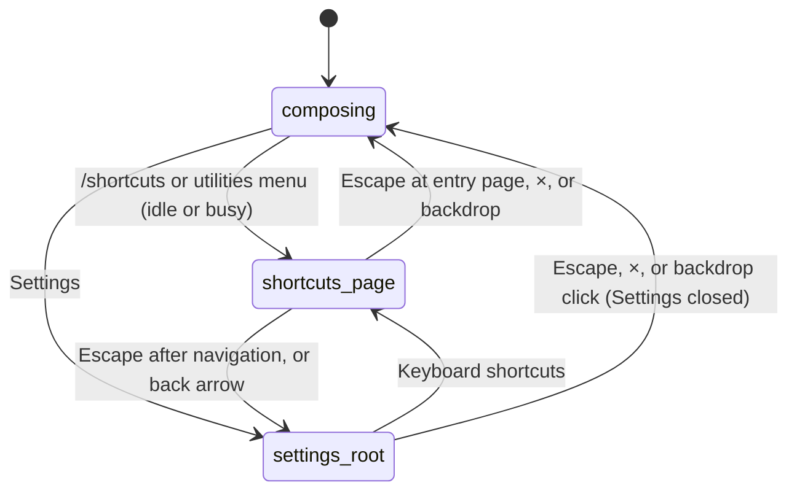

# Keyboard shortcuts

Chat/thinking rows revised for CL-03, CL-09 / CC-07 in [PR #803](https://github.com/tmustier/pi-for-excel/pull/803). Tab chords and modal guards below describe CC-08, shipped in [PR #802](https://github.com/tmustier/pi-for-excel/pull/802).

## Summary

Pi for Excel can be driven almost entirely from the keyboard: sending, steering and following up, stopping, restoring queued messages, cycling thinking, managing tabs, the command menu and composer focus. This document describes the in-product **Keyboard shortcuts** page and indexes bindings by their owning feature. `/shortcuts`, the utilities menu and Settings all open it, including while busy. It needs no provider; host-reserved keys still may not reach Pi.

## The simple case

The user types `/shortcuts` and presses Enter, or opens the utilities menu (the gear) and chooses "Keyboard shortcuts". The Settings overlay opens directly on a page titled "Keyboard shortcuts" with the subtitle "Quick reference for chat, tab, navigation, and system shortcuts.", and a back arrow to the Settings root.

The page lists four groups, "Chat", "Tabs", "Navigation" and "System", each a list of key labels and descriptions. Keys are shown in macOS notation (⌃ ⌘ ⌥ ⇧) when the taskpane runs on a Mac, and as "Ctrl+…", "Alt+…", "Shift+…" otherwise. Tab chords use Control+Option on Mac, not Command. The page is read-only.

Escape closes at a deep-linked entry page; after navigation from Settings root it goes back first. × closes at once. The user lands back in the originating tab.

## The interaction, event by event

### Opening the page

`/shortcuts` and the utilities-menu item both open Settings at the shortcuts page; Settings → "Keyboard shortcuts" navigates there from the root. If Settings is already open, `/shortcuts` moves it to the shortcuts page. Which notation is shown is decided when the page renders, from the browser's platform: Excel on the web on a Mac shows Mac symbols.

### Ends at once

`/shortcuts` is a local command and opens while busy. Nothing goes to the model or transcript. For a different command that is refused, both typed and menu paths retain the draft; the historical command-menu text-loss observation below is superseded.

### Committed, while busy, finishes

There is nothing to commit. The page is a static list; opening it changes no setting or workbook. A turn continues behind it. Escape follows the entry-page/navigation rule above; × and the backdrop close Settings.

### What the page lists

Windows label first, Mac label second where they differ. The Windows/Linux chord names do not imply native Windows acceptance; see coverage below.

| Group | Keys | Description |
| --- | --- | --- |
| Chat | Enter | "Send message" |
| Chat | "Enter (while streaming)" | "Steer Pi after its current step" |
| Chat | Alt+Enter / ⌥ Enter | "Queue follow-up message" |
| Chat | Alt+↑ / ⌥ ↑ | "Restore queued message" |
| Chat | Ctrl+Alt+T / ⌃ ⌥ T | "Cycle thinking level (in the message box)" |
| Chat | Ctrl+O / ⌘ O | "Expand or collapse tool details" |
| Tabs | Ctrl+Alt+N / ⌃ ⌥ N | "New tab" |
| Tabs | Ctrl+Alt+W / ⌃ ⌥ W | "Close tab" |
| Tabs | Ctrl+Alt+Shift+T / ⌃ ⌥ ⇧ T | "Reopen closed tab" |
| Tabs | ← → | "Switch tabs (exit input first)" |
| Tabs | Ctrl+Alt+← / → / ⌃ ⌥ ← / → | "Previous / next tab" |
| Tabs | Shift+F10 / ⇧ F10 | "Open the menu for the focused tab" |
| Navigation | / | "Open command menu" |
| Navigation | ↑ ↓ | "Navigate menu items" |
| Navigation | F2 | "Focus chat input" |
| System | Esc | "Dismiss popup / Stop generation / Exit input" |

## The index

Every shortcut the product handles, in the taskpane only (keys pressed while focus is in Excel's grid never reach Pi). "Text field" is as defined in the [glossary](../glossary.md#input). "Anywhere" means anywhere in the taskpane with no modal overlay open, unless a guard says otherwise. IME composition keys are not handled as shortcuts.

### Composer and turn

| Keys | What it does | Where and guards | Owner |
| --- | --- | --- | --- |
| Enter | Idle: sends. Responding: steers. Busy but not responding: queues. Text starting with `/`: runs the command instead. | Focus in the composer. Empty text does nothing. | [the composer](../turn/the-composer.md), [turns](../foundations/turns.md) |
| Shift+Enter | Inserts a line break. | Composer. | [the composer](../turn/the-composer.md) |
| Alt/Option+Enter | Responding: follow-up. Idle: sends like Enter. | Composer. | [steering and the queue](../turn/steering-and-the-queue.md) |
| Alt/Option+Up | Restore queued: moves waiting steers, follow-ups and queued prompts into the composer. Toasts "Restored {count} queued message(s) to editor" or "No queued messages to restore". Also accepted as Alt/Option+PageUp, which some webviews send instead. | In the composer, or anywhere focus is not in another text field. Ignored on key repeat. | [steering and the queue](../turn/steering-and-the-queue.md) |
| Escape | Responding: stops and restores waiting items to the composer. Idle with focus in the composer: moves focus to the tab strip. | Only when no menu, popover or overlay claims Escape; see [Escape](#escape). | [stopping](../turn/stopping.md) |
| Ctrl+Alt/Option+T | Cycles the active tab's supported thinking levels; toast includes the dedicated chord. | Composer only, no modal. Not Cmd on Mac. | [thinking](../turn/thinking.md) |
| Shift+Tab | Moves focus backwards normally; never changes thinking. | Native focus navigation, including composer and dialogs. | [thinking](../turn/thinking.md) |
| Ctrl/Cmd+O | Shows or hides tool-card bodies and thinking blocks in the transcript; translated toast with the platform's shortcut label. | Anywhere. Lower-case o only, so Shift is not allowed. | [tool calls](../turn/tool-calls.md) |
| F2 | Puts focus in the composer with the caret at the end. | Anywhere, with no modifier and no modal open. | [the composer](../turn/the-composer.md) |

### Tabs

| Keys | What it does | Where and guards | Owner |
| --- | --- | --- | --- |
| Ctrl+Alt+N | Opens a new tab. | Anywhere, including text fields, with no dialog open. Control+Option on Mac. | [tabs](../sessions/tabs.md) |
| Ctrl+Alt+W | Closes the active tab, with the usual refusals and confirmation. | Anywhere, including text fields, with no dialog open. Control+Option on Mac. | [tabs](../sessions/tabs.md) |
| Ctrl+Alt+Shift+T | Reopens the most recently closed tab. | Anywhere with no dialog open. Control+Option+Shift on Mac. | [reopening closed tabs](../sessions/reopening-closed-tabs.md) |
| ← / → | Switches to the previous or next tab, wrapping around. | Not in a text field, menu or status popover, and no dialog open; ignored on key repeat. When a tab itself has focus, the tab strip handles the arrows the same way. | [tabs](../sessions/tabs.md) |
| Ctrl+Alt+Left / Ctrl+Alt+Right | Previous or next tab. | Also works in the composer, with no dialog open. Control+Option on Mac. | [tabs](../sessions/tabs.md) |
| Enter or Space on a focused tab | Selects it. | Focus on a tab button. | [tabs](../sessions/tabs.md) |
| Shift+F10 on a focused tab | Opens that tab's context menu, including Rename. | Focus on a tab button. | [tabs](../sessions/tabs.md) |

Ctrl/Cmd+Z is never handled as reopen, including while the close toast is visible; it stays native undo. The toast's **Undo** action and `/reopen` still reopen tabs. The old Ctrl/Cmd+T/W/Shift+T, Ctrl+PageUp/PageDown and Cmd+Shift+[ / ] tab aliases are removed.

### Menus, pickers and overlays

| Keys | What it does | Where and guards | Owner |
| --- | --- | --- | --- |
| `/` | Typed as the first character of the composer, opens the command menu. | Composer, single line. | [the command menu](../commands/the-command-menu.md) |
| ↑ / ↓ | Moves the command-menu highlight. | While the command menu is visible, anywhere. No modifiers. | [the command menu](../commands/the-command-menu.md) |
| Enter | Runs the highlighted command, with no arguments. | While the command menu is visible, anywhere; Shift and Alt are ignored. | [the command menu](../commands/the-command-menu.md) |
| Tab | Fills the composer with the highlighted command name. | While the command menu is visible. | [the command menu](../commands/the-command-menu.md) |
| ↑ / ↓, Enter, typing | Moves through, chooses, filters models. | Model picker. | [the model picker](../setup/the-model-picker.md) |
| Enter | Confirms a text-input dialog. | Its input field. | [the taskpane](../foundations/the-taskpane.md) |

### Escape

Escape goes to the first of these that applies, in this order:

1. An open status popover closes. See [the status bar](the-status-bar.md).
2. The command menu, if visible, closes.
3. With the tab idle and focus in the composer, focus moves out to the tab strip.
4. With the tab responding, Pi stops, unless a surface that claims Escape is open: the utilities menu, the command menu, the model picker, Settings, the API-key dialogs, the welcome overlay, or an extension widget. The established list is in [turns](../foundations/turns.md#stop).
5. An open overlay handles it: if focus is in a text field inside the overlay, the first Escape only leaves the field and the second closes the overlay. In Settings, Escape goes back one page and closes at the root.
6. The utilities menu or the tab context menu, if open, closes.

## What Excel on the web does with the keys

**Historical pre-#802 observations**, retained to explain why the old tab aliases were replaced. Tried with real key input (operating-system key events into the Chrome window running Excel on the web, Linux, so Ctrl chords), focus in Pi's composer unless noted. "Pi saw it" was checked with a capturing key listener in the taskpane. These are not acceptance results for the new chords.

| Keys | Pi saw it | What happened |
| --- | --- | --- |
| Ctrl+T | No | Chrome opened a new browser tab. |
| Ctrl+W | No | Chrome closed the browser tab running Excel, and the taskpane with it. Reopening that tab with Ctrl+Shift+T brought back Excel with the taskpane closed; Pi had to be opened again from the ribbon. |
| Ctrl+Shift+T | Only when Chrome had nothing to reopen | With a closed browser tab available, Chrome reopened it. In the one case where Chrome had none, Pi received the key and reopened its own closed tab. |
| Ctrl+PageUp / Ctrl+PageDown | No | Chrome switched to the neighbouring browser tab; with only one browser tab, nothing happened. Focus on a Pi tab made no difference. |
| Ctrl+O | Yes | Pi toggled details ("Details hidden (⌃O)"); no browser or Excel Open dialog. |
| Ctrl+Z (empty composer, nothing closed) | Yes | Nothing; Excel's own undo did not run. |
| Shift+Tab | Yes | Reverse-focus navigation only. PR #803 removes the old simultaneous thinking-level change. |
| Escape, F2, ←/→, Alt+↑ | Yes | As in the index: Escape moved focus from the composer to the tab strip, F2 brought it back, arrows switched tabs from the tab strip, Alt+↑ toasted "No queued messages to restore". |
| F6 | Not handled | Focus left the page entirely (to the browser's own controls); it did not reach the grid. |
| Ctrl+F6 | Taken by Office.js | Office.js hands Ctrl+F6 to Excel as "leave the add-in"; no visible change was observed. |

## Mismatches between the page and the code

- **F6 and Shift+F6** are host/browser behavior, not Pi bindings. PR #802 removes their misleading entries from the page.
- **Ctrl+P** appears only in the menu description of `/default-models`, "Switch models with Ctrl+P". No such shortcut exists; in Excel on the web Ctrl+P prints.
- **Ctrl/Cmd+Z** is no longer a reopen shortcut. **Ctrl/Cmd+O** is now listed on the page.
- **Tab** in the command menu, **Shift+Enter**, **Enter in the command menu**, **Alt/Option+PageUp** and **arrow keys on a focused tab** work but are not listed.
- Enter while streaming is labelled **"Steer Pi after its current step"**: it waits for the current response/tools, rather than interrupting them. Send uses that same path while responding; Alt/Option+Enter remains follow-up.
- **"Restore queued message"** is singular, but every waiting steer, follow-up and queued prompt is restored at once.
- **"← → Switch tabs (exit input first)"** applies to plain arrows. The dedicated Ctrl+Alt+Left/Right chords also work inside the composer.

## Modifiers

| Modifier | Set before | Changed while busy |
| --- | --- | --- |
| Model and provider | No effect on the page. The thinking chord only offers the model's supported levels. | No effect. |
| Thinking level | No effect on the page. | No effect. |
| Execution mode | No effect. | No effect. |
| Files in the workspace, or an overlay open | The page is itself a modal. Thinking cycling does not act behind it; Shift+Tab navigates its controls. | Same. |
| Tab state (new, restored, another tab busy) | No effect on the page. Shortcuts act on the active tab. | `/shortcuts` and menu navigation remain available. |
| Host (desktop or web) | Notation follows the platform. The common tab chords replace browser-reserved aliases; see [What Excel on the web does with the keys](#what-excel-on-the-web-does-with-the-keys) for historical observations. | No effect. |

## Cancel and interrupt

| Event | Before sent | While busy |
| --- | --- | --- |
| Stop (button or Escape) | Escape closes at the entry page, or goes back after deeper navigation. | A turn running in the tab is not stopped by Escape while Settings is open; Settings claims it. |
| The user sends something else | The overlay holds focus; nothing can be sent until it closes. | Same. |
| Tab switched, created, closed or reopened | Tab shortcuts do not act behind the open modal page. | Same. |
| An overlay or menu opens | Opening another Settings page replaces the shortcuts page. | Same. |
| Model or thinking level changes | The thinking chord does not act behind the modal page. Shift+Tab navigates its controls. | Same. |
| The provider fails | No effect. | No effect. |
| The taskpane goes away | Nothing to lose. | Same. |
| The workbook changes underneath | No effect. | No effect. |
| Focus moves to the grid or another window | The page stays open. Shortcuts stop working until focus returns to the taskpane. | Same. |
| The context window fills | No effect. | No effect. |

After closing the page the user is back in the same tab with the composer as it was.

## Interactions with other systems

**Persistence.** None. Shortcuts cannot be customised and nothing about them is saved.

**Workbook changes and recovery.** None. No shortcut changes the workbook directly.

**Other tabs and sessions.** Shortcuts act on the active tab; tab shortcuts change which tab is active.

**Execution mode and approvals.** There is no shortcut for the execution mode.

**Models and providers.** There is no shortcut for the model picker, despite "Switch models with Ctrl+P".

**Offline and provider errors.** None.

**Notifications.** The shortcuts' own toasts are listed in the index.

**Settings and preferences.** The page lives in Settings and has no options.

**Host differences.** Grid keys go to Excel, not Pi. Shift+Tab is only focus navigation. Thinking uses Ctrl+Alt+T on Windows/Linux and Ctrl+Option+T on Mac. Tab chords use the same Ctrl+Alt modifiers (Control+Option on Mac), not browser-tab aliases. This is a pane-focus contract, not a global workbook shortcut.

**Language.** Group titles, descriptions, the "Enter (while streaming)" label and details-toggle toasts are translated; key names are not. Details-toggle labels follow the platform.

**Accessibility and keyboard.** Shift+Tab retains reverse-focus navigation everywhere, with no thinking side effect. Ctrl+Alt+T (Ctrl+Option+T on Mac) cycles thinking only from the composer with no modal open. The page itself uses `kbd` labels. PR #803's browser regression test and Excel-web keyboard recording verify the new separation; the old desktop/web Shift+Tab findings are historical.

## Edge cases

- Ctrl+Alt+W in the composer closes the active tab, with the usual close refusals and confirmation.
- Ctrl/Cmd+Z right after closing a tab remains native undo; Pi never consumes it for reopening.
- Modal overlays block tab switching, thinking cycling, details toggling and F2 focus behind the overlay.
- Holding an arrow key or Alt/Option+Up does not repeat the action.
- Ctrl/Cmd+O is a single taskpane-wide toggle, not per tab, and resets on reload.

## Open questions and verification

Busy refusal, two-Escape deep links, `/default-models` and command-menu draft loss below are historical, superseded by #789/#793/#805. The merged #802 tab chords and its acceptance evidence remain unchanged.

- F6 and Shift+F6 are not Pi bindings and are no longer listed on the page. Host-specific pane cycling is outside this contract.
- `/default-models` advertises Ctrl+P (`src/language/locales/en.json:45`), which is not implemented.
- PR #803 releases Shift+Tab and assigns composer-only Ctrl+Alt/Option+T. The baseline browser regression changes thinking on Shift+Tab; the new version moves focus without changing it.
- `/shortcuts` (and every busy-refused command) chosen with Enter from the command menu clears the composer before the refusal (`src/commands/command-menu.ts:35-41` clears, then `src/taskpane/init.ts:1713` refuses). Confirmed in Excel on the web. Inconsistent with the editor path (`src/taskpane/keyboard-shortcuts/editor-actions.ts:181`), which keeps the text.
- Ctrl/Cmd+O toasts are translated and use the platform shortcut label in PR #802.
- Every overlay built on the shared overlay dialog claims Escape (`src/utils/escape-guard.ts:9`, `src/ui/overlay-dialog.ts:192`, `:234`), matching goal.md. Confirmed in Excel on the web for the resume picker: Escape while responding closed the picker and the turn kept running.
- Browser-reserved shortcuts on Excel on the web: confirmed with real key input; see [What Excel on the web does with the keys](#what-excel-on-the-web-does-with-the-keys). The Mac browser chords (Cmd+T, Cmd+W, Cmd+Shift+[ ]) were not tried.
- Desktop Windows and Windows/AltGr layouts remain **untested**, not blocked. macOS background acceptance and its limits are recorded below.

### CC-08 acceptance and limits

Excel on the web exercised the dedicated tab chords with pane focus; browser tests cover undo preservation, modal suppression and the focused-tab menu. The baseline observations above were made against `ec453df`; the new behavior is from PR #802.

Excel for Mac was checked on exact `569f81984e432512dcffe737b3ae0cc051b51b8b`, with the shortcut code unchanged by the later dark-select CSS fix. With the composer focused, Control+Option+N/W/Shift+T/Left/Right opened, closed, reopened and switched tabs; Control+Option+T cycled thinking high → xhigh. No Option characters were inserted and no visible Excel interception occurred. Cmd+Z reached the composer unprevented; Ctrl+Z produced no pane keydown; neither reopened a tab. With grid focus, none of these chords reached Pi and there was no visible Excel action.

The Mac test used background, app-targeted computer-use `press_key`, **not HID/system-keyboard input**, and Excel was never foregrounded. It does not establish foreground/global macOS or Excel shortcut coverage. Tab-button focus and open dialogs were not tested in that native run. No screenshots or log files survived cleanup; the surviving per-chord output is in the [Mac verifier thread](https://ampcode.com/threads/T-01a1797b-5ec5-74c6-8c3c-9e9e80649744).
