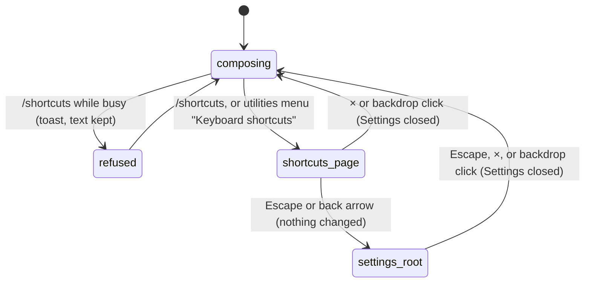

# Keyboard shortcuts

## Summary

Pi for Excel can be driven almost entirely from the keyboard: sending, steering and following up, stopping, restoring queued messages, cycling the thinking level, opening, closing, reopening and switching tabs, the command menu, and returning focus to the composer. This document has two parts. The first describes the **Keyboard shortcuts** page, the in-product reference opened with `/shortcuts`, from the utilities menu's "Keyboard shortcuts" item, or from Settings → "Keyboard shortcuts". The second is the **index** of every shortcut the product actually handles, with where it works, what blocks it, and the document that owns its behaviour. Behaviour is described in the owning documents; this index only points to them (see the README's scope decision on shortcuts). The page is available while the tab is busy only from the utilities menu or Settings: `/shortcuts` is refused while busy. It needs no provider and works on every host, though some shortcuts collide with the browser on Excel on the web.

## The simple case

The user types `/shortcuts` and presses Enter, or opens the utilities menu (the gear) and chooses "Keyboard shortcuts". The Settings overlay opens directly on a page titled "Keyboard shortcuts" with the subtitle "Quick reference for chat, tab, navigation, and system shortcuts.", and a back arrow to the Settings root.

The page lists four groups, "Chat", "Tabs", "Navigation" and "System", each a list of key labels and descriptions. Keys are shown in macOS notation (⌘ ⌥ ⇧) when the taskpane runs on a Mac, and as "Ctrl+…", "Alt+…", "Shift+…" otherwise. The page is read-only.

The user presses Escape once to go back to the Settings root and again to close Settings, or clicks × to close at once. They land back in the tab they came from.

## The interaction, event by event

### Opening the page

`/shortcuts` and the utilities-menu item both open Settings at the shortcuts page; Settings → "Keyboard shortcuts" navigates there from the root. If Settings is already open, `/shortcuts` moves it to the shortcuts page. Which notation is shown is decided when the page renders, from the browser's platform: Excel on the web on a Mac shows Mac symbols.

### Ends at once

While the active tab is busy, `/shortcuts` shows "Can't run /shortcuts while Pi is busy" and the typed text stays in the composer. The utilities menu item works while busy. Nothing is recorded either way.

### Committed, while busy, finishes

There is nothing to commit. The page is a static list; opening it changes no setting and does not touch the session or the workbook. A turn running in the tab continues behind the overlay. Closing the page returns to the Settings root (Escape or back) or closes Settings (× or the backdrop).

### What the page lists

Quoted exactly, Windows label first, Mac label second where they differ.

| Group | Keys | Description |
| --- | --- | --- |
| Chat | Enter | "Send message" |
| Chat | "Enter (while streaming)" | "Interrupt and redirect" |
| Chat | Alt+Enter / ⌥ Enter | "Queue follow-up message" |
| Chat | Alt+↑ / ⌥ ↑ | "Restore queued message" |
| Chat | Shift+Tab / ⇧ Tab | "Cycle thinking depth" |
| Tabs | Ctrl+T / ⌘ T | "New tab" |
| Tabs | Ctrl+W / ⌘ W | "Close tab" |
| Tabs | Ctrl+Shift+T / ⌘ ⇧ T | "Reopen closed tab" |
| Tabs | ← → | "Switch tabs (exit input first)" |
| Tabs | Ctrl+PgUp / PgDn / ⌘ ⇧ [  /  ⌘ ⇧ ] | "Previous / next tab" |
| Navigation | / | "Open command menu" |
| Navigation | ↑ ↓ | "Navigate menu items" |
| Navigation | F2 | "Focus chat input" |
| Navigation | F6 | "Toggle focus: worksheet ↔ sidebar" |
| Navigation | Shift+F6 / ⇧ F6 | "Toggle focus (reverse)" |
| System | Esc | "Dismiss popup / Stop generation / Exit input" |

## The index

Every shortcut the product handles, in the taskpane only (keys pressed while focus is in Excel's grid never reach Pi). "Text field" is as defined in the [glossary](../glossary.md#input). "Anywhere" means anywhere in the taskpane, including inside overlays, unless a guard says otherwise.

### Composer and turn

| Keys | What it does | Where and guards | Owner |
| --- | --- | --- | --- |
| Enter | Idle: sends. Responding: steers. Busy but not responding: queues. Text starting with `/`: runs the command instead. | Focus in the composer. Empty text does nothing. | [the composer](../turn/the-composer.md), [turns](../foundations/turns.md) |
| Shift+Enter | Inserts a line break. | Composer. | [the composer](../turn/the-composer.md) |
| Alt/Option+Enter | Responding: follow-up. Idle: sends like Enter. | Composer. | [steering and the queue](../turn/steering-and-the-queue.md) |
| Alt/Option+Up | Restore queued: moves waiting steers, follow-ups and queued prompts into the composer. Toasts "Restored {count} queued message(s) to editor" or "No queued messages to restore". Also accepted as Alt/Option+PageUp, which some webviews send instead. | In the composer, or anywhere focus is not in another text field. Ignored on key repeat. | [steering and the queue](../turn/steering-and-the-queue.md) |
| Escape | Responding: stops and restores waiting items to the composer. Idle with focus in the composer: moves focus to the tab strip. | Only when no menu, popover or overlay claims Escape; see [Escape](#escape). | [stopping](../turn/stopping.md) |
| Shift+Tab | Cycles the active tab's thinking level; toast "Thinking: {level} (next turn)". | Anywhere, including text fields and overlays, whenever a tab exists. With the command menu open it completes the command instead. | [thinking](../turn/thinking.md) |
| Ctrl/Cmd+O | Shows or hides tool-card bodies and thinking blocks in the transcript; toast "Details hidden (⌃O)" or "Details shown (⌃O)". | Anywhere. Lower-case o only, so Shift is not allowed. | [tool calls](../turn/tool-calls.md) |
| F2 | Puts focus in the composer with the caret at the end. | Anywhere, with no modifier, even with an overlay open. | [the composer](../turn/the-composer.md) |

### Tabs

| Keys | What it does | Where and guards | Owner |
| --- | --- | --- | --- |
| Ctrl/Cmd+T | Opens a new tab. | Anywhere, including text fields. | [tabs](../sessions/tabs.md) |
| Ctrl/Cmd+W | Closes the active tab, with the usual refusals and confirmation. | Anywhere, including text fields. | [tabs](../sessions/tabs.md) |
| Ctrl/Cmd+Shift+T | Reopens the most recently closed tab. | Anywhere. | [reopening closed tabs](../sessions/reopening-closed-tabs.md) |
| Ctrl/Cmd+Z | Reopens the most recently closed tab. | Only if a closed tab is available, and either the "Closed {title} · Undo" toast is showing, or focus is not in a text field, or the text field is empty. In a text field with text and no undo toast it is ordinary text undo. | [reopening closed tabs](../sessions/reopening-closed-tabs.md) |
| ← / → | Switches to the previous or next tab, wrapping around. | Not in a text field; ignored on key repeat. When a tab itself has focus, the tab strip handles the arrows the same way. | [tabs](../sessions/tabs.md) |
| Ctrl+PageUp / Ctrl+PageDown | Previous or next tab. Ctrl, not Cmd, on every platform. | Not in a text field. | [tabs](../sessions/tabs.md) |
| Cmd+Shift+[ / Cmd+Shift+] | Previous or next tab. macOS only (Cmd). | Not in a text field. | [tabs](../sessions/tabs.md) |
| Enter or Space on a focused tab | Selects it. | Focus on a tab button. There is no keyboard path to the tab context menu or to renaming. | [tabs](../sessions/tabs.md) |

### Menus, pickers and overlays

| Keys | What it does | Where and guards | Owner |
| --- | --- | --- | --- |
| `/` | Typed as the first character of the composer, opens the command menu. | Composer, single line. | [the command menu](../commands/the-command-menu.md) |
| ↑ / ↓ | Moves the command-menu highlight. | While the command menu is visible, anywhere. No modifiers. | [the command menu](../commands/the-command-menu.md) |
| Enter | Runs the highlighted command, with no arguments. | While the command menu is visible, anywhere; Shift and Alt are ignored. | [the command menu](../commands/the-command-menu.md) |
| Tab | Fills the composer with the highlighted command name. | While the command menu is visible. | [the command menu](../commands/the-command-menu.md) |
| ↑ / ↓, Enter, typing | Moves through, chooses, filters models. | Model picker. | [the model picker](../setup/the-model-picker.md) |
| Enter | Confirms a text-input dialog. | Its input field. | [the taskpane](../foundations/the-taskpane.md) |

### Escape

Escape goes to the first of these that applies, in this order:

1. An open status popover closes. See [the status bar](the-status-bar.md).
2. The command menu, if visible, closes.
3. With the tab idle and focus in the composer, focus moves out to the tab strip.
4. With the tab responding, Pi stops, unless a surface that claims Escape is open: the utilities menu, the command menu, the model picker, Settings, the API-key dialogs, the welcome overlay, or an extension widget. The established list is in [turns](../foundations/turns.md#stop).
5. An open overlay handles it: if focus is in a text field inside the overlay, the first Escape only leaves the field and the second closes the overlay. In Settings, Escape goes back one page and closes at the root.
6. The utilities menu or the tab context menu, if open, closes.

## Mismatches between the page and the code

- **F6 and Shift+F6** ("Toggle focus: worksheet ↔ sidebar", "Toggle focus (reverse)") are not handled by Pi at all. Excel desktop on Windows has its own F6 pane cycling that may produce this effect; in a browser F6 usually moves to the address bar. The page presents them as Pi shortcuts.
- **Ctrl+P** appears only in the menu description of `/default-models`, "Switch models with Ctrl+P". No such shortcut exists; in Excel on the web Ctrl+P prints.
- **Ctrl/Cmd+Z** (reopen closed tab) and **Ctrl/Cmd+O** (show or hide details) work but are not on the page.
- **Tab** in the command menu, **Shift+Enter**, **Enter in the command menu**, **Alt/Option+PageUp**, **Ctrl+PageUp/PageDown on a Mac** and **arrow keys on a focused tab** work but are not listed.
- **"Interrupt and redirect"** for Enter while streaming overstates it: a steer does not interrupt anything; it is delivered after the current model response and its tools finish (see [turns](../foundations/turns.md#while-pi-is-busy)).
- **"Restore queued message"** is singular, but every waiting steer, follow-up and queued prompt is restored at once.
- **"← → Switch tabs (exit input first)"** is accurate, but the same text-field guard silently applies to Ctrl+PageUp/PageDown and Cmd+Shift+[ ], which the page does not say.

## Modifiers

| Modifier | Set before | Changed while busy |
| --- | --- | --- |
| Model and provider | No effect on the page. Shift+Tab only offers the model's supported levels. | No effect. |
| Thinking level | No effect on the page. | No effect. |
| Execution mode | No effect. | No effect. |
| Files in the workspace, or an overlay open | The page is itself an overlay. Several shortcuts still act behind any overlay (Shift+Tab, Ctrl/Cmd+T, Ctrl/Cmd+W, F2, the arrows when a non-text control has focus). | Same. |
| Tab state (new, restored, another tab busy) | No effect on the page. Shortcuts act on the active tab. | `/shortcuts` is refused while busy; the menu item is not. |
| Host (desktop or web) | Notation follows the platform. On Excel on the web, the browser may keep Ctrl/Cmd+T, Ctrl/Cmd+W and Ctrl/Cmd+Shift+T for itself. | No effect. |

## Cancel and interrupt

| Event | Before sent | While busy |
| --- | --- | --- |
| Stop (button or Escape) | Escape on the page goes back to the Settings root. | A turn running in the tab is not stopped by Escape while Settings is open; Settings claims it. |
| The user sends something else | The overlay holds focus; nothing can be sent until it closes. | Same. |
| Tab switched, created, closed or reopened | Ctrl/Cmd+T and Ctrl/Cmd+W act on the tabs behind the open page. | Same. |
| An overlay or menu opens | Opening another Settings page replaces the shortcuts page. | Same. |
| Model or thinking level changes | Shift+Tab changes the level behind the page. | Same. |
| The provider fails | No effect. | No effect. |
| The taskpane goes away | Nothing to lose. | Same. |
| The workbook changes underneath | No effect. | No effect. |
| Focus moves to the grid or another window | The page stays open. Shortcuts stop working until focus returns to the taskpane. | Same. |
| The context window fills | No effect. | No effect. |

After closing the page the user is back in the same tab with the composer as it was.

## Interactions with other systems

**Persistence.** None. Shortcuts cannot be customised and nothing about them is saved.

**Workbook changes and recovery.** None. No shortcut changes the workbook directly.

**Other tabs and sessions.** Shortcuts act on the active tab; tab shortcuts change which tab is active.

**Execution mode and approvals.** There is no shortcut for the execution mode.

**Models and providers.** There is no shortcut for the model picker, despite "Switch models with Ctrl+P".

**Offline and provider errors.** None.

**Notifications.** The shortcuts' own toasts are listed in the index.

**Settings and preferences.** The page lives in Settings and has no options.

**Host differences.** Keys pressed in Excel's grid go to Excel, not Pi. Chrome and Edge reserve Ctrl/Cmd+T, Ctrl/Cmd+W and Ctrl/Cmd+Shift+T, so on Excel on the web these probably open, close or reopen browser tabs instead (Ctrl/Cmd+W closing the browser tab with Excel in it); not confirmed. Desktop webviews may swallow plain arrow keys, which is why the fallback chords exist.

**Language.** Group titles, descriptions and the "Enter (while streaming)" label are translated; key names are not. The Ctrl/Cmd+O toasts are hard-coded English.

**Accessibility and keyboard.** Shift+Tab never moves focus backwards anywhere in the taskpane, including in Settings and dialogs, because it is taken for the thinking level. Keyboard-only users must move forwards with Tab. The page itself is plain text with `kbd` key labels.

## Edge cases

- Ctrl/Cmd+W in the composer closes the tab, not just the text, because tab shortcuts have no text-field guard.
- Ctrl/Cmd+Z right after closing a tab reopens it even while typing in a non-empty field, as long as the undo toast is visible; the user's text undo is lost for that keystroke.
- With focus on a toggle or button inside an overlay, ← and → switch tabs behind it.
- F2 with an overlay open moves focus into the composer behind the overlay's backdrop.
- Holding an arrow key or Alt/Option+Up does not repeat the action.
- Ctrl/Cmd+O is a single taskpane-wide toggle, not per tab, and resets on reload.

## Open questions and verification

- F6 and Shift+F6 are listed on the page (`src/commands/builtins/settings-pages/shortcuts-page.ts:74`, `:75`) but not implemented anywhere in Pi. Whether the host provides them has not been checked. Treat as a documentation bug on the page.
- `/default-models` advertises Ctrl+P (`src/language/locales/en.json:45`), which is not implemented.
- Shift+Tab is captured everywhere for the thinking level (`src/taskpane/keyboard-shortcuts.ts:379`), which breaks reverse focus navigation across the whole taskpane. Looks like an accessibility bug.
- Ctrl/Cmd+O toasts are hard-coded English and use ⌃ even on macOS, where Cmd also works (`src/taskpane/keyboard-shortcuts.ts:400`).
- The code's Escape guard treats every overlay built on the shared overlay dialog as claiming Escape (`src/utils/escape-guard.ts:9` matches `.pi-welcome-overlay[data-claims-escape='true']`, the class and attribute `src/ui/overlay-dialog.ts:192` and `:234` give every such overlay). That suggests the resume picker, Backups, confirm and text-input dialogs also claim Escape, which conflicts with the established statement that generic overlay dialogs do not. Needs a check by hand before either document is changed.
- Browser-reserved shortcuts on Excel on the web (Ctrl/Cmd+T, W, Shift+T) have not been tried.
- Keyboard behaviour in desktop Excel on Windows and macOS has not been checked by hand.

Verified against pi-for-excel commit `ec453df`.
