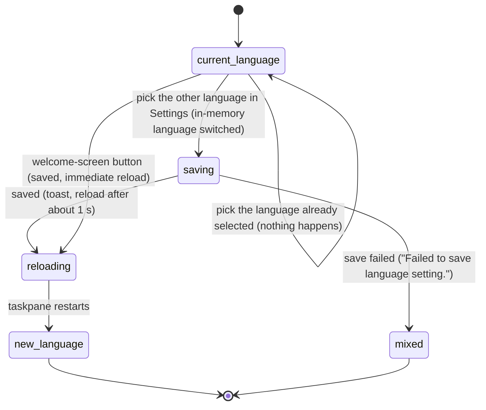

# Language and theme

## Summary

The UI language decides which language the taskpane's own words are shown in: labels, buttons, tooltips, toasts, placeholders, the command menu's descriptions and the Settings pages. Pi for Excel offers English, the default, and Simplified Chinese, which is labelled "中文（简体）· AI 翻译" because the translation was generated by AI. The language is chosen in Settings, in the "Behavior" group's "Language / 语言" row, or on the first-run welcome screen with the "English" and "中文" buttons. Changing it reloads the taskpane. It never changes what Pi is told or how the model answers: the instructions, tool descriptions and workbook context sent to the model are always English, and the model is not told which UI language is selected. The theme is light. A dark theme exists only as the experimental feature "Dark mode", off by default; when turned on it follows Office's theme where Office reports one and the operating system's otherwise. Both work with no provider connected and on every host; the language can be changed while a tab is busy, at the cost of the reload.

## The simple case

The user opens Settings (gear → "Settings", or `/settings`). In the "Behavior" group, the "Language / 语言" row shows a drop-down set to "English". The user picks "中文（简体）· AI 翻译". A toast appears, already in Chinese (the translation of "Language changed. Reloading..."), and about a second later the taskpane reloads.

The taskpane comes back in Chinese: the header menu, composer placeholders, status bar, Settings and toasts. The tabs, their transcripts and the workbook are restored the way any reload restores them (see [persistence and restore](../cross-cutting/persistence-and-restore.md)). Pi's answers are in whatever language the user writes to it in; the setting does not change that.

The theme needs no action: the taskpane is light, whatever Office or the operating system uses.

## The interaction, event by event

### Choosing a language

The Settings row is a drop-down with two entries, "English" and "中文（简体）· AI 翻译". Its label "Language / 语言" is bilingual so it can be found in either language. On the welcome screen shown before any provider is connected (see [welcome and login](../setup/welcome-and-login.md)), a small bar at the top right holds "English" and "中文"; the current one is outlined in the accent colour.

The choice is one setting for the add-in on this computer and browser profile, not per workbook or per tab.

### Ends at once

Choosing the language already in use does nothing on the welcome screen. In Settings the drop-down does not fire for an unchanged value. Nothing is recorded.

### Saving and the reload

Choosing the other language in Settings does three things in order: the taskpane's language is switched in memory at once, the setting is saved, and then the toast "Language changed. Reloading..." is shown, in the new language, and the taskpane reloads one second later. Confirmed in Excel on the web both ways: switching to Chinese showed "语言已更改，正在重新加载…" and the page unloaded 1.03 s after the pick; switching back showed "Language changed. Reloading...". On the welcome screen the setting is saved and the taskpane reloads immediately, with no toast.

The reload is a full restart of the taskpane, the same as closing and reopening it. Nothing asks for confirmation, even when a tab is responding. Everything a reload loses is lost (confirmed in Excel on the web for a composer draft, and for three tabs that came back numbered 1 to 3 as "对话 1"…"对话 3"): a turn in progress ends without a record of its ending, composer drafts and queued messages are discarded, a new session that Pi has not answered yet is not kept, and chosen tab titles fall back to "Chat N". See [persistence and restore](../cross-cutting/persistence-and-restore.md) and [renaming a tab](../sessions/renaming-a-tab.md).

### While the change applies

There is no busy phase beyond the one-second toast. Text already on screen does not change before the reload; only text drawn in that second (the toast itself) uses the new language.

### After the reload

The taskpane reads the setting at startup, before anything is drawn, and draws everything in that language. A stored value it does not recognise, or a storage error, means English.

If saving fails, the toast "Failed to save language setting." appears in the new language and no reload happens. The in-memory switch is not undone, so the taskpane is left mixed: what is already drawn stays in the old language, anything drawn from now on (new toasts, newly opened overlays) uses the new one, and the next reload returns to the old language. See [Open questions](#open-questions-and-verification).

## What is and is not translated

**Translated:** every UI string that goes through the product's translation layer, which is nearly all of the taskpane's chrome: the header and utilities menu, the tab strip and its context menu, the empty state and starter hints, the composer placeholders, the working indicator and queue strip, the status bar and its popovers, the command menu's descriptions, Settings and its pages, the resume picker, the Backups dialog, the Files workspace, confirm dialogs, most toasts and banners, and the humanized labels in tool cards ("Range", "Cell").

**Never translated, by design:** anything the model reads. The system prompt, tool names and descriptions, auto-context about the workbook, and compaction instructions stay English so the conversation's fixed prefix is identical in both languages and prompt caching keeps working. Command names (`/model`), key names, model names and provider names are also not translated. The model's answers are not translated; the model chooses its language from the conversation.

**Not translated, but probably should be:** strings written directly in English in the code. Confirmed in the Chinese UI on Excel on the web: the Ctrl/Cmd+O toasts, and `/yolo status`, which mixes the two ("自动 mode — Pi applies workbook changes immediately."). Seen while drafting: the "Rename tab" prompt title, the Ctrl/Cmd+O toasts "Details hidden (⌃O)" and "Details shown (⌃O)", the `/yolo` toasts ("Usage: /yolo [on|off|toggle|status]", "Confirm mode — Pi asks before each workbook change."), the status bar's lock badge and its tooltips, several tool-card labels ("Copy CSV", "Input", "Result", "Data", "✓ Done"), the context-overflow and CORS banners and "API key required for {provider}.", the command menu's accessible name "Slash commands", and every string supplied by an extension (such as "/snake" and "Play Snake! 🐍"). The Chinese locale has the same set of entries as English; a missing translation would fall back to English.

## The theme

By default the taskpane is always light. It does not follow Office's dark theme or the operating system's dark mode.

Turning on the experimental feature "Dark mode" ("Enable Office/theme-driven dark mode for the task pane UI.") with `/experimental` (see [experimental](../extensions/experimental.md)) switches the taskpane at once, without a reload, to whichever theme it can detect:

1. Office's theme, if Office reports one: its dark-theme flag, or else whether Office's background (or failing that, foreground) colour is dark.
2. Otherwise, the operating system's or browser's light/dark preference.

While the feature is on, the theme is re-checked when Office finishes loading and whenever the operating system's preference changes. It is not re-checked when the user changes Office's own theme while the taskpane is open, so the taskpane may stay in the old theme until the next reload or the next operating-system change. Turning the feature off returns to light immediately. The feature is stored in the browser's local storage for the add-in, so it applies to every workbook on this computer and browser profile.

## Modifiers

| Modifier | Set before | Changed while busy |
| --- | --- | --- |
| Model and provider | No effect. The model is never told the UI language. | No effect. |
| Thinking level | No effect. | No effect. |
| Execution mode | No effect. | No effect. |
| Files in the workspace, or an overlay open | No effect from files. The language row is inside the Settings overlay. | No effect. |
| Tab state (new, restored, another tab busy) | Tab labels "Chat N" are translated. Tabs are restored after the reload as any reload restores them. | A language change reloads the taskpane and ends running turns in every tab without asking. |
| Host (desktop or web) | No difference in language. The theme depends on whether the host reports an Office theme. | No effect. |

Changing the theme feature while a turn runs only recolours the taskpane.

## Cancel and interrupt

| Event | Before sent | While busy |
| --- | --- | --- |
| Stop (button or Escape) | Escape in Settings goes back or closes; the drop-down value does not change until a language is picked. | Once picked, the reload cannot be cancelled. |
| The user sends something else | Not possible while Settings holds focus. | A message sent in the second before the reload is lost with it. |
| Tab switched, created, closed or reopened | No effect. | Lost in the reload unless already saved. |
| An overlay or menu opens | No effect. | The reload closes every overlay. |
| Model or thinking level changes | No effect. | A thinking-level change not yet saved with its session is lost in the reload. |
| The provider fails | No effect. | A turn in progress ends with the reload, not with a provider error. |
| The taskpane goes away | Closing the taskpane before picking changes nothing. | If the setting was saved, the next open uses the new language. |
| The workbook changes underneath | No effect. | Workbook changes Pi already made stay made; a mutation in flight may or may not complete. |
| Focus moves to the grid or another window | No effect. | The reload happens anyway. |
| The context window fills | No effect. | No effect. |

## Interactions with other systems

**Persistence.** The language is a saved setting read once at startup. The theme feature flag is saved in local storage. Neither is part of a session. See [persistence and restore](../cross-cutting/persistence-and-restore.md).

**Workbook changes and recovery.** None, except that the reload behaves like any reload for a turn in progress.

**Other tabs and sessions.** Both settings apply to all tabs. Saved sessions are not translated; a session's messages keep the language they were written in.

**Execution mode and approvals.** None.

**Models and providers.** None. Prompt caching is unaffected by the UI language because nothing sent to the model depends on it.

**Offline and provider errors.** None.

**Notifications.** "Language changed. Reloading..." and "Failed to save language setting.".

**Settings and preferences.** The language row sits in Settings → "Behavior" with the "Auto" execution toggle and the fork-on-model-switch toggle; see [settings](../setup/settings.md). There is no theme setting outside `/experimental`.

**Host differences.** None for the language. For the theme, Office reports its theme on Excel desktop (confirmed in Excel for Mac: with Office dark, turning the flag on made the taskpane dark at once, and turning it off made it light); whether Excel on the web reports one has not been confirmed, and in the standalone taskpane only the operating-system preference applies.

**Language.** This document's subject.

**Accessibility and keyboard.** The language drop-down is a native select, usable with the keyboard. With dark mode off, users who rely on the operating system's dark mode get a light taskpane. A few elements use fixed colours that ignore the theme: the Snake widget's white panel and the welcome screen's language buttons.

## Edge cases

- The confirmation toast after a language change is shown in the newly chosen language, not the one the user was reading.
- Picking a language on the welcome screen reloads at once, losing whatever was typed into an API-key field there.
- Switching language twice quickly: the second pick happens in a taskpane that is about to reload; whichever save lands last wins.
- A session written in English stays English after switching to Chinese: only the chrome around it changes.
- With dark mode on and no Office theme reported, the taskpane follows the operating system even inside Excel.

## Open questions and verification

- A language change reloads the taskpane with no confirmation, ending running turns and discarding drafts (`src/commands/builtins/settings-pages/root-page.ts:205`). Confirmed in Excel on the web: switching language while a tab was responding reloaded at once with no confirm; after the reload the user message was there and the streaming answer was gone. Probably worth a confirm when any tab is busy or has a draft.
- When saving fails, the in-memory language has already been switched (`src/commands/builtins/settings-pages/root-page.ts:199`), leaving a mixed-language taskpane until the next reload. Confirmed in Excel on the web with the storage write made to fail: the error toast "保存语言设置失败。" was already in Chinese, there was no reload, the Settings page turned Chinese while the tabs and status bar stayed English. Looks like a bug; the switch should follow a successful save.
- Welcome-screen language buttons reload at once with no toast: confirmed in Excel on the web with a production build and empty storage, where "中文" reloaded straight into Chinese.
- Welcome-screen language buttons ignore save failures silently (`src/taskpane/welcome-login.ts:197`–`:217`) and use hard-coded colours.
- Dark mode does not react to Office theme changes while the taskpane is open; only operating-system changes and Office readiness re-check it (`src/ui/theme-mode.ts:164`–`:185`). Not confirmed by hand.
- Dark mode on Excel on the web: with the `/experimental` flag on ("Dark mode: enabled") and the operating system emulated as dark, the taskpane stayed light, because Office on the web reports a white body background in its theme and that wins over the system preference. Confirmed in Excel on the web.
- `src/taskpane.html` hard-codes `lang="zh-CN"` on the root element, so the page declares Chinese even when the UI is English. Seen in Excel on the web; may affect screen-reader pronunciation and fonts. Minor.
- The list of hard-coded English strings above was collected while drafting other documents and is not exhaustive.
- Confirmed in Excel on the web (2026-10-26): the Settings row and its two entries, the toast in the new language, the reload about 1 s later, the draft lost, tabs renumbered, the Chinese chrome (tabs, hints, placeholder, status bar, utilities menu), and the English Ctrl/Cmd+O and `/yolo status` toasts. Not tried: the welcome-screen buttons, a save failure, a language change while responding, dark mode.

Verified against pi-for-excel commit `ec453df`.
