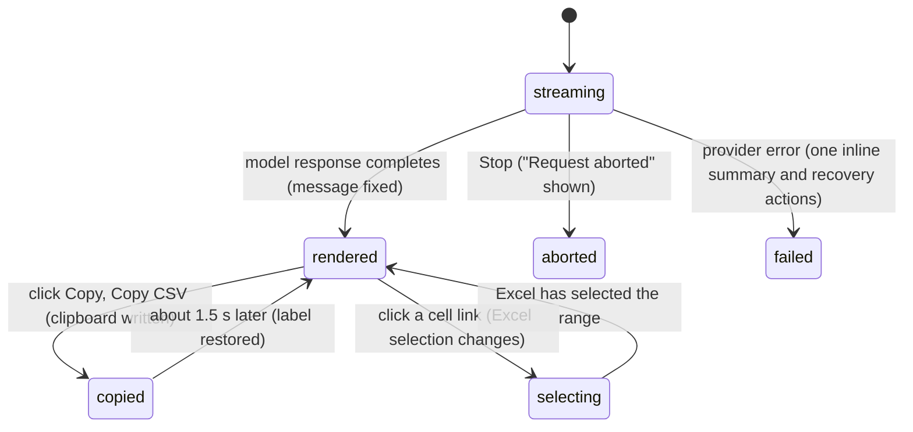

# Message rendering

**Behavior update:** CC-04 and CC-05 shipped in [PR #802](https://github.com/tmustier/pi-for-excel/pull/802). Answer references and answer/table/code copy below describe the merged behavior.

Failure rendering revised for CC-01 / CC-02 in [PR #803](https://github.com/tmustier/pi-for-excel/pull/803): one inline summary with Retry, a fix action and collapsed diagnostic Details; no separate run-error banner. Retried partial text stays as an interrupted response.

## Summary

Message rendering turns conversations into user cards, formatted answers, tool grids and dependency trees. Completed answers offer Copy answer and Copy table; qualified references in answer prose and cell addresses in tool cards select cells in Excel. Raw HTML stays literal, images are never loaded, and ordinary links retain their protocol allowlist. This document owns appearance and answer actions. Streaming belongs to [sending and the response](../turn/sending-and-the-response.md), tool cards to [tool calls](../turn/tool-calls.md), reasoning to [thinking](../turn/thinking.md), and summaries to [context and compaction](../turn/context-and-compaction.md). Restored sessions render offline; workbook navigation needs Excel.

## The simple case

The user sends "Summarize Sheet1 and give me the formula for the total". Their message appears at the bottom of the transcript in a white card on the right. Pi's answer appears on the left, without a card: a heading, a short bulleted list with some words in bold, a small markdown table that scrolls sideways if it is too wide, and a code block labelled "text" holding `=SUM(B2:B20)`, with a "Copy" button in its bar.

Above the text, the tool card "Read Sheet1!A1:D20" shows its range as a blue link. The user expands the card: its body shows the data as a grid with column letters and row numbers and a "Copy CSV" button. Clicking the blue range link makes Excel switch to Sheet1 and select A1:D20.

The user clicks "Copy" on the code block. The label changes to "Copied!" with a check mark for about a second and a half, and the formula is on the clipboard.

## The interaction, event by event

### What decides the rendering

Each message is rendered by its role:

- **User messages** sit right-aligned in a white card. Their text is rendered as markdown too, so `**bold**` typed by the user shows bold and a line starting with `-` becomes a list item.
- **Assistant messages** sit left-aligned with no card. Their parts appear in the order the model produced them: text (as markdown), [thinking blocks](../turn/thinking.md), and [tool cards](../turn/tool-calls.md). Text parts that are empty or only spaces are skipped. No token count or cost row is shown under a message; the [context meter](the-status-bar.md#the-context-meter) is the only usage readout.
- **Tool results** are not shown as messages of their own; each appears inside the tool card of the call it answers.
- **Compaction summaries** appear as a collapsed card "Summarized {extent}" with a "Summary" section; **archived history** as a collapsed card "Show earlier messages" with "{n} chat messages", opening on "Archived history (UI only)". See [context and compaction](../turn/context-and-compaction.md).

### Ends at once: what is not rendered

These are deliberate safety rules and apply to every markdown surface (user messages, Pi's text, thinking blocks, tool output rendered as markdown, compaction summaries):

- **Raw HTML** is shown as literal text. `<b>bold</b>` appears with its angle brackets. Text inside backticks or code fences is left alone.
- **Images** are never loaded. `` becomes a link labelled "image: logo" that opens the URL in a new window, or plain text "image: logo" if the URL is not an allowed link.
- **Links** are clickable only for `http`, `https`, `mailto` and `tel`. Anything else (`javascript:`, `data:`, `file:`) is shown as its link text, not as a link. Allowed links open in a new window, without giving the opened page access to the taskpane.
- **Math** is not typeset. `$5 and $6` stays as written, which is why: dollar signs are currency in spreadsheets.

Confirmed in the UI gallery for all four, and in Excel on the web in a live user message and Pi's answer: `<b>raw</b>` showed its brackets, `$5 and $6` stayed as written, an image became a link "image: logo", a `javascript:` link showed only its text, and an `https` link opened in a new window with `noopener noreferrer`.

### Markdown

Text follows GitHub-style markdown: headings, emphasis, strikethrough, ordered and unordered lists, block quotes, horizontal rules, inline code, fenced code and tables. A single line break inside a paragraph is not kept: two lines without a blank line between them run together into one paragraph. This applies to user messages as well, so a message written over several lines with Shift+Enter shows as one paragraph unless the lines are separated by blank lines or are list items. Confirmed in Excel on the web: a user message with "line one" and "line two" on separate lines showed "line one line two".

Tables are wrapped in a horizontally scrolling box so a wide table does not widen the taskpane. They are ordinary HTML tables, not the Excel-style grid below. Each table in a completed assistant answer has a "Copy table" button. It copies headers and rows as tab-separated text, with one line per row, so Excel pastes them into cells. Formatting is not copied; line breaks within a cell become spaces.

Each completed assistant response containing text also has "Copy answer", shown on hover or keyboard focus (always visible where hover is unavailable). It copies the rendered answer text, with tables as tab-separated text, without thinking blocks, tool cards or action labels. These actions remain available on earlier answers while another response streams. They appear on a streaming response only after it completes.

### Code blocks

A fenced code block becomes a code card: a bar with the language label and a "Copy" button (tooltip "Copy"), and the code below it in a monospace box that scrolls sideways. A fence without a language is labelled "text". JavaScript, TypeScript, Python, HTML, XML, CSS, JSON, Bash and SQL are syntax-highlighted by name; for any other label, or none, the highlighter guesses among those languages.

Clicking "Copy" writes the code exactly as written to the clipboard. Answer, table and code copy share one path: clipboard API, then the older browser copy method, then a dialog with the text selected and instructions to press Ctrl/Cmd+C. "Copied!" is shown only when a browser copy method reports success; opening the manual-copy dialog is not reported as success. Code shows its check mark for 1.5 seconds; answer and table copy show a confirmation toast. If the user closes the manual dialog without copying, nothing was copied.

A fence whose language label contains anything but letters, digits and underscores (`c++`, `objective-c`, `f#`) does not get a code card: it is shown as a plain preformatted block with no bar and no Copy button. Confirmed in the UI gallery and in Excel on the web (a `c++` fence in a user message and in Pi's answer).

### Copyable commands

Setup cards that ask the user to run a command (the bridge setup cards, see [experimental](../extensions/experimental.md)) show the command in a row with a copy icon, titled "Copy command" and then "Copied" for 1.4 seconds. If the clipboard is unavailable, clicking selects the command text so the user can copy it by hand.

### Data grids from reads

When Pi reads a range in CSV mode (the card title reads "Export {range} (CSV)"), the tool card's body shows a "Data" section with an Excel-style grid: column letters along the top starting at the range's first column, row numbers down the side starting at its first row, numbers and Excel errors styled distinctly, and empty cells blank. A "Copy CSV" button above it copies the CSV text Pi received; its label becomes "Copied!" for 1.5 seconds. A read with no values shows "(empty)". The grid is only how the card looks; Pi itself received plain CSV. Pi's default read (compact mode) has no grid: its result is shown as markdown, with a table headed by the column letters and row numbers, followed by "Formulas" and "⚠️ Errors" lines where present, and no "Copy CSV" button. Confirmed in Excel on the web: a default read of Data2!C5:E9 showed a markdown table with no "Copy CSV"; a CSV-mode read of Sheet1!B1:D3 showed the grid with columns B–D, rows 1–3 and "Copy CSV" (the grid appears only for `details.kind === "read_range_csv"`, `src/ui/tool-renderers.ts:1105`).

### Dependency trees

When Pi traces precedents or dependents of a cell, the tool card shows "Precedents" or "Dependents" with a tree. Each node shows the cell's value formatted with its Excel number format (percentages, currency, thousands separators, negatives in parentheses), its address as a cell link, the number of children ("3 precedents", "1 dependent"), and its formula in monospace. Children on the same sheet as their parent show only the cell part ("G44"); cross-sheet children show the full address. The root and the first level of branches are open; deeper branches are collapsed and open with a click.

### Other tool output

The rest of a tool card's result is rendered by what it looks like: JSON as a highlighted code card, text that looks like markdown as markdown (with any leading YAML front-matter block removed and colour codes shown as names), anything else as plain text. A mutation whose result only echoes what was done shows "✓ Done". A result with no text shows "(no output)".

### Cell links

Cell and range addresses inside tool cards are blue links: in card titles, in the humanized input ("Range", "Cell", "Start", "Source", "Position"), in before/after change tables, and in dependency trees. A list of several ranges becomes one link per range, with a shared sheet name shown once and "+N more" (not a link) after the first eight in places that cap the list.

Clicking a link activates its sheet and selects its range with Excel's normal highlight, leaving focus in the taskpane. For a multi-area tool address only the first area is selected. No values change, no backup is made and the tab does not become busy. Clicks within 0.3 seconds are ignored. Navigation failures use the existing error toast; a deleted or renamed sheet no longer fails silently.

Completed assistant prose also links valid sheet-qualified A1 references on sheets that exist in the current workbook: for example Sheet1!B12, 'Q3 Plan'!C4:F9 and absolute references with dollar signs. The link selects the range using the same navigation as a tool card. Sheet names containing apostrophes are supported. Inline code, code fences, ordinary web links, unknown sheets and out-of-grid addresses stay unchanged. Bare B12, Q3 and FY24 stay plain text to avoid guessing whether prose is a cell address. References are resolved after completion, not on every streamed token. If workbook metadata cannot be read, the answer remains readable plain text. A sheet deleted after rendering produces the shared navigation-error toast when clicked.

### Attachments

Pi for Excel cannot attach files to a message; dropped files go to the [Files workspace](../files/the-files-workspace.md). Sessions created elsewhere or by older versions may contain user messages with attachments. These show under the message text as tiles: an image with a preview is shown as a small image, any other file as an icon (a spreadsheet icon for `.xlsx`, `.xls`) with its file name. Tiles cannot be opened. Confirmed in Excel on the web with a stored session edited to carry three attachments: "Budget 2026.xlsx" and "notes.pdf" showed as icon tiles with truncated names, an image with a preview showed as the image, and clicking a tile did nothing.

### Errors and endings

- A final model response that **failed** shows one plain-language inline summary, Retry and a relevant fix action. The original diagnostic is collapsed under Details, not repeated in a separate banner. A partial response preserved for retry keeps its rendered text and interrupted marker; the continuation follows it rather than erasing what the user read. See [provider errors and offline](../cross-cutting/provider-errors-and-offline.md).
- A model response that was **aborted** ends with the label "Request aborted". Tool calls in it that never got a result render as failed cards with no output. Confirmed in Excel on the web: Stop mid-stream kept the partial text and ended it with "Request aborted", with no banner; a request sent offline ended with "Error: Failed to fetch".
- Everything rendered before the ending stays as it was.

## Modifiers

| Modifier | Set before | Changed while busy |
| --- | --- | --- |
| Model and provider | No effect on rendering. | No effect. |
| Thinking level | Decides whether thinking blocks appear; see [thinking](../turn/thinking.md). | No effect on what is already rendered. |
| Execution mode | No effect. | No effect. |
| Files in the workspace, or an overlay open | No effect. An overlay covers the transcript; links and Copy buttons cannot be clicked until it closes. | Same. |
| Tab state (new, restored, another tab busy) | A restored tab renders its history the same way, including cell links, which still point at the addresses Pi used, whatever has changed in the workbook since. | Cell links in a busy tab still work; selecting cells does not interrupt the turn. |
| Host (desktop or web) | Cell links need Excel; in the standalone taskpane they do nothing. Links open in a browser window chosen by the host. | No effect. |

Rendering never changes mid-message because of a variant; Ctrl/Cmd+O only shows or hides tool-card bodies and thinking blocks (see [tool calls](../turn/tool-calls.md)).

## Cancel and interrupt

| Event | Before sent | While busy |
| --- | --- | --- |
| Stop (button or Escape) | Not applicable. | The streaming message keeps what it has and shows "Request aborted". |
| The user sends something else | Not applicable. | A delivered steer or follow-up renders as a new user message. |
| Tab switched, created, closed or reopened | Each tab renders its own transcript; a "Copied!" label is lost on switching. | Switching back shows everything streamed so far. |
| An overlay or menu opens | No effect on rendering. | Same. |
| Model or thinking level changes | No effect. | No effect. |
| The provider fails | Not applicable. | The message ends with the "Error:" line. |
| The taskpane goes away | Nothing to lose; rendering is rebuilt from the saved session. | The streaming message is lost; completed messages render again after reopening. |
| The workbook changes underneath | Grids, trees and change tables show what the tool saw at the time and do not update. Cell links select whatever is at that address now. | Same. |
| Focus moves to the grid or another window | No effect. Clicking a cell link changes Excel's selection but leaves focus on the link in the taskpane (confirmed in Excel on the web). | Same. |
| The context window fills | Compacted messages are replaced by the summary card. | Same. |

## Interactions with other systems

**Persistence.** Nothing about rendering is saved; transcripts are re-rendered from the saved messages. The Ctrl/Cmd+O state is not saved.

**Workbook changes and recovery.** Cell links change Excel's selection only. Pi's [auto-context](../turn/auto-context.md) will report the new selection with the next message.

**Other tabs and sessions.** None.

**Execution mode and approvals.** None.

**Models and providers.** None. How a model formats its answer is up to the model.

**Offline and provider errors.** Rendering is local. A link in a message opens only if the network is available.

**Notifications.** Answer and table copy confirm successful browser copying with "Copied!". Code copy uses its button label. Manual fallback opens a selectable-text dialog, not a success toast.

**Settings and preferences.** None. There is no setting for fonts, line breaks or link behaviour.

**Host differences.** Cell links work in Excel desktop and Excel on the web through Excel's own selection. Where an `http` link opens (the system browser, a new browser tab, a host dialog) is decided by the host and has not been confirmed.

**Language.** "Copy", "Copied!", "Error:", "Request aborted" and "(no output)" in the default card are translated. In Excel tool cards, "Copy CSV", "(empty)", "(no output)", "✓ Done", the section labels ("Input", "Result", "Data", "Precedents", "Dependents"), "image: …" and "N precedents" are hard-coded English.

**Accessibility and keyboard.** Cell links and Copy buttons are focusable and activate with Enter. Collapsed dependency-tree branches are native disclosure elements. The streaming text is not announced to screen readers.

## Edge cases

- A relative link (link text pointing at a bare file name such as `notes.md`) is clickable and resolves against the taskpane's own address, so it opens a page on the add-in's server, not a workbook file.
- Code containing `<`, `>` or `&` is copied exactly as the model wrote it, not as escaped HTML.
- A grid's column letters follow the range, so a read of `C5:E9` is headed C, D, E and numbered 5–9.
- Two quick clicks on different cell links within 0.3 seconds: only the first is followed.
- Front-matter stripping applies only to tool output; a user message or answer that starts with a `---` block is rendered as markdown like any other text.

## Open questions and verification

- Single line breaks collapse in user messages because the user's text is rendered as markdown without line-break preservation (`src/ui/messages/messages.ts` renders user text through `markdown-block`). Confirmed in a live user message in Excel on the web. A user's carefully line-broken message looks different from what they typed. May be worth treating as a bug.
- Code fences with a language label containing `+`, `-` or `#` lose their code card and Copy button (`src/ui/messages/markdown-block.ts:120` only matches word characters). Confirmed in the UI gallery and in Excel on the web. Looks like a bug.
- PR #802 shares the existing navigation error path between answer and tool links, including feedback for a sheet deleted after rendering.
- "Copy CSV" and several tool-card labels are hard-coded English (`src/ui/render-csv-table.ts:70`, `src/ui/tool-renderers.ts:1183`), while the equivalent "(no output)" in the default card is translated.
- Where links open on each host has not been checked; on Excel on the web they carry `target="_blank"`, so they would open a browser tab.
- PR #802 routes answer, table and code copying through the same helper. Browser tests exercise refused clipboard methods and verify the manual dialog's exact TSV/code text, without a false success label. On its final stacked head, a real Excel-web turn produced the answer table and a range link; independent Office.js read-back verified B2:C4 and clicking its answer reference selected that range. Copy table followed by real Ctrl+V in the grid pasted the exact three rows and two columns into H12:I14, independently read back through Office.js. Native desktop clipboard paths still need host acceptance.
- Attachment tiles were confirmed in Excel on the web by editing a stored session to carry attachments; no real session with attachments was available.
- The data grid with "Copy CSV" appears only for CSV-mode reads. Pi's default read shows a markdown table instead, so most reads have no "Copy CSV".

Verified against pi-for-excel commit `ec453df`.
