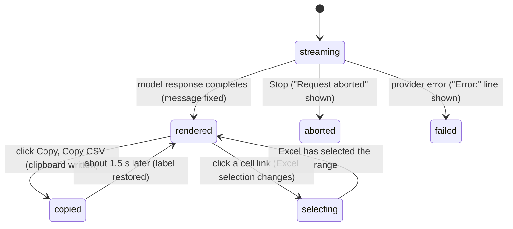

# Message rendering

## Summary

Message rendering is how the transcript turns a conversation into something readable: user messages as right-aligned cards, Pi's answers as formatted text with code blocks and tables, results of workbook reads as Excel-style grids and dependency trees, and cell addresses in tool cards as links that select the cells in Excel. It is also what keeps that rendering safe: raw HTML is never rendered, images are never loaded, and only ordinary web, mail and phone links are clickable. This document owns how a message *looks* once its content exists. When content appears and how it streams is owned by [sending and the response](../turn/sending-and-the-response.md); tool cards as a whole, their headers and grouping, by [tool calls](../turn/tool-calls.md); thinking blocks by [thinking](../turn/thinking.md); compaction summaries by [context and compaction](../turn/context-and-compaction.md). Rendering is the same with or without a provider (restored sessions render offline) and on every host, except that cell links need Excel.

## The simple case

The user sends "Summarize Sheet1 and give me the formula for the total". Their message appears at the bottom of the transcript in a white card on the right. Pi's answer appears on the left, without a card: a heading, a short bulleted list with some words in bold, a small markdown table that scrolls sideways if it is too wide, and a code block labelled "text" holding `=SUM(B2:B20)`, with a "Copy" button in its bar.

Above the text, the tool card "Read Sheet1!A1:D20" shows its range as a blue link. The user expands the card: its body shows the data as a grid with column letters and row numbers and a "Copy CSV" button. Clicking the blue range link makes Excel switch to Sheet1 and select A1:D20.

The user clicks "Copy" on the code block. The label changes to "Copied!" with a check mark for about a second and a half, and the formula is on the clipboard.

## The interaction, event by event

### What decides the rendering

Each message is rendered by its role:

- **User messages** sit right-aligned in a white card. Their text is rendered as markdown too, so `**bold**` typed by the user shows bold and a line starting with `-` becomes a list item.
- **Assistant messages** sit left-aligned with no card. Their parts appear in the order the model produced them: text (as markdown), [thinking blocks](../turn/thinking.md), and [tool cards](../turn/tool-calls.md). Text parts that are empty or only spaces are skipped. No token count or cost row is shown under a message; the [context meter](the-status-bar.md#the-context-meter) is the only usage readout.
- **Tool results** are not shown as messages of their own; each appears inside the tool card of the call it answers.
- **Compaction summaries** appear as a collapsed card "Summarized {extent}" with a "Summary" section; **archived history** as a collapsed card "Show earlier messages" with "{n} chat messages", opening on "Archived history (UI only)". See [context and compaction](../turn/context-and-compaction.md).

### Ends at once: what is not rendered

These are deliberate safety rules and apply to every markdown surface (user messages, Pi's text, thinking blocks, tool output rendered as markdown, compaction summaries):

- **Raw HTML** is shown as literal text. `<b>bold</b>` appears with its angle brackets. Text inside backticks or code fences is left alone.
- **Images** are never loaded. `` becomes a link labelled "image: logo" that opens the URL in a new window, or plain text "image: logo" if the URL is not an allowed link.
- **Links** are clickable only for `http`, `https`, `mailto` and `tel`. Anything else (`javascript:`, `data:`, `file:`) is shown as its link text, not as a link. Allowed links open in a new window, without giving the opened page access to the taskpane.
- **Math** is not typeset. `$5 and $6` stays as written, which is why: dollar signs are currency in spreadsheets.

Confirmed in the UI gallery for all four.

### Markdown

Text follows GitHub-style markdown: headings, emphasis, strikethrough, ordered and unordered lists, block quotes, horizontal rules, inline code, fenced code and tables. A single line break inside a paragraph is not kept: two lines without a blank line between them run together into one paragraph. This applies to user messages as well, so a message written over several lines with Shift+Enter shows as one paragraph unless the lines are separated by blank lines or are list items.

Tables are wrapped in a horizontally scrolling box so a wide table does not widen the taskpane. They are ordinary HTML tables, not the Excel-style grid below.

### Code blocks

A fenced code block becomes a code card: a bar with the language label and a "Copy" button (tooltip "Copy"), and the code below it in a monospace box that scrolls sideways. A fence without a language is labelled "text". JavaScript, TypeScript, Python, HTML, XML, CSS, JSON, Bash and SQL are syntax-highlighted by name; for any other label, or none, the highlighter guesses among those languages.

Clicking "Copy" writes the code exactly as written to the clipboard. The label becomes "Copied!" with a check mark for 1.5 seconds. If the browser refuses the clipboard, Pi tries an older copy method; if that fails too, the label simply does not change and no error is shown.

A fence whose language label contains anything but letters, digits and underscores (`c++`, `objective-c`, `f#`) does not get a code card: it is shown as a plain preformatted block with no bar and no Copy button. Confirmed in the UI gallery.

### Copyable commands

Setup cards that ask the user to run a command (the bridge setup cards, see [experimental](../extensions/experimental.md)) show the command in a row with a copy icon, titled "Copy command" and then "Copied" for 1.4 seconds. If the clipboard is unavailable, clicking selects the command text so the user can copy it by hand.

### Data grids from reads

When Pi reads a range as data, the tool card's body shows a "Data" section with an Excel-style grid: column letters along the top starting at the range's first column, row numbers down the side starting at its first row, numbers and Excel errors styled distinctly, and empty cells blank. A "Copy CSV" button above it copies the CSV text Pi received; its label becomes "Copied!" for 1.5 seconds. A read with no values shows "(empty)". The grid is only how the card looks; Pi itself received plain CSV.

### Dependency trees

When Pi traces precedents or dependents of a cell, the tool card shows "Precedents" or "Dependents" with a tree. Each node shows the cell's value formatted with its Excel number format (percentages, currency, thousands separators, negatives in parentheses), its address as a cell link, the number of children ("3 precedents", "1 dependent"), and its formula in monospace. Children on the same sheet as their parent show only the cell part ("G44"); cross-sheet children show the full address. The root and the first level of branches are open; deeper branches are collapsed and open with a click.

### Other tool output

The rest of a tool card's result is rendered by what it looks like: JSON as a highlighted code card, text that looks like markdown as markdown (with any leading YAML front-matter block removed and colour codes shown as names), anything else as plain text. A mutation whose result only echoes what was done shows "✓ Done". A result with no text shows "(no output)".

### Cell links

Cell and range addresses inside tool cards are blue links: in card titles, in the humanized input ("Range", "Cell", "Start", "Source", "Position"), in before/after change tables, and in dependency trees. A list of several ranges becomes one link per range, with a shared sheet name shown once and "+N more" (not a link) after the first eight in places that cap the list.

Clicking a link makes Excel activate the sheet and select the range, which scrolls it into view with Excel's normal selection highlight. For a multi-area address only the first area is selected. Nothing in the workbook changes: no backup is made, Excel's Undo is unaffected, and the tab does not become busy. Clicks closer together than 0.3 seconds are ignored. If the sheet no longer exists or the address is invalid, nothing happens and nothing is shown.

Addresses in Pi's own text ("see Sheet1!B12") are not links; only tool cards have them.

### Attachments

Pi for Excel cannot attach files to a message; dropped files go to the [Files workspace](../files/the-files-workspace.md). Sessions created elsewhere or by older versions may contain user messages with attachments. These show under the message text as tiles: an image with a preview is shown as a small image, any other file as an icon (a spreadsheet icon for `.xlsx`, `.xls`) with its file name. Tiles cannot be opened.

### Errors and endings

- A model response that **failed** ends with a line "Error:" followed by the provider's reason, inside the assistant message. The [error banner](../glossary.md#the-taskpane) is separate; see [sending and the response](../turn/sending-and-the-response.md).
- A model response that was **aborted** ends with the label "Request aborted". Tool calls in it that never got a result render as failed cards with no output.
- Everything rendered before the ending stays as it was.

## Modifiers

| Modifier | Set before | Changed while busy |
| --- | --- | --- |
| Model and provider | No effect on rendering. | No effect. |
| Thinking level | Decides whether thinking blocks appear; see [thinking](../turn/thinking.md). | No effect on what is already rendered. |
| Execution mode | No effect. | No effect. |
| Files in the workspace, or an overlay open | No effect. An overlay covers the transcript; links and Copy buttons cannot be clicked until it closes. | Same. |
| Tab state (new, restored, another tab busy) | A restored tab renders its history the same way, including cell links, which still point at the addresses Pi used, whatever has changed in the workbook since. | Cell links in a busy tab still work; selecting cells does not interrupt the turn. |
| Host (desktop or web) | Cell links need Excel; in the standalone taskpane they do nothing. Links open in a browser window chosen by the host. | No effect. |

Rendering never changes mid-message because of a variant; Ctrl/Cmd+O only shows or hides tool-card bodies and thinking blocks (see [tool calls](../turn/tool-calls.md)).

## Cancel and interrupt

| Event | Before sent | While busy |
| --- | --- | --- |
| Stop (button or Escape) | Not applicable. | The streaming message keeps what it has and shows "Request aborted". |
| The user sends something else | Not applicable. | A delivered steer or follow-up renders as a new user message. |
| Tab switched, created, closed or reopened | Each tab renders its own transcript; a "Copied!" label is lost on switching. | Switching back shows everything streamed so far. |
| An overlay or menu opens | No effect on rendering. | Same. |
| Model or thinking level changes | No effect. | No effect. |
| The provider fails | Not applicable. | The message ends with the "Error:" line. |
| The taskpane goes away | Nothing to lose; rendering is rebuilt from the saved session. | The streaming message is lost; completed messages render again after reopening. |
| The workbook changes underneath | Grids, trees and change tables show what the tool saw at the time and do not update. Cell links select whatever is at that address now. | Same. |
| Focus moves to the grid or another window | No effect. Clicking a cell link moves focus to Excel's selection. | Same. |
| The context window fills | Compacted messages are replaced by the summary card. | Same. |

## Interactions with other systems

**Persistence.** Nothing about rendering is saved; transcripts are re-rendered from the saved messages. The Ctrl/Cmd+O state is not saved.

**Workbook changes and recovery.** Cell links change Excel's selection only. Pi's [auto-context](../turn/auto-context.md) will report the new selection with the next message.

**Other tabs and sessions.** None.

**Execution mode and approvals.** None.

**Models and providers.** None. How a model formats its answer is up to the model.

**Offline and provider errors.** Rendering is local. A link in a message opens only if the network is available.

**Notifications.** None. Copy feedback is the button label, not a toast.

**Settings and preferences.** None. There is no setting for fonts, line breaks or link behaviour.

**Host differences.** Cell links work in Excel desktop and Excel on the web through Excel's own selection. Where an `http` link opens (the system browser, a new browser tab, a host dialog) is decided by the host and has not been confirmed.

**Language.** "Copy", "Copied!", "Error:", "Request aborted" and "(no output)" in the default card are translated. In Excel tool cards, "Copy CSV", "(empty)", "(no output)", "✓ Done", the section labels ("Input", "Result", "Data", "Precedents", "Dependents"), "image: …" and "N precedents" are hard-coded English.

**Accessibility and keyboard.** Cell links and Copy buttons are focusable and activate with Enter. Collapsed dependency-tree branches are native disclosure elements. The streaming text is not announced to screen readers.

## Edge cases

- A relative link (link text pointing at a bare file name such as `notes.md`) is clickable and resolves against the taskpane's own address, so it opens a page on the add-in's server, not a workbook file.
- Code containing `<`, `>` or `&` is copied exactly as the model wrote it, not as escaped HTML.
- A grid's column letters follow the range, so a read of `C5:E9` is headed C, D, E and numbered 5–9.
- Two quick clicks on different cell links within 0.3 seconds: only the first is followed.
- Front-matter stripping applies only to tool output; a user message or answer that starts with a `---` block is rendered as markdown like any other text.

## Open questions and verification

- Single line breaks collapse in user messages because the user's text is rendered as markdown without line-break preservation (`src/ui/messages/messages.ts` renders user text through `markdown-block`; observed for `markdown-block` in the UI gallery, not yet in a live user bubble). A user's carefully line-broken message looks different from what they typed. May be worth treating as a bug.
- Code fences with a language label containing `+`, `-` or `#` lose their code card and Copy button (`src/ui/messages/markdown-block.ts:120` only matches word characters). Confirmed in the UI gallery. Looks like a bug.
- A cell link that fails (deleted or renamed sheet) does nothing and gives no feedback; the failure is an unhandled promise (`src/ui/cell-link.ts:82`, `:102`). Probably worth a toast.
- "Copy CSV" and several tool-card labels are hard-coded English (`src/ui/render-csv-table.ts:70`, `src/ui/tool-renderers.ts:1183`), while the equivalent "(no output)" in the default card is translated.
- Where links open on each host has not been checked.
- Attachment tiles were read from code only; no session with attachments was available.

Verified against pi-for-excel commit `ec453df`.
