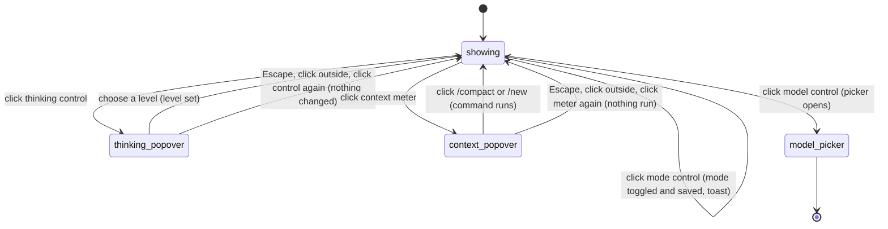

# The status bar

## Summary

The status bar is the row of small controls under the [composer](../turn/the-composer.md) that shows, and lets the user change, the settings that shape the active tab's next turn: which model answers, how hard it thinks, whether Pi asks before changing the workbook, and how full the conversation is. It always reflects the [active tab](../glossary.md#sessions-and-tabs) and changes when the user switches tabs. From left to right it holds the **model control** (the π mark, the model name and a chevron), the **thinking control** (a brain icon and the level, such as "High"), the **context meter** (for example "1% / 500k"), a **lock badge** that appears only while the tab is involved with the [workbook lock](../glossary.md#the-workbook), and, at the right edge, the **execution-mode control** ("Auto" or "Confirm"). Every control is a button with a hover tooltip; the thinking control and the context meter open a small popover. The bar is usable while the tab is busy (only changing the model is refused), works the same on every host, and with no provider connected still shows the tab's model. This document owns the controls themselves; the behaviour behind them is owned by [the model picker](../setup/the-model-picker.md), [thinking](../turn/thinking.md), [context and compaction](../turn/context-and-compaction.md) and [confirm mode and approvals](../workbook/confirm-mode-and-approvals.md).

## The simple case

The user glances at the bar: "π GPT-6.1 Sol", "High", "1% / 500k", and "Auto" on the right. Hovering any of them shows a tooltip saying what it is.

The user clicks "High". A popover titled "Thinking level" opens above it, listing the levels this model supports, each with a hint ("Balanced — solid reasoning"), the current one ticked. The user clicks "Low"; the popover closes and the control now says "Low". The next model request uses it.

The user clicks "Auto". It becomes "Confirm" and a toast says "Confirm mode.". From now on Pi asks before each workbook change, in every tab. Clicking the model name opens the model picker; clicking the context meter opens a popover with "/compact" and "/new". The user is back in the composer's tab, with focus wherever they clicked.

## The interaction, event by event

### The model control

The control shows the active tab's model by its display name (or its id when it has no name), cut off with an ellipsis when the bar is narrow, followed by a chevron. With no model set it says "Select model". Its tooltip is "Switch the AI model for this session."

Clicking it closes any open status popover, refreshes the list of connected providers, and opens the [model picker](../setup/the-model-picker.md) for the active tab. The picker remembers which tab it was opened for: choosing a model applies to that tab even if the user has switched since. While that tab is busy, the picker still opens, but choosing a different model is refused with "Wait for this tab to finish before changing models" (confirmed in Excel on the web: the picker closes, the toast shows, the label is unchanged). The Settings preference to fork on model switch changes what choosing does; see the picker document.

### The thinking control

The control shows the tab's [thinking level](../glossary.md#models-and-providers) by its label: "Off", "Min", "Low", "Medium", "High", "Extra high" or "Max". Its tooltip is "How deeply Pi reasons before answering — higher is slower but more thorough. Click to select, or press ⇧Tab to cycle." Its accessible name is "Thinking level {level}".

Clicking it opens the thinking popover, anchored above the control:

- Title "Thinking level", then the tooltip text as a description.
- One row per level the current model supports, each with its label and hint: "Fastest — no reasoning step" (Off), "Quick — light reasoning" (Min), "Fast — moderate reasoning" (Low), "Balanced — solid reasoning" (Medium), "Slow — thorough reasoning" (High), "Very slow — extra-high reasoning" (Extra high), "Slowest — maximum reasoning" (Max). The current level has a ✓.
- A model without reasoning support lists only "Off".

Confirmed in Excel on the web: GPT-6.1 Sol lists Min to Max (no "Off"), GPT-4.1 mini lists only "Off".

Choosing a row sets the tab's level and closes the popover. Choosing the level already active only closes it. There is no toast and no flash (confirmed in Excel on the web). Shift+Tab, by contrast, cycles to the next supported level (wrapping from the last to the first), shows the toast "Thinking: {level} (next turn)" (confirmed in Excel on the web, wrapping from "Max" to "Min"), briefly tints the control in the level's colour, and draws a thin coloured line along the bottom of the taskpane. Either way the change applies from the next model request; see [thinking](../turn/thinking.md).

### The context meter

The meter shows how much of the model's [context window](../glossary.md#models-and-providers) the active tab's conversation is estimated to use: a percentage, a slash, and the window size in thousands ("500k") or millions ("1M"). A model that does not declare a window is treated as 200k.

The percentage changes colour as it fills. These thresholds belong to the meter only; when auto-compaction triggers is owned by [context and compaction](../turn/context-and-compaction.md).

| Usage | Colour | Warning |
| --- | --- | --- |
| 40% or less | Normal | None |
| Over 40% | Yellow | "Context {pct}% full." then "Consider using /compact to free space or /new to start fresh." |
| Over 60% | Red | "Context {pct}% full — responses may become less reliable." then "Use /compact to free space or /new to start fresh." |
| Over 100% | Red | "Context is full — the next message will fail." then "Use /compact to free space or /new to start fresh." |

Hovering shows a tooltip: "How much of Pi's memory (context window) this conversation is using.", the exact count "{used} / {total} tokens", and the warning with its advice when there is one. The accessible name is "Context usage {pct}% of {label}".

Clicking opens the context popover: the title "Context usage", the same description, the token count, the warning text (without the advice sentence), and two buttons: "/compact" ("Summarize earlier messages to free space.") and "/new" ("Open a fresh tab with empty context."). Clicking a button closes the popover and runs that command exactly as if it had been chosen in the [command menu](../commands/the-command-menu.md): both are allowed while busy, and `/compact` is queued. Confirmed in Excel on the web for the popover's contents and "/new", which opened a new tab. Also confirmed for "/compact": at 38% it toasted "Nothing to compact"; at 75% the working indicator read "Compacting context…" and a "Summarized 97,729 tokens" card appeared. The meter kept reading 75% for more than 30 seconds afterwards, until the user switched tabs and back, when it read 39% (see [Edge cases](#edge-cases)).

Confirmed in Excel on the web for the thresholds, using GPT-6 Luna (272k window) and large filler messages: at 38% the meter was grey with no warning; at 58% it was yellow with "Context 58% full." in the tooltip and popover; at 64% and 75% it was red with "Context 64% full — responses may become less reliable.". Over 100% was not reached, because auto-compaction ran before sending (see [provider errors and offline](../cross-cutting/provider-errors-and-offline.md#the-context-window-overflows)).

> Technical note: the count is an estimate. It starts from the token usage the provider reported for the tab's last completed model response (aborted and failed responses are skipped), and adds an estimate for messages after it. A new tab therefore shows a small non-zero figure for the system prompt and tools before anything is sent, and the meter jumps when a response completes.

### The lock badge

While the active tab is waiting for the workbook lock, a badge "lock…" appears after the context meter with the tooltip "A workbook write is queued behind another session."; while it holds the lock, the badge says "lock" with the tooltip "This session currently holds the workbook write lock.". It disappears when the mutation finishes. It is the status-bar counterpart of the tab's "Locking…" label; see [the workbook](../foundations/the-workbook.md). It is not clickable.

Confirmed in Excel on the web for "lock" during a single-cell write: in a 349 px taskpane the badge does not fit on the bar's row and wraps onto a second line under the model control. Like every status-bar change, its removal waits until the pointer leaves the bar (see [Edge cases](#edge-cases)); with the pointer resting on the bar, "lock" stayed for more than 20 seconds after the turn ended. With two tabs writing at once (each write held about 5 s by delaying Excel's calls over the DevTools protocol), the active tab showed "lock" while the background tab's label read "Chat 1 Locking…" for about 4.5 s until the first write finished. With the waiting tab active instead, the bar showed "lock…" with the tooltip "A workbook write is queued behind another session." and its tab label read "Chat 1 Locking…". When the other tab's held write finished, the badge changed to "lock" and the write went in.

### The execution-mode control

The right-hand control shows "Auto" or "Confirm". Its tooltip is "Auto: Pi applies workbook changes immediately. Click to switch to Confirm." or "Confirm: Pi asks before each workbook change. Click to switch to Auto.".

Clicking it closes any status popover, switches the mode, saves it, and shows the toast "{mode} mode." with the new mode ("Confirm mode.", "Auto mode."). Confirmed in Excel on the web, with one surprise: the control's own label keeps showing the old mode until the pointer leaves the bar, because the bar does not redraw while hovered. For a moment after the click the toast says "Confirm mode." while the button under the pointer still says "Auto". The mode is one setting for the whole taskpane, not per tab: every tab's control changes, and the Settings toggle follows. It applies from the next mutation, even in a turn already running. See [confirm mode and approvals](../workbook/confirm-mode-and-approvals.md) for what Confirm does.

### When there is no tab

During startup and teardown, when no tab exists, the whole bar is replaced by the text "No active session". Clicking the model or thinking control in that state, if it was still drawn, shows the toast "No active session". In practice the user does not see this: across several reloads in Excel on the web, the bar's first drawing already showed the restored tab, and "No active session" never appeared.

## Modifiers

| Modifier | Set before | Changed while busy |
| --- | --- | --- |
| Model and provider | Decides the model label, which thinking levels the popover lists, and the window size in the meter. With no provider connected the label still shows the tab's model. | Opening the picker works; choosing another model is refused with "Wait for this tab to finish before changing models". |
| Thinking level | Shown in the control. | Can be changed from the popover or with Shift+Tab; applies from the next model request. |
| Execution mode | Shown at the right. | Can be toggled; applies from the next mutation. |
| Files in the workspace, or an overlay open | No effect from files. An overlay covers the bar; it cannot be clicked until the overlay closes. | Same. |
| Tab state (new, restored, another tab busy) | The bar shows the active tab only. A restored tab shows its saved model and level; its meter reflects the restored history. Another tab being busy does not change this bar, except the lock badge when this tab waits for that tab's mutation. | The meter, lock badge and labels update as the turn runs. |
| Host (desktop or web) | No difference. | No difference. |

Changing a variant while a popover is open does not refresh the popover: it shows the levels and warning from the moment it opened.

## Cancel and interrupt

| Event | Before sent | While busy |
| --- | --- | --- |
| Stop (button or Escape) | With a popover open, Escape closes the popover and does nothing else, even while Pi is responding (confirmed in Excel on the web); a second Escape stops. | Stopping the turn does not affect the bar beyond its labels returning to idle values. |
| The user sends something else | Sending from the composer does not close a popover opened by click; clicking the send button closes it, because it is a click outside. | The meter updates as the new message is delivered. |
| Tab switched, created, closed or reopened | Clicking a tab closes an open popover. Switching with the keyboard (arrow keys, Ctrl/Cmd+T) leaves it open, still bound to the old tab: choosing a level then changes the old tab (confirmed in Excel on the web). | The bar switches to the new active tab's values at once. |
| An overlay or menu opens | Opening the model picker or toggling the mode closes the popover. Other overlays draw over it; it stays underneath. | Same. |
| Model or thinking level changes | The labels update. An open thinking popover is not refreshed. | Same. |
| The provider fails | No effect on the bar. The meter ignores the failed response when estimating. | Same. |
| The taskpane goes away | A popover is lost. A mode toggle is saved as soon as it is clicked; a thinking-level change is saved with the session the next time the session is saved. | Same. |
| The workbook changes underneath | No effect. | The lock badge reflects the lock as it changes. |
| Focus moves to the grid or another window | A popover stays open until the next click or Escape inside the taskpane. | Same. |
| The context window fills | The meter turns yellow, then red, and warns. | Auto-compaction or overflow recovery runs; the meter drops when the summary replaces older messages. |

After any interrupt the user is where they were; only the mode toggle commits anything immediately.

## Interactions with other systems

**Persistence.** The execution mode is saved as a setting when toggled and survives reloads. The model and thinking level belong to the session and are saved with it; see [persistence and restore](../cross-cutting/persistence-and-restore.md).

**Workbook changes and recovery.** The bar does not change the workbook. The lock badge reports the [workbook lock](../foundations/the-workbook.md).

**Other tabs and sessions.** The model, thinking level and meter are per tab; the execution mode is shared by all tabs.

**Execution mode and approvals.** The right-hand control is one of three ways to change the mode, with `/yolo` and the "Auto" toggle in Settings. Each shows a different toast for the same change: "{mode} mode." here, "Auto mode." or "Confirm mode." from Settings, and "Confirm mode — Pi asks before each workbook change." from `/yolo`.

**Models and providers.** Clicking the model control refreshes the connected-provider list before the picker opens. See [the model picker](../setup/the-model-picker.md).

**Offline and provider errors.** None.

**Notifications.** "{mode} mode." when the mode is toggled, and "Thinking: {level} (next turn)" for Shift+Tab. The popovers are not notifications.

**Settings and preferences.** The fork-on-model-switch preference changes what choosing a model does. `/debug` adds a usage breakdown after the context meter; see [experimental](../extensions/experimental.md).

**Host differences.** None.

**Language.** Labels, tooltips, level hints and popover text are translated. The lock badge and its tooltips are hard-coded English. Model names are never translated.

**Accessibility and keyboard.** Every control is a real button reachable with Tab and activated with Enter or Space. Popovers are announced as dialogs with polite live updates, but focus does not move into them; the user must Tab forward to reach their rows. Escape closes them. Shift+Tab cannot be used to move backwards to the bar, because it cycles the thinking level everywhere; see [keyboard shortcuts](keyboard-shortcuts.md). Tooltips appear on hover only, not on keyboard focus.

## Edge cases

- While the pointer is over the bar or focus is inside it, the bar does not redraw; it catches up about 0.2 s after the pointer leaves or focus moves out. During a streaming response the meter appears frozen while hovered. This is deliberate, so tooltips do not flicker. It also applies when the bar moves under a pointer that has not moved: after sending, the composer shrinks and the bar slides up, and if it lands under the pointer the bar stops redrawing until the pointer moves. Confirmed in Excel on the web.
- The tooltip for the context meter is shifted left or right so it stays inside a narrow taskpane.
- A popover taller than the taskpane is limited to its height and its list scrolls.
- Clicking the thinking control twice closes the popover; clicking the context meter while the thinking popover is open swaps one for the other. Only one status popover exists at a time. In a narrow taskpane (349 px on Excel on the web) the thinking popover is wide enough to cover the context meter and the mode control, so the swap cannot be done with the pointer: the click lands on the popover.
- A window of 1.5 million tokens is shown as "2M", because the size is rounded to whole millions.
- A model without reasoning shows "Off", and Shift+Tab keeps it at "Off" while still showing the toast.

## Open questions and verification

- Confirmed in Excel on the web (2026-10-26): the controls, tooltips and popover contents, the busy model refusal, the mode toast and its stale label while hovered, Shift+Tab cycling, the thinking popover staying bound to the old tab, "lock" on a single write, "lock…" while the active tab waits, the redraw deferral, the yellow and red thresholds, and "/new" and "/compact" from the context popover. "No active session" was never seen. Not reached: the "over 100%" warning, because auto-compaction ran first.
- After "/compact" from the popover, the meter kept showing the pre-compaction figure (75%) until a tab switch, though the summary had replaced the older messages. The pointer was not on the bar, so the hover deferral does not explain it. The cause was not established. Minor.
- The model control shows the model's name only, never its provider. After an OpenAI (API) key was added next to the ChatGPT login, one tab whose control read "GPT-6.1 Sol" was in fact on the `openai` (API-key) provider (272k window, picker row "openai") while others were on `openai-codex` (500k); its turns failed with the API key's 401. Only the picker's provider column and the meter's window size told them apart. How that tab moved to `openai` was not established (`src/models/model-refresh-owner.ts:224-240` reconciles idle tabs' models; `src/taskpane/default-model.ts` prefers `openai` over `openai-codex` for the default). May be worth showing the provider when two connected providers offer the same model.
- The mode control's label does not change on click while hovered (deferred redraw), so for a moment the toast and the button disagree. Minor.
- Choosing a level from the thinking popover gives no feedback beyond the label, while Shift+Tab shows a toast and a flash (`src/taskpane/init.ts:1967`). Probably fine, but inconsistent.
- The thinking popover is bound to the tab that was active when it opened; after a keyboard tab switch it still changes that tab (`src/taskpane/init.ts:1952`). Confirmed in Excel on the web: popover opened on a GPT-6.1 Sol tab, → switched to a GPT-4.1 mini tab, "Min" chosen; the visible tab stayed "Off" and the hidden tab became "Min". Minor bug.
- The lock badge text and tooltips are hard-coded English (`src/taskpane/status-bar.ts:120`, `:122`), and its wording ("session", "lock") differs from the tab's "Locking…".
- Window sizes are rounded to whole millions (`src/taskpane/status-bar.ts:91`), so non-round windows over 1M are mislabelled.
- If saving the execution mode fails, the click does nothing visible: no toast, no error. Read from code (`src/execution/controller.ts`).
- Popover behaviour on Excel desktop for Windows has not been checked by hand. Confirmed in Excel for Mac: the thinking popover, choosing a level, Shift+Tab cycling with its toast, and Escape closing only the popover during a turn all behave as on the web.

Verified against pi-for-excel commit `ec453df`.
