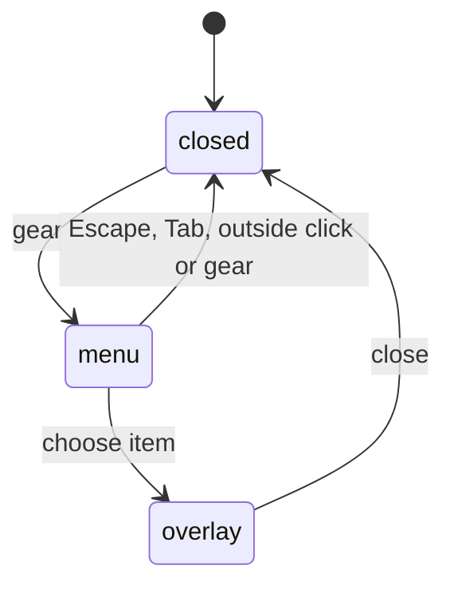

# The utilities menu

## Summary

The header gear, labelled “Settings and tools”, opens the general-purpose menu. Its seven items, in order, are Settings, Extensions, Files, Rules, Resume session, Backups and Keyboard shortcuts. Opening it changes neither the conversation nor workbook. It works while busy and without a connected provider once the welcome modal is closed.

## The simple case

Click the gear, choose Rules, edit guidance in its modal and close it to return to chat. Escape or an outside click dismisses the menu without opening anything.

## The interaction, event by event

### Opening the menu

Click, Enter or Space on the gear opens it and focuses the first item. Arrows wrap through enabled items; Home/End jump; letters find an item; Enter/Space activate. Tab or Escape closes and returns focus to the gear. It closes the tab context menu; only one such menu is open.

### Ends at once

Escape closes the menu before composer Escape or Stop. Outside clicks close it and may also activate the clicked target. No setting or session is saved just for opening or dismissing it.

### Choosing an item

| Item | Opens | Owner |
| --- | --- | --- |
| Settings | Settings root | [settings](../setup/settings.md) |
| Extensions | Connections page | [hub](../extensions/the-extensions-hub.md) |
| Files | Files list | [workspace](../files/the-files-workspace.md) |
| Rules | Rules editor | [rules](../guidance/rules.md) |
| Resume session | New-tab resume picker, or “No previous sessions” | [resume](../sessions/resuming-a-session.md) |
| Backups | Automatic backups page | [backups](../workbook/backups-and-revert.md) |
| Keyboard shortcuts | Shortcut reference | [shortcuts](keyboard-shortcuts.md) |

The menu closes before opening the target. Every modal takes focus, traps Tab and restores focus when closed. Settings opened at a deep link closes on Escape at its entry page; navigating further makes Escape go back first. Unsaved-change guards still run.

### While the overlay is open

The menu has no ongoing operation. A running turn continues behind the modal, but the user cannot type or invoke tab shortcuts behind it. The chosen page owns its saving, cancellation and errors.

### After the overlay closes

Focus returns to the initiating control when it still exists, otherwise the modal's fallback. The menu remembers no selection between openings.

## Modifiers

| Modifier | Set before | Changed while busy |
| --- | --- | --- |
| Model and provider | No effect. | No effect. |
| Thinking level | No effect. | No effect. |
| Execution mode | No effect on opening. | Chosen page owns changes. |
| Files or overlay | Modal covers gear. | Opening a modal dismisses menus. |
| Tab state | Items available in all states. | Resume focuses an existing open session or opens safely without replacing busy work. |
| Host | Same menu keyboard model. | No effect. |

## Cancel and interrupt

| Event | Before sent | While busy |
| --- | --- | --- |
| Stop/Escape | Dismiss menu. | Escape dismisses, not Stop. |
| Another send | Composer is not the menu's focused target. | Turn continues; menu has no queue. |
| Tabs change | Outside click closes menu. | Existing turn belongs to its tab. |
| Overlay/menu opens | Other surface replaces/dismisses menu. | No saved menu state. |
| Model/thinking | No menu state. | Busy choices apply to the next turn. |
| Provider failure | No effect on menu data. | Per-tab notice is separate. |
| Pane disappears | Menu lost. | No menu work to recover. |
| Workbook changes | No effect. | Chosen page sees its normal workbook state. |
| Focus leaves | No commit. | Turn continues. |
| Context fills | No effect. | Compaction belongs to runtime. |

## Interactions with other systems

**Persistence.** None for menu. **Workbook changes and recovery.** Backups opens a page, not a restore. **Other tabs and sessions.** Resume focuses an existing open session, reuses an idle empty tab or opens a new one without replacing a non-empty conversation. **Execution mode and approvals.** No approval for navigation. **Models and providers.** No requirement to connect. **Offline and provider errors.** Menu works offline. **Notifications.** Target actions own feedback. **Settings and preferences.** No menu preferences. **Host differences.** Same keyboard model. **Language.** Labels translated on render. **Accessibility and keyboard.** Gear exposes expanded state; menu items have keyboard focus and shared arrow/typeahead handling.

## Edge cases

- Short panes scroll the menu; it remains anchored to the gear.
- Nothing saved and nothing recently closed means Resume gives a toast rather than an empty picker.
- Backups and Rules are pages of Settings but keep entry-page-aware Escape behavior.

## Open questions and verification

Inspected sidebar menu, shared menu keyboard and modal handling. Historical observations of no arrow navigation and two Escapes with composer focus are superseded. Full Windows desktop keyboard/screen-reader acceptance remains untested in this pass.

Source inspected at `1f51cf8`, with model-choice wording reconciled to merged #805. No new menu acceptance run is claimed.
