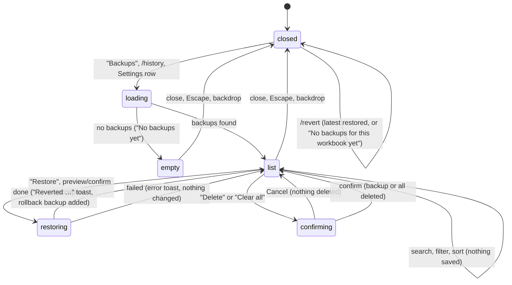

# Backups and revert

## Summary

Backups let the user restore the cells, formats or structure captured before Pi's changes. They are durable across saves/reloads and retained per workbook. The Backups dialog (`/history`, Settings or utilities menu) lists/searches/filters them; `/revert` targets the latest. Both remain available while busy and serialize recovery with workbook writes. User restores preview/confirm the replacement; Pi's recovery tool follows [approval policy](confirm-mode-and-approvals.md). Inverse capture is attempted, and failures are reported, not hidden. See [the workbook](../foundations/the-workbook.md#backups) for capture limits.

## The simple case

Pi has written a block of numbers into Sheet1!B2:D20 and the user does not like the result. The user types `/revert` and presses Enter. B2:D20 goes back to what it held before Pi's write, and a toast says "Reverted Sheet1!B2:D20". The composer is cleared and the user is back where they were.

For anything other than the latest change, the user opens the gear menu and chooses "Backups". The dialog lists the workbook's backups, newest first, each as "{action} · {address}" with how long ago it was taken and how many cells it covers, for example "Format cells · Sheet1!A1:F1", "3 changes · #5d2c0a1e9b4f". The user clicks "Restore" on the one they want; the toast says "Reverted Sheet1!A1:F1", and a new entry "Restore · Sheet1!A1:F1" with "Restored from #5d2c0a1e9b4f" appears at the top of the list.

Saving or reloading never deletes automatic backups, on desktop or web. Explicit deletion and retention govern their lifetime; see [the workbook](../foundations/the-workbook.md#backups).

## The interaction, event by event

### Opening the dialog

The Backups dialog is a page of the Settings overlay, titled "Backups" with the subtitle "Snapshots saved before Pi modifies data". Escape and the back arrow return to Settings; a second Escape, the close button or the backdrop closes the overlay. It lists the full retained set for this workbook. While it loads, the status reads "Loading…" and controls are disabled.

With no backups it shows the retention notice and an empty state: "No backups yet" and "Pi will save snapshots here before making changes to your data." With backups it adds:

- a search box ("Search backups…") that matches the backup id, the action name and the address, applied 0.2 seconds after typing stops;
- an action filter, "All actions (N)" followed by one option per kind present, each with its count: "Write", "Fill formula", "Python transform", "Format cells", "Conditional format", "Comments", "Charts", "Modify structure", "Restore";
- a sort button that toggles between "↓ Newest" and "↑ Oldest";
- a toolbar with "Download backup", "Refresh" and "Clear all", and a status such as "12 backups" or "3 of 12 shown" (or "No backups match the current filter." when nothing matches);
- a collapsed "Retention settings" section: "Keep at most [120] backups" with "Save".

Each entry shows its action and address, a relative time, "{N} change(s) · #{first 12 characters of the id}", "Restore" and "Delete", and, for a backup made by a revert, "Restored from #{id}".

The list does not update by itself while open. Backups Pi makes while the dialog is open appear after "Refresh" or reopening.

### Ends at once

Nothing is changed when the user only searches, filters, sorts, refreshes, or closes the dialog. `/revert` with no backup for this workbook shows "No backups for this workbook yet" and does nothing. `/revert` is available while busy; an accepted restore waits for the workbook lock.

### Restoring

"Restore" first checks what will be replaced. If the preview finds later edits, it asks before overwriting them; Cancel keeps those edits. While restoring, controls disable until it finishes. Restore waits for the [workbook lock](../foundations/the-workbook.md#the-workbook-lock). This later-edit confirmation is separate from the agent tool's Confirm-mode approval.

What a restore puts back depends on what was captured:

| Backup of | Restore does |
| --- | --- |
| Write, fill formula, Python transform | Writes the captured values and formulas back into the same address, over whatever is there now. |
| Format cells | Puts back the captured fonts, fills, number formats, borders, alignment, wrap, sizes and merges. Fails if the range's shape has changed. |
| Conditional format | Replaces the range's rules with the captured rules. |
| Comments | Puts the cell's comment thread back as it was, or removes a comment Pi added. |
| Charts, create | Deletes the chart Pi created, found by its id; if the id cannot be confirmed it fails rather than delete another chart. |
| Charts, update | Puts back the chart's type, title, legend and position. Its data source cannot be put back. |
| Modify structure, insert or add | Deletes the inserted rows, columns or sheet, but only if they hold no data. |
| Modify structure, delete | Re-inserts the rows, columns or sheet and their captured values and formulas (not their formatting). |
| Modify structure, rename, hide, unhide, duplicate | Renames back, restores the visibility, or deletes the duplicate if it holds no data. |

Restoring does not remove the backup; it can be restored again. It does add a new "Restore" backup of what it overwrote, so the revert can be reverted.

### Deleting and clearing

"Delete" asks "Delete this backup?" ("Backup: {address} (#{id})", buttons "Cancel" and "Delete"), then removes that one backup ("Deleting…"). "Clear all" asks "Delete all backups for this workbook?" ("This will delete {count} backup(s).", buttons "Cancel" and "Delete all"), then removes every backup for this workbook ("Clearing…") and shows "Cleared {count} backup(s)". Deleting a backup does not change the workbook; it only removes the ability to revert that change.

### Finishes

After a restore, the toast is "Reverted {address}", the list reloads with the new "Restore" entry at the top, and the dialog stays open. After `/revert`, the toast is the same and no dialog opens. Failures show a toast and leave the workbook as it was:

- "Restore failed: {message}" in the dialog, "Revert failed: {message}" for `/revert`;
- messages include "Snapshot belongs to a different workbook.", "Current workbook identity is unavailable; cannot safely restore this snapshot.", "Structure checkpoint restore is blocked: target rows contain data and cannot be deleted safely.", "Format checkpoint range shape changed and cannot be restored safely." and "Sheet referenced by structure checkpoint no longer exists."

A failed delete shows "Delete failed: {message}", or "Backup not found" if it was already gone. A failed load shows "Failed to load backups: {message}" and the status "Load failed".

## `/revert`

`/revert` restores the most recent backup for the current workbook, whatever made it, exactly as "Restore" on the top entry of the dialog would. Because a revert itself creates a backup, the most recent backup after `/revert` is the revert's own: running `/revert` a second time undoes the first revert and puts Pi's change back. `/revert` is a toggle for the last change, not a multi-step undo; to go further back the user needs the dialog.

## Pi's `workbook_history` tool

The user can ask Pi to list or restore backups ("undo your last two edits"). Pi's tool cards read "List backups", "Restore backup {id}" or "Restore latest backup", "Delete backup {id}", "Clear backups". A list shows up to 10 backups by default (50 at most) as a table of id, time, tool, range and changed count. A restore says "✅ Restored backup `{id}` at **{address}**.", "Changed item(s): N." and "Rollback backup created: `{id}`."

Pi's restore takes the workbook lock and asks in Confirm mode. Delete and clear also serialize and always ask, even in Auto: deleting the safety net is not a read.

## Retention

The "Keep at most" field accepts 5 to 120 and applies per workbook (default 120), with a global 240-entry cap. Saving reports the saved limit or failure. The dialog loads the full retained set, so Clear all's count matches the set it deletes. See [the workbook](../foundations/the-workbook.md#backups).

## Unsaved workbooks

An identity-less workbook can use a document token for backups. Saving never deletes them, though changing identity changes which list is shown. Where a token cannot be stored, the receipt names the unavailable backup. See [the workbook](../foundations/the-workbook.md#unsaved-and-new-workbooks).

## Modifiers

| Modifier | Set before | Changed while busy |
| --- | --- | --- |
| Model and provider | No effect. Backups and revert need no provider. | No effect. |
| Thinking level | No effect. | No effect. |
| Execution mode | User restores ask if the preview finds later edits; Pi's restore asks in Confirm mode. | No effect on a restore in progress. |
| Files in the workspace, or an overlay open | No effect from files. The dialog is itself an overlay (a page of Settings). | Restoring from the dialog while Pi is writing waits for the lock. |
| Tab state (new, restored, another tab busy) | Backups belong to the workbook, not to a tab: every tab sees the same list. Command and dialog work while busy. | A restore started while another tab writes waits for that write to finish. |
| Host (desktop or web) | Same durable-backup policy; optional capture APIs differ. | Saving/reloading does not clear entries. |

Nothing changed during a restore affects it; it applies the backup it was asked for.

## Cancel and interrupt

| Event | Before sent | While busy |
| --- | --- | --- |
| Stop (button or Escape) | Escape returns to the Settings page; a second Escape closes the overlay (confirmed). Escape on a delete or clear confirmation closes only the confirmation. Stop does not apply to a closed dialog. | A restore cannot be stopped. Escape closes the dialog, but the restore continues and its toast still appears. Stopping Pi's turn does not stop a restore the user started. |
| The user sends something else | The dialog covers the composer. `/revert` and `/history` are commands, not messages. | Not possible until the dialog closes. |
| Tab switched, created, closed or reopened | The list does not depend on the tab. | The restore continues; the active tab is shown as holding the lock while it runs. |
| An overlay or menu opens | A delete or clear confirm opens over the dialog; closing it cancels. An approval dialog for a busy tab can open on top of the dialog. | Not applicable. |
| Model or thinking level changes | No effect. | No effect. |
| The provider fails | No effect. | No effect. |
| The taskpane goes away | Nothing happens. | A restore already sent to Excel may complete without its rollback backup being stored. |
| The workbook changes underneath | The list is a snapshot; "Refresh" updates it. Saving does not clear it. | Restore replaces current target content; its preview/confirmation is not a co-authoring lock. |
| Focus moves to the grid or another window | The dialog stays open. | The restore continues. |
| The context window fills | No effect. | No effect. |

After any interrupt the user is back in the dialog or the composer; a restore either completed (with its toast) or changed nothing.

## Interactions with other systems

**Persistence.** Durable browser storage, per-workbook retention and atomic current-list updates across panes; no save/reload clearing. See [persistence and restore](../cross-cutting/persistence-and-restore.md).

**Workbook changes and recovery.** A restore is itself a change to the workbook, made through the workbook lock, recorded in the audit log, and backed up. Excel's Undo does not undo it.

**Other tabs and sessions.** One list per workbook, shared by all tabs and sessions. Restoring a change made in another tab works the same way. Pi in other tabs is not told that a revert happened, beyond what auto-context reports as changed cells at the next send.

**Execution mode and approvals.** User restores preview later edits and ask before replacing them; Pi's restore asks in Confirm mode. Deleting recovery through Pi always asks.

**Models and providers.** None.

**Offline and provider errors.** None.

**Notifications.** Outcome toasts and a truthful retention/lifetime notice. Rollback backup capture/storage failures are reported rather than claiming a reversible restore.

**Settings and preferences.** "Keep at most" is applied. "Download backup" belongs to [manual backups](manual-backups.md).

**Host differences.** See [Modifiers](#modifiers).

**Language.** The dialog's labels, toasts and confirms are translated. The action names in the list and filter ("Write", "Format cells", …), "{N} change(s)", the status counts ("12 backups", "3 of 12 shown") and the restore failure messages are English in every UI language.

**Accessibility and keyboard.** Every control is a native input or button reachable with Tab. There is no shortcut for `/revert` or for opening the dialog. Escape closes the confirm on top of the dialog first, then returns from Backups to Settings, then closes Settings.

## Edge cases

- A backup with "0 changes" (Pi wrote the same values) can still be restored; it changes nothing visible and adds a "Restore" entry.
- Restoring an old write after the user inserted rows above it writes the old values at the old address, which now holds different data.
- Restoring "insert rows" after the user typed into the inserted rows is refused rather than deleting their data.
- Clear all counts the full retained set, not a truncated preview.
- The "Download backup" button is in the toolbar, which is hidden while the list is empty, so a full copy cannot be taken from the dialog until at least one automatic backup exists.
- A backup's address may name a sheet that has since been renamed; restoring then fails.
- An irreversible chart-create restore retires its consumed checkpoint rather than repeatedly claiming to restore the same absent chart; rollback limitations are disclosed.

## Open questions and verification

- Checked by hand in Excel on the web (orb session, anonymous-link workbook, `ec453df`), 26 October 2026: opening and closing the dialog, the empty state, entries, search, filter, sort, Restore, Delete, Clear all, retention, `/revert` (latest, twice, nothing left, while busy), Pi's list, restore and clear, and the effect of a taskpane reload. See [the workbook checklist](../verification/workbook.md#workbookbackups-and-revertmd). Desktop Excel, "Clear all" with more than 40 backups, and restores across tabs were not run.
- Merged recovery/storage source addresses save-boundary clearing, ignored retention, truncated Clear all counts and consumed chart checkpoints. Old REVERT-21/22/24/26 observations remain historical evidence.
- **Confirmed.** A dialog restore started while another tab's write held the lock showed "Restoring…" for about 17 s and ran after the write (REVERT-25); the open list did not show a backup made meanwhile until "Refresh" (REVERT-23).
- `/revert` and manual capture now work while busy under the same workbook lock. Agent delete/clear always ask. User restores preview and confirm current replacement, but are not isolated from co-author edits.
- On Excel on the web, Excel's own Undo also takes back restores; see [the workbook](../foundations/the-workbook.md#excels-undo).
- Relative times seen: "just now", "1m ago", "9m ago"; longer spans not checked.

Verified against pi-for-excel commit `1f51cf8` (source inspection; old dated runs are historical).
