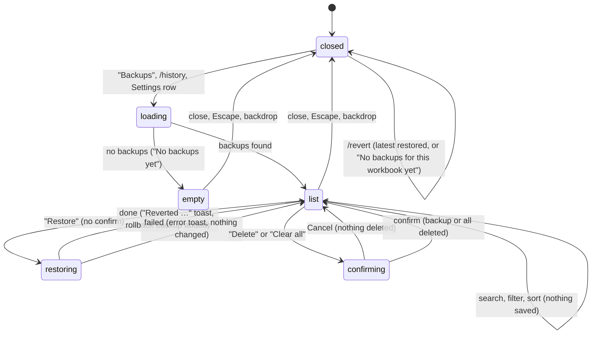

# Backups and revert

## Summary

Backups let the user take back changes Pi made to the workbook. Before most [mutations](../glossary.md#the-workbook), Pi saves a snapshot of what it is about to change (what is captured, when none is taken, and when they are cleared is owned by [the workbook](../foundations/the-workbook.md#backups)). The user sees and uses them in three places: the **Backups** dialog, which lists the current workbook's backups with search, filter, sort, restore and delete; **`/revert`**, which restores the latest backup in one step; and Pi itself, which can list and restore backups with its `workbook_history` tool when asked. Restoring a backup is a *revert*: the cells, formats or structure it covers go back to how they were before that mutation, and a new backup of what the revert overwrote is saved so the revert can itself be reverted. The Backups dialog opens from the [utilities menu](../ui/the-utilities-menu.md) ("Backups"), from the Backups row in [Settings](../setup/settings.md), or with `/history`; `/history` works while Pi is busy, `/revert` does not. None of it needs a provider. The dialog carries the warning "Backups will be cleared when this workbook is saved in Excel.", which is the single most important thing to know about it.

## The simple case

Pi has written a block of numbers into Sheet1!B2:D20 and the user does not like the result. The user types `/revert` and presses Enter. B2:D20 goes back to what it held before Pi's write, and a toast says "Reverted Sheet1!B2:D20". The composer is cleared and the user is back where they were.

For anything other than the latest change, the user opens the gear menu and chooses "Backups". The dialog lists the workbook's backups, newest first, each as "{action} · {address}" with how long ago it was taken and how many cells it covers, for example "Format cells · Sheet1!A1:F1", "3 changes · #5d2c0a1e9b4f". The user clicks "Restore" on the one they want; the toast says "Reverted Sheet1!A1:F1", and a new entry "Restore · Sheet1!A1:F1" with "Restored from #5d2c0a1e9b4f" appears at the top of the list.

On Excel desktop, when the user saves the workbook, all of these disappear within a few seconds. On Excel on the web saving never clears them, but reopening or reloading the taskpane does (confirmed in Excel on the web; see [the workbook](../foundations/the-workbook.md#backups)).

## The interaction, event by event

### Opening the dialog

The Backups dialog is a page of the Settings overlay, titled "Backups" with the subtitle "Snapshots saved before Pi modifies data". Because it is a page of Settings, Escape and the back arrow in its header return to the Settings page rather than closing, even when it was opened with `/history` or from the utilities menu; a second Escape, the close button ("Close settings") or a click on the dimmed backdrop closes the overlay (confirmed in Excel on the web). It lists backups for the workbook in this window only, at most the 40 most recent. While it loads, the status reads "Loading…" and controls are disabled.

With no backups it shows only the warning and an empty state: "No backups yet" and "Pi will save snapshots here before making changes to your data." With backups it adds:

- a search box ("Search backups…") that matches the backup id, the action name and the address, applied 0.2 seconds after typing stops;
- an action filter, "All actions (N)" followed by one option per kind present, each with its count: "Write", "Fill formula", "Python transform", "Format cells", "Conditional format", "Comments", "Charts", "Modify structure", "Restore";
- a sort button that toggles between "↓ Newest" and "↑ Oldest";
- a toolbar with "Download backup", "Refresh" and "Clear all", and a status such as "12 backups" or "3 of 12 shown" (or "No backups match the current filter." when nothing matches);
- a collapsed "Retention settings" section: "Keep at most [120] backups" with "Save".

Each entry shows its action and address, a relative time, "{N} change(s) · #{first 12 characters of the id}", "Restore" and "Delete", and, for a backup made by a revert, "Restored from #{id}".

The list does not update by itself while open. Backups Pi makes while the dialog is open appear after "Refresh" or reopening.

### Ends at once

Nothing is changed when the user only searches, filters, sorts, refreshes, or closes the dialog (the close button, Escape, or a click on the backdrop). `/revert` with no backup for this workbook shows "No backups for this workbook yet" and does nothing. `/revert` while the active tab is busy is refused with "Can't run /revert while Pi is busy" and the composer is cleared, so the command has to be typed again (confirmed in Excel on the web).

### Restoring

"Restore" acts at once; there is no confirmation. The status reads "Restoring…" and every control in the dialog is disabled until it finishes. The restore waits for the [workbook lock](../foundations/the-workbook.md#the-workbook-lock) like any mutation (another tab's write finishes first), but never asks for [approval](confirm-mode-and-approvals.md), even in Confirm mode.

What a restore puts back depends on what was captured:

| Backup of | Restore does |
| --- | --- |
| Write, fill formula, Python transform | Writes the captured values and formulas back into the same address, over whatever is there now. |
| Format cells | Puts back the captured fonts, fills, number formats, borders, alignment, wrap, sizes and merges. Fails if the range's shape has changed. |
| Conditional format | Replaces the range's rules with the captured rules. |
| Comments | Puts the cell's comment thread back as it was, or removes a comment Pi added. |
| Charts, create | Deletes the chart Pi created, found by its id; if the id cannot be confirmed it fails rather than delete another chart. |
| Charts, update | Puts back the chart's type, title, legend and position. Its data source cannot be put back. |
| Modify structure, insert or add | Deletes the inserted rows, columns or sheet, but only if they hold no data. |
| Modify structure, delete | Re-inserts the rows, columns or sheet and their captured values and formulas (not their formatting). |
| Modify structure, rename, hide, unhide, duplicate | Renames back, restores the visibility, or deletes the duplicate if it holds no data. |

Restoring does not remove the backup; it can be restored again. It does add a new "Restore" backup of what it overwrote, so the revert can be reverted.

### Deleting and clearing

"Delete" asks "Delete this backup?" ("Backup: {address} (#{id})", buttons "Cancel" and "Delete"), then removes that one backup ("Deleting…"). "Clear all" asks "Delete all backups for this workbook?" ("This will delete {count} backup(s).", buttons "Cancel" and "Delete all"), then removes every backup for this workbook ("Clearing…") and shows "Cleared {count} backup(s)". Deleting a backup does not change the workbook; it only removes the ability to revert that change.

### Finishes

After a restore, the toast is "Reverted {address}", the list reloads with the new "Restore" entry at the top, and the dialog stays open. After `/revert`, the toast is the same and no dialog opens. Failures show a toast and leave the workbook as it was:

- "Restore failed: {message}" in the dialog, "Revert failed: {message}" for `/revert`;
- messages include "Snapshot belongs to a different workbook.", "Current workbook identity is unavailable; cannot safely restore this snapshot.", "Structure checkpoint restore is blocked: target rows contain data and cannot be deleted safely.", "Format checkpoint range shape changed and cannot be restored safely." and "Sheet referenced by structure checkpoint no longer exists."

A failed delete shows "Delete failed: {message}", or "Backup not found" if it was already gone. A failed load shows "Failed to load backups: {message}" and the status "Load failed".

## `/revert`

`/revert` restores the most recent backup for the current workbook, whatever made it, exactly as "Restore" on the top entry of the dialog would. Because a revert itself creates a backup, the most recent backup after `/revert` is the revert's own: running `/revert` a second time undoes the first revert and puts Pi's change back. `/revert` is a toggle for the last change, not a multi-step undo; to go further back the user needs the dialog.

## Pi's `workbook_history` tool

The user can ask Pi to list or restore backups ("undo your last two edits"). Pi's tool cards read "List backups", "Restore backup {id}" or "Restore latest backup", "Delete backup {id}", "Clear backups". A list shows up to 10 backups by default (50 at most) as a table of id, time, tool, range and changed count. A restore says "✅ Restored backup `{id}` at **{address}**.", "Changed item(s): N." and "Rollback backup created: `{id}`."

Pi's restore is a mutation: in Confirm mode it asks for approval, and it takes the workbook lock. Pi's delete and clear are not treated as mutations and never ask, even in Confirm mode (see [Open questions](#open-questions-and-verification)).

## Retention

The "Keep at most" field accepts 5 to 120. Outside that range: "Retention limit must be between 5 and 120". Saving shows "Retention set to {count} backups", or "Failed to save retention: {message}". At this commit the value is stored but not applied: Pi keeps the 120 most recent backups across all workbooks regardless. See [the workbook](../foundations/the-workbook.md#backups).

## Unsaved workbooks

On desktop Excel, a workbook that has never been saved gets backups like any other; Pi files them under a token stored in the document. They are cleared when the workbook is saved for the first time. Where the host cannot store that token, Pi makes no backups for an unsaved workbook and the tool cards say "no backup". See [the workbook](../foundations/the-workbook.md#unsaved-and-new-workbooks).

## Modifiers

| Modifier | Set before | Changed while busy |
| --- | --- | --- |
| Model and provider | No effect. Backups and revert need no provider. | No effect. |
| Thinking level | No effect. | No effect. |
| Execution mode | User restores never ask. Pi's restore asks in Confirm mode. | No effect on a restore in progress. |
| Files in the workspace, or an overlay open | No effect from files. The dialog is itself an overlay (a page of Settings). | Restoring from the dialog while Pi is writing waits for the lock. |
| Tab state (new, restored, another tab busy) | Backups belong to the workbook, not to a tab: every tab sees the same list. `/revert` is refused only when the active tab is busy; the dialog works while busy. | A restore started while another tab writes waits for that write to finish. |
| Host (desktop or web) | On Excel on the web, saving never clears backups but every taskpane load does, and a workbook without a location (never saved on desktop, or opened through an anonymous link on the web) loses its first backup (confirmed; see [the workbook](../foundations/the-workbook.md#backups)). | No effect. |

Nothing changed during a restore affects it; it applies the backup it was asked for.

## Cancel and interrupt

| Event | Before sent | While busy |
| --- | --- | --- |
| Stop (button or Escape) | Escape returns to the Settings page; a second Escape closes the overlay (confirmed). Escape on a delete or clear confirmation closes only the confirmation. Stop does not apply to a closed dialog. | A restore cannot be stopped. Escape closes the dialog, but the restore continues and its toast still appears. Stopping Pi's turn does not stop a restore the user started. |
| The user sends something else | The dialog covers the composer. `/revert` and `/history` are commands, not messages. | Not possible until the dialog closes. |
| Tab switched, created, closed or reopened | The list does not depend on the tab. | The restore continues; the active tab is shown as holding the lock while it runs. |
| An overlay or menu opens | A delete or clear confirm opens over the dialog; closing it cancels. An approval dialog for a busy tab can open on top of the dialog. | Not applicable. |
| Model or thinking level changes | No effect. | No effect. |
| The provider fails | No effect. | No effect. |
| The taskpane goes away | Nothing happens. | A restore already sent to Excel may complete without its rollback backup being stored. |
| The workbook changes underneath | The list is a snapshot; "Refresh" updates it. On desktop, saving clears all backups within about 4 seconds even with the dialog open; entries then fail with "Snapshot not found." On the web, saving does not clear them. | A restore writes the captured state over the user's newer edits in the same range without warning (confirmed: a value the user typed after Pi's write was erased by `/revert`). |
| Focus moves to the grid or another window | The dialog stays open. | The restore continues. |
| The context window fills | No effect. | No effect. |

After any interrupt the user is back in the dialog or the composer; a restore either completed (with its toast) or changed nothing.

## Interactions with other systems

**Persistence.** Backups live in the add-in's browser storage and survive a taskpane reload only while the workbook has unsaved changes; reloading on a saved workbook clears them. Excel on the web always reports the workbook as saved, so there every reload clears them (confirmed: 16 backups gone after one reload). See [persistence and restore](../cross-cutting/persistence-and-restore.md).

**Workbook changes and recovery.** A restore is itself a change to the workbook, made through the workbook lock, recorded in the audit log, and backed up. Excel's Undo does not undo it.

**Other tabs and sessions.** One list per workbook, shared by all tabs and sessions. Restoring a change made in another tab works the same way. Pi in other tabs is not told that a revert happened, beyond what auto-context reports as changed cells at the next send.

**Execution mode and approvals.** User restores never ask; Pi's do in Confirm mode.

**Models and providers.** None.

**Offline and provider errors.** None.

**Notifications.** Toasts for every outcome. The warning callout in the dialog is the only notice that saving clears backups; nothing tells the user when it happens.

**Settings and preferences.** "Keep at most" (stored, not applied). The "Download backup" button belongs to [manual backups](manual-backups.md).

**Host differences.** See [Modifiers](#modifiers).

**Language.** The dialog's labels, toasts and confirms are translated. The action names in the list and filter ("Write", "Format cells", …), "{N} change(s)", the status counts ("12 backups", "3 of 12 shown") and the restore failure messages are English in every UI language.

**Accessibility and keyboard.** Every control is a native input or button reachable with Tab. There is no shortcut for `/revert` or for opening the dialog. Escape closes the confirm on top of the dialog first, then returns from Backups to Settings, then closes Settings.

## Edge cases

- A backup with "0 changes" (Pi wrote the same values) can still be restored; it changes nothing visible and adds a "Restore" entry.
- Restoring an old write after the user inserted rows above it writes the old values at the old address, which now holds different data.
- Restoring "insert rows" after the user typed into the inserted rows is refused rather than deleting their data.
- The "Clear all" confirmation counts only the backups the dialog loaded (at most 40); it deletes every backup for the workbook (up to 120).
- The "Download backup" button is in the toolbar, which is hidden while the list is empty, so a full copy cannot be taken from the dialog until at least one automatic backup exists.
- A backup's address may name a sheet that has since been renamed; restoring then fails.

## Open questions and verification

- Checked by hand in Excel on the web (orb session, anonymous-link workbook, `ec453df`), 26 October 2026: opening and closing the dialog, the empty state, entries, search, filter, sort, Restore, Delete, Clear all, retention, `/revert` (latest, twice, nothing left, while busy), Pi's list, restore and clear, and the effect of a taskpane reload. See [the workbook checklist](../verification/workbook.md#workbookbackups-and-revertmd). Desktop Excel, "Clear all" with more than 40 backups, and restores across tabs were not run.
- **Confirmed bug (web).** Saving never clears backups on Excel on the web, but every taskpane load does, because the host always reports the workbook as saved (`src/workbook/save-boundary-monitor.ts:74`). The dialog's warning is wrong there. REVERT-24; see [the workbook](../foundations/the-workbook.md#open-questions-and-verification).
- **Confirmed bug.** "Keep at most" is saved (`src/workbook/recovery/log-store.ts:64`) and never applied (`src/workbook/recovery-log.ts:420` caps at 120 across all workbooks): with 5 saved, the list held 10. REVERT-21.
- "Clear all" builds its message from the loaded list (`src/commands/builtins/settings-pages/backups-page.ts:232`, loaded with a limit of 40 at `src/taskpane/init.ts:1548`) but clears every backup for the workbook. The count can be wrong above 40. Minor bug; not run (11 backups gave the right count).
- `/revert` is not busy-allowed but `/history` is, and restoring from the dialog while Pi is writing is allowed. The two paths to the same action disagree; a product call.
- **Confirmed.** `workbook_history` delete and clear are reads to the policy (`src/tools/execution-policy.ts:73`), so in Confirm mode Pi cleared every backup without asking. Probably worth treating as a bug. APPROVE-17.
- **Confirmed.** Restores of range values overwrite whatever is in the range now, including the user's later edits, without a conflict check (`src/workbook/recovery/log-restore.ts`, range path). Intended per design; worth stating in the UI. REVERT-19.
- On Excel on the web, Excel's own Undo also takes back restores; see [the workbook](../foundations/the-workbook.md#excels-undo).
- Relative times seen: "just now", "1m ago", "9m ago"; longer spans not checked.

Verified against pi-for-excel commit `ec453df`.
