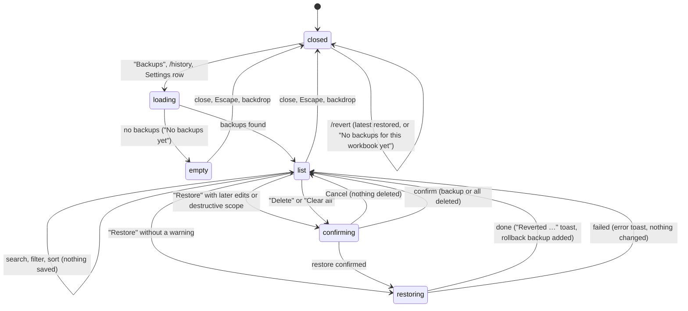

# Backups and revert

## Summary

Backups let the user restore the cells, formats or structure captured before Pi's changes. They survive saves/reloads in local, best-effort storage, not as a durable copy of the workbook. The Backups dialog (`/history`, Settings or utilities menu) pages/searches/filters the current workbook's history; `/revert` targets the latest. Both remain available while busy and serialize recovery with workbook writes. User restores preview/confirm the replacement; Pi's recovery tool follows [approval policy](confirm-mode-and-approvals.md). Inverse capture is attempted, and failures are reported, not hidden. See [the workbook](../foundations/the-workbook.md#backups) for capture limits.

## The simple case

Pi has written a block of numbers into Sheet1!B2:D20 and the user does not like the result. The user types `/revert` and presses Enter. B2:D20 goes back to what it held before Pi's write, and a toast says "Reverted Sheet1!B2:D20". The composer is cleared and the user is back where they were.

For anything other than the latest change, the user opens the gear menu and chooses "Backups". The dialog lists the workbook's backups, newest first, each as "{action} · {address}" with how long ago it was taken and how many cells it covers, for example "Format cells · Sheet1!A1:F1", "3 changes · #5d2c0a1e9b4f". The user clicks "Restore" on the one they want; the toast says "Reverted Sheet1!A1:F1", and a new entry "Restore · Sheet1!A1:F1" with "Restored from #5d2c0a1e9b4f" appears at the top of the list.

Saving, AutoSave and reloading the taskpane do not clear backups, on desktop or the web. Save As moves the open workbook's history to its new identity rather than wiping or copying it. The warning explains the remaining risk: "Backups stay on this computer through saves and Save As. The oldest are removed only above 512 MiB. Browser or Excel cache clearing and storage eviction can erase backups, chats, sign-ins and settings. Download a full backup for durable recovery."

## The interaction, event by event

### Opening the dialog

The Backups dialog is a page of the Settings overlay, titled "Backups" with the subtitle "Snapshots saved before Pi modifies data". Escape and the back arrow follow the shared [overlay](../glossary.md#the-taskpane) navigation. It lists backups for the workbook in this window only, 50 per page. While it loads, the status reads "Loading…" and controls are disabled.

With no backups it shows only the warning and an empty state: "No backups yet" and "Pi will save snapshots here before making changes to your data." With backups it adds:

- a search box ("Search this page…") that matches the backup id, action name and address on the loaded page, applied 0.2 seconds after typing stops;
- an action filter, "All actions (N)" followed by one option per kind present, each with its count: "Write", "Fill formula", "Python transform", "Format cells", "Conditional format", "Comments", "Charts", "Modify structure", "Restore";
- a sort button that toggles between "↓ Newest" and "↑ Oldest";
- a toolbar with "Download backup", "Refresh" and "Clear all", and a status such as "12 backups" or "3 of 12 shown" (or "No backups match the current filter." when nothing matches);
- "Previous page" and "Next page", disabled when there is no page in that direction, and the hint "50 backups per page. Search and action filters apply to this page only." Sorting starts again at the first page in the chosen direction. There is no retention setting.

Each entry shows its action and address, a relative time, "{N} change(s) · #{first 12 characters of the id}", "Restore" and "Delete", and, for a backup made by a revert, "Restored from #{id}".

The list does not update by itself while open. Backups Pi makes while the dialog is open, or a Save As identity change, appear after "Refresh" or reopening. Running `/history` again while it is already open does not refresh it. Refresh and a successful restore/delete return to the first page.

### Ends at once

Nothing is changed when the user only searches, filters, sorts, refreshes, or closes the dialog. `/revert` with no backup for this workbook shows "No backups for this workbook yet" and does nothing. `/revert` is available while busy; an accepted restore waits for the workbook lock.

### Restoring

The status reads "Restoring…" and every control in the dialog is disabled until the operation finishes. If the range contains edits made since Pi's change, "Overwrite later edits?" names the affected cells and offers "Keep my edits" or "Restore anyway". Declining changes nothing. Destructive structure restores also require the existing explicit confirmation and live safety checks. These safety dialogs are distinct from execution-mode [approval](confirm-mode-and-approvals.md): a restore the user chose does not ask a second general approval. It waits for the [workbook lock](../foundations/the-workbook.md#the-workbook-lock) like any mutation.

What a restore puts back depends on what was captured:

| Backup of | Restore does |
| --- | --- |
| Write, fill formula, Python transform | Writes the captured values and formulas back into the same address, over whatever is there now. |
| Format cells | Puts back the captured fonts, fills, number formats, borders, alignment, wrap, sizes and merges. Fails if the range's shape has changed. |
| Conditional format | Replaces the range's rules with the captured rules. |
| Comments | Puts the cell's comment thread back as it was, or removes a comment Pi added. |
| Charts, create | Deletes the chart Pi created, found by its id; if the id cannot be confirmed it fails rather than delete another chart. |
| Charts, update | Puts back the chart's type, title, legend and position. Its data source cannot be put back. |
| Modify structure, insert or add | Deletes the inserted rows, columns or sheet, but only if they hold no data. |
| Modify structure, delete | Re-inserts the rows, columns or sheet and their captured values and formulas (not their formatting). |
| Modify structure, rename, hide, unhide, duplicate | Renames back, restores the visibility, or deletes the duplicate if it holds no data. |

Restoring normally leaves the original backup and adds a new "Restore" backup of what it overwrote. A chart-create restore cannot recreate the deleted chart; after success its consumed backup is removed so repeated `/revert` does not get stuck there. If the inverse backup cannot be saved after a restore, Pi warns honestly: the already-applied workbook change is not rolled back.

### Deleting and clearing

"Delete" asks "Delete this backup?" ("Backup: {address} (#{id})", buttons "Cancel" and "Delete"), then removes that one backup ("Deleting…"). "Clear all" asks "Delete all backups for this workbook?" with "This deletes every backup for this workbook, including backups on other pages. This cannot be undone." Confirming "Delete all" removes every page for this workbook, not only visible or filtered entries, and shows "Cleared {count} backup(s)". Other workbooks are untouched. Deleting a backup does not change the workbook; it removes the ability to revert that change.

### Finishes

After a restore, the toast is "Reverted {address}", the list reloads with the new "Restore" entry when available, and the dialog stays open. After `/revert`, the toast is the same and no history dialog opens. Refused or cancelled restores leave the workbook as it was; an error after Excel already applied a change is not a transactional rollback:

- "Restore failed: {message}" in the dialog, "Revert failed: {message}" for `/revert`;
- messages include "Snapshot belongs to a different workbook.", "Current workbook identity is unavailable; cannot safely restore this snapshot.", "Structure checkpoint restore is blocked: target rows contain data and cannot be deleted safely.", "Format checkpoint range shape changed and cannot be restored safely." and "Sheet referenced by structure checkpoint no longer exists."

A failed delete shows "Delete failed: {message}", or "Backup not found" if it was already gone. A failed load shows "Failed to load backups: {message}" and the status "Load failed".

## `/revert`

`/revert` restores the most recent backup for the current workbook, whatever made it, exactly as "Restore" on the top entry of the dialog would. Because a revert itself creates a backup, the most recent backup after `/revert` is the revert's own: running `/revert` a second time undoes the first revert and puts Pi's change back. `/revert` is a toggle for the last change, not a multi-step undo; to go further back the user needs the dialog.

## Pi's `workbook_history` tool

The user can ask Pi to list or restore backups ("undo your last two edits"). Pi's tool cards read "List backups", "Restore backup {id}" or "Restore latest backup", "Delete backup {id}", "Clear backups". A list shows 10 backups by default (50 at most) as a table of id, time, tool, range and changed count, plus a cursor when more remain. Pi can request successive pages without loading every backup. Restore reads only the chosen backup; later edits require explicit user permission through `overwrite_later_edits`, and destructive restores require `allow_destructive`. A successful restore reports its rollback backup when one was saved.

Pi's restore is a mutation: in Confirm mode it asks for approval, and it takes the workbook lock. Deleting or clearing recovery backups always asks for consent, in either mode, because it removes the user's safety net.

## Retention

There is no count or age limit and no "Keep at most" setting. Useful backups stay until the user deletes them or automatic history across all workbooks on this origin exceeds **512 MiB**. Then the oldest backups go first, regardless of workbook. There is no newest-backup floor: heavy use of one workbook can eventually remove another's entire history. A single backup larger than the ceiling is refused with a "Too large to back up" reason before any existing history is evicted.

> Technical note: [#809](https://github.com/tmustier/pi-for-excel/pull/809) stores each backup as a gzip Blob with separate indexed metadata; the fixed budget counts compressed payload plus metadata bytes, not physical database/index overhead. Writes, lists and eviction never load unrelated payloads. Listing uses exclusive time/id cursors, not growing offsets. The ceiling is a safety bound, not a reservation against host quota or a guarantee against whole-origin eviction.

Existing history is migrated once without changing backup IDs or contents. A failed migration leaves the original list intact and shows "Backups could not be upgraded. Existing backups are unchanged; new backups may be unavailable until storage recovers." Other Pi data can still open. Old-format data remains readable while migration is deferred; a new backup may not be available until the copy can commit. See [storage failures](../cross-cutting/persistence-and-restore.md#storage-failures-quota-and-clearing) for the forward-only database upgrade and whole-origin loss risks.

## Unsaved workbooks

On desktop Excel and anonymous-link Excel on the web, a workbook without a path identity can get backups under a token stored in the document. Reading history does not create that token. On first save its backups move to the saved identity; they are not cleared. Later Save As, rename or move observed while the pane follows that document move the history again, preserving any backups already under the destination. History is not copied back to the original file. A file moved while no pane observes both identities cannot be matched safely; its old history remains under the old identity and counts toward the ceiling. Where the host cannot store the token, Pi makes no backup. See [the workbook](../foundations/the-workbook.md#unsaved-and-new-workbooks).

## Modifiers

| Modifier | Set before | Changed while busy |
| --- | --- | --- |
| Model and provider | No effect. Backups and revert need no provider. | No effect. |
| Thinking level | No effect. | No effect. |
| Execution mode | User restores do not ask a general approval, but later-edits/destructive warnings still apply. Pi's restore asks in Confirm mode. | No effect on a restore in progress. |
| Files in the workspace, or an overlay open | No effect from files. The dialog is itself an overlay (a page of Settings). | Restoring from the dialog while Pi is writing waits for the lock. |
| Tab state (new, restored, another tab busy) | Backups belong to the workbook, not to a tab: every tab sees the same list. Command and dialog work while busy. | A restore started while another tab writes waits for that write to finish. |
| Host (desktop or web) | Saves, AutoSave and reloads retain history on both. Anonymous-link web workbooks may use a document token rather than a path identity. Storage quota and eviction vary by host. | No save-triggered clearing. |

Changing the model, provider or thinking level does not replace the selected backup. Live workbook safety checks still apply.

## Cancel and interrupt

| Event | Before sent | While busy |
| --- | --- | --- |
| Stop (button or Escape) | Escape returns to the Settings page; a second Escape closes the overlay (confirmed). Escape on a delete or clear confirmation closes only the confirmation. Stop does not apply to a closed dialog. | A restore cannot be stopped. Escape closes the dialog, but the restore continues and its toast still appears. Stopping Pi's turn does not stop a restore the user started. |
| The user sends something else | The dialog covers the composer. `/revert` and `/history` are commands, not messages. | Not possible until the dialog closes. |
| Tab switched, created, closed or reopened | The list does not depend on the tab. | The restore continues; the active tab is shown as holding the lock while it runs. |
| An overlay or menu opens | A delete or clear confirm opens over the dialog; closing it cancels. An approval dialog for a busy tab can open on top of the dialog. | Not applicable. |
| Model or thinking level changes | No effect. | No effect. |
| The provider fails | No effect. | No effect. |
| The taskpane goes away | Nothing happens. | A restore already sent to Excel may complete without its rollback backup being stored. |
| The workbook changes underneath | The list is a loaded page; "Refresh" updates it. Saving does not clear history. Another pane can delete or evict a listed backup, which then fails safely with "Snapshot not found." | Range restores preview later edits and ask before overwriting them; live structure guards still reject unsafe deletes. |
| Focus moves to the grid or another window | The dialog stays open. | The restore continues. |
| The context window fills | No effect. | No effect. |

After an interrupt the user returns to the dialog or composer. Refusal or cancellation before applying changes leaves the workbook alone; a change already sent to Excel may complete even if its rollback backup cannot be saved.

## Interactions with other systems

**Persistence.** Backups survive saves and reloads in local browser storage. Save As moves history, not payload files; multiple panes share atomic storage operations rather than overwriting stale lists. Cache clearing or origin eviction can also erase chats, sign-ins and settings. See [persistence and restore](../cross-cutting/persistence-and-restore.md).

**Workbook changes and recovery.** A restore is itself a change to the workbook, made through the workbook lock, recorded in the audit log, and backed up when possible. Pi's recovery does not depend on Excel's Undo stack.

**Other tabs and sessions.** One list per workbook, shared by all tabs and sessions. Restoring a change made in another tab works the same way. Pi in other tabs is not told that a revert happened, beyond what auto-context reports as changed cells at the next send.

**Execution mode and approvals.** User restores do not ask a general approval; their safety warnings still apply. Pi's restores ask in Confirm mode, and deleting recovery history always asks.

**Models and providers.** None.

**Offline and provider errors.** None.

**Notifications.** Toasts report user operations and backup-save failures. The callout explains the ceiling, local storage loss and downloading a durable full backup. A committed change with no saved backup is explicitly reported as unavailable for reversion.

**Settings and preferences.** No retention preference. The "Download backup" button belongs to [manual backups](manual-backups.md), which are outside the automatic-history ceiling.

**Host differences.** See [Modifiers](#modifiers).

**Language.** The dialog's labels, toasts and confirms are translated. The action names in the list and filter ("Write", "Format cells", …), "{N} change(s)", the status counts ("12 backups", "3 of 12 shown") and the restore failure messages are English in every UI language.

**Accessibility and keyboard.** Every control is a native input or button reachable with Tab. There is no shortcut for `/revert` or for opening the dialog. Escape closes the confirm on top of the dialog first, then returns from Backups to Settings, then closes Settings.

## Edge cases

- A backup with "0 changes" (Pi wrote the same values) can still be restored; it changes nothing visible and adds a "Restore" entry.
- Restoring an old write after the user inserted rows above it writes the old values at the old address, which now holds different data.
- Restoring "insert rows" after the user typed into the inserted rows is refused rather than deleting their data.
- Search and action counts cover the loaded page, not the entire archive. Clear all is deliberately broader than either the filter or page.
- The "Download backup" button is in the toolbar, which is hidden while the list is empty, so a full copy cannot be taken from the dialog until at least one automatic backup exists.
- A backup's address may name a sheet that has since been renamed; restoring then fails.
- Reverting a chart-create backup cannot bring the chart back. Its consumed entry is removed after success so the next `/revert` can reach older changes.

## Open questions and verification

- [#809](https://github.com/tmustier/pi-for-excel/pull/809): real Excel-web model write, independent Office readback, `/revert`, Backups and reload passed. A later edit of 909 triggered "Overwrite later edits?"; "Keep my edits" preserved it. Native Chromium tests covered two-pane migration and concurrent writes, 71 entries paged 50 + 21, and Clear all across pages. Inspected 420-pixel renders covered first/last/empty pages and the all-pages confirmation.
- Real Excel for Mac, isolated origin: four pre-upgrade backups migrated intact; new writes, inverse restore, restore of a migrated snapshot and relaunch passed. Save As into a new and existing destination moved metadata without changing Blob files. Delete and Clear all freed files and reduced accounting exactly. The normal development origin was untouched.
- Failed migration rollback, legacy read fallback, eviction order, no protected floor and oversized refusal were tested through public storage interfaces, not by filling a real Mac disk. Real full-disk behavior, peak large-payload heap, Windows WebView2 quota and long-term eviction remain unmeasured. Rename/move outside Save As were not exercised on Mac.
- Historical [workbook checklist](../verification/workbook.md#workbookbackups-and-revertmd) observations at `ec453df` predate the merged save/restore fixes and #809; they are not the current storage contract. General lock, chart and approval guards here come from main's merged fixes, not new behavior in #809.
- The open panel still needs Refresh/reopen after changes outside it. `/revert` and manual capture work while busy under the same workbook lock. User restores preview and confirm current replacement, but are not isolated from co-author edits.
- Merged-main historical acceptance also covered a dialog restore waiting behind another tab's write (REVERT-25), and the list requiring Refresh for a backup made meanwhile (REVERT-23). Excel's own Undo also takes back restores on the web; see [the workbook](../foundations/the-workbook.md#excels-undo).

Verified against pi-for-excel main [1f51cf8](https://github.com/tmustier/pi-for-excel/commit/1f51cf8f) plus [#809](https://github.com/tmustier/pi-for-excel/pull/809): implementation [5c61b21](https://github.com/tmustier/pi-for-excel/commit/5c61b21d), final metadata-fallback/test/doc follow-up [9f4f60d](https://github.com/tmustier/pi-for-excel/commit/9f4f60d7). Mac acceptance used the initial implementation; final fallback validation used deterministic tests.
