# Confirm mode and approvals

## Summary

The [execution mode](../foundations/the-workbook.md#the-execution-mode) decides whether Pi changes the workbook without asking (**Auto**, the default) or stops before every [mutation](../glossary.md#the-workbook) and asks the user to allow it (**Confirm**). The asking is an *approval*: an overlay dialog with "Cancel" and "Allow once". Declining fails that one tool call; Pi sees the failure and the turn goes on. The mode is shown and switched by the control at the right end of the [status bar](../ui/the-status-bar.md), the "Auto mode" switch in [Settings](../setup/settings.md), and the `/yolo` command. It is one setting for the whole add-in, kept across reloads, and can be changed at any time, including while Pi is busy. Separately from the mode, a few risky actions ask in any mode: direct Office.js code that reaches beyond the Excel API, and the first use of a local Python bridge. Everything here works with no provider connected (only approvals need a turn) and on Excel on the web, because the dialogs are drawn inside the taskpane rather than by the browser.

## The simple case

The user clicks "Auto" in the status bar. A toast says "Confirm mode." and the mode changes at once, but the control keeps saying "Auto" until the pointer and focus leave the status bar; then it reads "Confirm" (confirmed in Excel on the web; see [Open questions](#open-questions-and-verification)). Nothing else changes until Pi next tries to change the workbook.

The user asks Pi to fill in a column. Pi reads the sheet as usual, without asking. When it is about to write, a dialog appears over the taskpane, titled "Allow workbook mutation in Safe mode?", with the tool and range it wants to change and the tip "Tip: run /yolo on to switch to Auto mode (no confirmations)." The turn waits. The user clicks "Allow once"; the dialog closes, the write runs, and Pi continues. If Pi makes three writes, the user is asked three times.

To go back, the user clicks "Confirm" in the status bar (toast "Auto mode.") or types `/yolo on`.

## The interaction, event by event

```mermaid
stateDiagram-v2
    [*] --> auto
    auto --> confirm : status-bar click, Settings switch, /yolo off (mode saved)
    confirm --> auto : status-bar click, Settings switch, /yolo on (mode saved)
    confirm --> asking : Pi calls a mutation (turn waits)
    asking --> allowed : "Allow once" (this call runs)
    asking --> declined : Cancel, close, Escape or backdrop click (call fails)
    asking --> declined : another approval dialog opens (call fails)
    allowed --> confirm : mutation done
    declined --> confirm : Pi sees the failure, turn continues
    auto --> risky : Pi runs Office.js beyond the Excel API
    risky --> auto : "Allow once" or Cancel
```

### Switching the mode

There are three ways, all with the same effect:

- **The status-bar control.** A button showing "Auto" or "Confirm" with a small chevron. Its tooltip is "Auto: Pi applies workbook changes immediately. Click to switch to Confirm." or "Confirm: Pi asks before each workbook change. Click to switch to Auto." One click switches at once (the chevron does not open a menu) and shows "Auto mode." or "Confirm mode.". The label and tooltip are not redrawn while the pointer is over the status bar or the button has focus, so right after the click it still shows the old mode; it catches up when the user clicks or moves elsewhere. Clicking it closes any open status-bar popover.
- **Settings.** In the Behavior group, the switch "Auto mode" ("Pi applies changes immediately without asking"). On is Auto, off is Confirm. The toast is "Auto mode." or "Confirm mode."; if saving fails, the switch flips back and the toast is "Couldn't update execution mode.".
- **`/yolo`.** Described below.

The mode is saved immediately in the add-in's storage and applies to every tab and every workbook in this browser profile. Each tab's session is told about the new mode from its next request to the model. In Confirm mode Pi is also instructed to ask in chat before changing the workbook and to reconfirm destructive structure changes, so a user may be asked once in the conversation and again by the dialog.

### `/yolo`

`/yolo` runs even while Pi is busy. Its argument, case-insensitive:

| Typed | Effect | Toast |
| --- | --- | --- |
| `/yolo`, `/yolo status`, `show` or `get` | Reports the mode, changes nothing. | "Auto mode — Pi applies workbook changes immediately." or "Confirm mode — Pi asks before each workbook change." |
| `/yolo on`, `yolo` or `fast` | Switches to Auto. | "Auto mode — Pi applies workbook changes immediately." |
| `/yolo off`, `safe` or `cautious` | Switches to Confirm. | "Confirm mode — Pi asks before each workbook change." |
| `/yolo toggle` | Switches to the other mode. | The new mode's sentence. |
| Anything else | Nothing. | "Usage: /yolo [on|off|toggle|status]" |

Asking for the mode it is already in shows the same sentence and changes nothing. "On" means Auto: the command is named for the mode with fewer confirmations, which reads backwards if the user thinks of `/yolo` as "the confirmation switch".

### Ends at once

Switching the mode never reaches the model or the workbook directly; it only changes what happens at the next mutation. An unknown `/yolo` argument records nothing. Reads never ask in either mode, and neither do restores the user starts from the [Backups dialog](backups-and-revert.md) or `/revert`: the user already chose those.

### Approval asked

In Confirm mode, the approval is asked when Pi's tool call arrives, before it waits for the [workbook lock](../foundations/the-workbook.md#the-workbook-lock). The dialog is an overlay over the whole taskpane:

- Title: "Allow workbook mutation in Safe mode?"
- Body: "Allow workbook mutation in Confirm mode?", then "Tool: {tool}" (with the action for multi-action tools, such as "comments:add" or "view_settings:freeze_at"), then "Range: {range}" when the tool's input has a range, then "Tip: run /yolo on to switch to Auto mode (no confirmations)."
- Buttons: "Cancel" and "Allow once". The close button in the header is also labeled "Cancel".

Every mutation asks, including ones the user might not think of as changes: switching the active sheet, freezing panes, a write that will turn out to be blocked by overwrite protection, and Pi's own restore of a backup. See [the workbook](../foundations/the-workbook.md#what-pi-can-read-and-change) for which calls are mutations.

### While the dialog is open

The turn waits as long as the dialog stays open; there is no timeout. The overlay dims the transcript, the tab strip and the composer, but it does not take focus: the composer keeps it, so typing and Enter still reach the composer behind the dialog. Typing `/yolo on` and Enter while the dialog is open switches the mode (toast and all) and leaves the dialog open; its answer still counts (confirmed in Excel on the web). Other tabs keep running; their reads continue and their mutations can take the lock, because the waiting call has not asked for it yet.

### Answered

- **"Allow once"** lets this one call through. It then waits for the lock if needed and runs as described in [writing](writing.md). There is no "allow always"; the next mutation asks again.
- **Cancel** (the button, the header close, Escape, or a click on the dimmed backdrop) fails the call with "Mutation cancelled by user (Confirm mode)." The tool card shows the error. The model sees it and the turn continues: Pi may explain, try something else, or ask the same thing again, which opens a new dialog. Declining does not stop the turn; Stop does that.

Either way the dialog closes and focus returns to the composer. Nothing is recorded about the answer.

## Risky actions ask in any mode

Two approvals are not controlled by the execution mode.

**Direct Office.js.** Pi can run its own Office.js code against the workbook when its structured tools cannot do something (Excel tables, pivot tables, named ranges). In Auto mode it runs without asking when the code only uses the Excel API. When the code mentions anything beyond it (network, browser storage, page or window objects, workers, dynamic code, `Office.*`), Pi asks in every mode. In Confirm mode it asks for every such call. The dialog:

- Title: "Allow direct Office.js execution?"
- Body: "Action: {Pi's explanation}", "Code preview: {first line of the code}", and for flagged code "⚠️ Code references browser capabilities beyond the Excel API: {names}." followed by "These can reach network, storage, or credentials — review the code before allowing."
- Buttons: "Cancel" and "Allow once". Declining fails the call with "Office.js execution cancelled by user."

In Confirm mode, direct Office.js asks twice: first the workbook-mutation dialog, then this one. The second dialog appears after the call has taken the workbook lock, so other tabs' mutations wait while it is open.

**Local Python bridge.** When a local Python bridge is running and reachable, the first Python or LibreOffice call that would use it asks "Allow local Python / LibreOffice execution?" with "Tool:", "Bridge:" and a code, input or range preview, and the buttons "Cancel" and "Allow bridge". Allowing is remembered for that bridge address. In the default configuration there is no bridge: Python runs inside the taskpane and never shows this dialog. See [experimental](../extensions/experimental.md).

## Modifiers

| Modifier | Set before | Changed while busy |
| --- | --- | --- |
| Model and provider | No effect on whether Pi asks. The model decides which tools it calls and whether it also asks in chat. | No effect on the mode. Model changes are refused while busy. |
| Thinking level | No effect. | No effect. |
| Execution mode | This document. | A change applies from the next mutation. An approval dialog already open stays open and its answer still counts. |
| Files in the workspace, or an overlay open | No effect. Any other overlay is covered by the approval dialog; a second approval dialog closes the first. | Opening Settings during a turn and flipping "Auto mode" applies from the next mutation. |
| Tab state (new, restored, another tab busy) | The mode is shared by all tabs. An approval for a background tab appears over whichever tab is active, without saying which tab asked. | No effect. |
| Host (desktop or web) | No difference: the dialogs are taskpane overlays, not browser dialogs. | No effect. |

Changing the mode mid-turn never cancels or approves a pending dialog; it only changes what the next mutation does.

## Cancel and interrupt

| Event | Before sent | While busy |
| --- | --- | --- |
| Stop (button or Escape) | Escape while the dialog is open closes it as Cancel, not as Stop (confirmed). The Stop button is under the overlay. | If the turn is stopped some other way while a dialog is open, the dialog stays; the turn finishes ending only after it is answered, and the mutation does not run whichever button is pressed. |
| The user sends something else | The composer keeps focus behind the dialog: a typed message or command is sent (confirmed with `/yolo on`, which changed the mode and left the dialog open). | After answering, steers and follow-ups work as usual. |
| Tab switched, created, closed or reopened | Not possible while the dialog is open; the overlay covers the tab strip. | A tab whose turn is waiting on a dialog can only be closed after the dialog is answered. |
| An overlay or menu opens | A second approval (from another tab, or a second mutation in the same model response) closes the first dialog, which counts as Cancel for the first call. | Not applicable. |
| Model or thinking level changes | No effect on the dialog. | No effect. |
| The provider fails | No effect; the dialog is local. | If the provider fails later in the turn, approved changes stay. |
| The taskpane goes away | The waiting call never runs. Nothing is recorded. | Approved changes already made stay in the workbook. |
| The workbook changes underneath | The dialog shows what Pi asked for when it asked. If the user edits the target while deciding, an allowed write still checks for existing data (unless Pi asked to overwrite). | Not applicable. |
| Focus moves to the grid or another window | The dialog stays open and the turn keeps waiting. | Not applicable. |
| The context window fills | No effect. | No effect. |

After any interrupt the mode itself is unchanged; it is only ever changed by the three controls above.

## Interactions with other systems

**Persistence.** The mode is saved in the add-in's storage under one key for the whole browser profile; it survives reloads and applies to every workbook. Answers to approvals are not saved. The Python bridge approval is remembered per bridge address. See [persistence and restore](../cross-cutting/persistence-and-restore.md).

**Workbook changes and recovery.** Confirm mode does not change what is backed up. A declined call changes nothing and needs no backup. User-started restores never ask.

**Other tabs and sessions.** One mode for all tabs. Approvals from different tabs share one dialog slot (see [Open questions](#open-questions-and-verification)).

**Execution mode and approvals.** This document.

**Models and providers.** Pi is told the current mode, and in Confirm mode is told to ask in chat before mutating, independently of the dialog.

**Offline and provider errors.** None.

**Notifications.** When an approval is shown, Pi announces "Pi is waiting for your approval: {title}" to screen readers. Approvals waiting in the queue are not announced until shown. Closing the approval, including through Stop Pi, withdraws that announcement and cancels any delayed delivery; it does not erase a newer announcement from another event.

**Settings and preferences.** The "Auto mode" switch in Settings is the same setting as the status-bar control and `/yolo`; each updates the others immediately.

**Host differences.** None known.

**Language.** "Auto", "Confirm", their tooltips, the dialog title and buttons, and the Settings switch are translated. The dialog body, the `/yolo` toasts after the mode name, the usage toast, and the Office.js and Python dialog bodies are English in every UI language.

**Accessibility and keyboard.** The dialog does not take focus when it opens: focus stays in the composer (confirmed in Excel on the web), so Enter sends the draft rather than choosing a button. Escape cancels the dialog wherever focus is. A keyboard user reaches "Cancel" and "Allow once" with Tab. The status-bar control is a button reachable with Tab.

## Edge cases

- The dialog title says "Safe mode" while the body, the status bar and the toasts say "Confirm". Both refer to the same mode (confirmed in Excel on the web).
- `write_cells` names its target by start cell, not range, so its approval dialog shows "Tool: write_cells" with no "Range:" line (confirmed).
- Two mutations in one model response in Confirm mode open two dialogs in quick succession; the second replaces the first, which is declined without the user clicking anything (confirmed in Excel on the web). The same happens across tabs: a second tab's approval declines the first tab's open one.
- In Confirm mode Pi often asks in chat before calling the tool ("Please confirm: write 1 to Sheet1!H1?") and the dialog then asks again (confirmed).
- Declining repeatedly does not switch the mode or stop Pi from asking again.
- `/yolo on` while already in Auto shows the Auto sentence and does nothing else.
- Pi's `workbook_history` delete and clear do not ask, even in Confirm mode; only restore does ("Tool: workbook_history:restore"). Both confirmed in Excel on the web.

## Open questions and verification

- Checked by hand in Excel on the web (orb session, `ec453df`), 26 October 2026: the status-bar control, the Settings switch, every `/yolo` argument, the approval dialog's wording, Allow once, Escape, backdrop, typing behind the dialog, and concurrent approvals in one tab and across two tabs. See [the workbook checklist](../verification/workbook.md#workbookconfirm-mode-and-approvalsmd). Direct Office.js, the Python bridge and Stop while a dialog is open were not run.
- **Confirmed bug.** The approval title (`init.confirm.safeModeMutationTitle`, "Allow workbook mutation in Safe mode?") uses the old name, and the body's first line (`src/tools/with-workbook-coordinator.ts:95`) says "Confirm mode". The taskpane strips a body line only when it equals the title (`src/taskpane/init.ts:759`), so both are shown. APPROVE-06.
- **Confirmed bug.** `requestConfirmationDialog` closes any open dialog with the same overlay id before opening a new one (`src/ui/confirm-dialog.ts:45`), and closing settles the old promise as `false`. Every approval uses the same id, so concurrent approvals auto-decline all but the last: two writes in one model response (D1 declined, E1 applied) and two tabs (Chat 2's H1 declined when Chat 1's H3 dialog opened). APPROVE-13, APPROVE-14.
- **New, confirmed.** After a click on the status-bar mode control, the label keeps showing the old mode while the pointer is over the status bar or the button keeps focus: `src/taskpane/status-bar.ts` defers every re-render while the bar is hovered or focused (`shouldDeferRenderForInteraction`), and the click leaves focus on the button. The toast and the mode itself are correct. A user who clicks and looks sees "Auto" right after the "Confirm mode." toast. APPROVE-03. Looks like a bug; it belongs to [the status bar](../ui/the-status-bar.md) too.
- **Refuted.** The dialog does not take focus; the composer keeps it and stays usable behind the overlay. This matches the general rule that overlays other than Settings do not take focus. APPROVE-11.
- The range line reads only an input named `range` (`src/tools/with-workbook-coordinator.ts`, `getRangeParam`), so `write_cells` (start cell) and `modify_structure` (sheet and position) approvals do not say where the change will land. Confirmed for `write_cells`.
- In Confirm mode, direct Office.js asks twice, and the second dialog is shown while the call holds the workbook lock, because the coordinator wraps the gated tool (`src/taskpane/init.ts`, the order of `applyExperimentalToolGates` and `withWorkbookCoordinator`). Probably unintended. Not run in Confirm; in Auto, code using `fetch` asked "Allow direct Office.js execution?" with the warning, and Escape gave "Office.js execution cancelled by user." (APPROVE-19).
- The Confirm-mode system prompt tells Pi to ask in chat as well as relying on the dialog (`src/prompt/system-prompt.ts:80-87`), which produces two confirmations for one change (confirmed). A product call.
- **Confirmed.** `workbook_history` clear is classified as a read (`src/tools/execution-policy.ts:73`): in Confirm mode Pi cleared every backup with no dialog. APPROVE-17.
- **Confirmed.** Stop with an approval open leaves the dialog in place and the Stop button showing; after "Allow once" the write did not run, its card said "Aborted", and the turn ended with "Error: signal is aborted without reason". The Stop button is under the overlay, so the check pressed it programmatically. APPROVE-18.
- The mode survived a taskpane reload (APPROVE-20).
- `/yolo` wording ("on" = fewer confirmations) is the opposite of what "Confirm mode on" suggests; a product call.

P-168 announcement lifecycle was verified in [#806](https://github.com/tmustier/pi-for-excel/pull/806): a real model Files request in Excel on the web announced its approval; Stop Pi closed it, cleared the announcement and created no file. Browser regressions cover queued approvals, immediate withdrawal before announcement delivery and preserving a newer unrelated announcement.

Verified against pi-for-excel commit `c8f7016` for announcement lifecycle; remaining sections retain their historical `ec453df` baseline pending separate revision.
