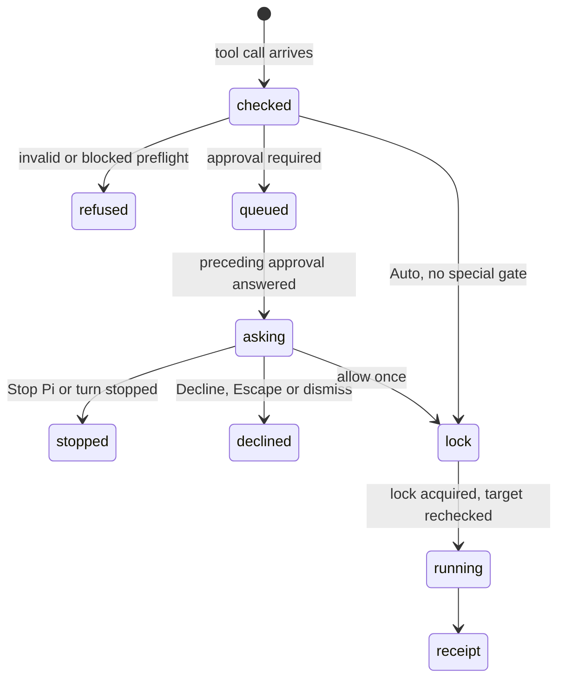

# Confirm mode and approvals

## Summary

As of [PR #808](https://github.com/tmustier/pi-for-excel/pull/808) (WT-01, WT-05), Auto applies ordinary workbook mutations without a dialog; Confirm asks unless the user has allowed reversible workbook changes for the rest of this turn. Irreversible actions still ask in either mode. The mode is shared across tabs and taskpanes on this browser origin and survives reload. Reads never ask. Deleting recovery backups always asks, as do separately gated risky capabilities. Approval is permission for an action, not a promise that Excel will accept it. The dialog is the confirmation: Pi presents a plan for multi-step work but is not instructed to ask the same question in chat.

## The simple case

The user selects Confirm in the status bar or turns off "Auto mode" in Settings. When Pi proposes a write, "Allow this change to the workbook?" names the tab, action and target, with an overwrite sample when preflight found existing content. The user allows it once or chooses "Allow for the rest of this turn"; only then can the call wait for the workbook lock and run. Declining changes nothing and returns a tool error to the model; it does not itself end the turn.

## The interaction, event by event

### Switching the mode

The status-bar mode button, Settings switch and `/yolo` change the same preference. `/yolo on` selects Auto; `off` selects Confirm; `toggle` swaps them; no argument or `status` reports it. Invalid arguments show usage. A change affects subsequent decisions, not an approval already waiting. Other panes receive the setting change without reload.

### `/yolo`

This command changes the same execution preference, not a separate permission bypass. Special capability and destructive-action gates still apply in Auto.

### Ends at once

Reads never ask. Checked writes may refuse invalid/occupied/unsafe targets before asking; they inspect again under the lock. A call stopped before submission changes nothing. User-started recovery has its own preview/confirmation rather than an extra Confirm-mode tool dialog.

### Approval asked

Approvals queue rather than replacing each other. Each identifies its originating tab and action; "{count} more waiting" discloses the queue. Overwrite information names nonempty cells when available. The call has not acquired the workbook lock yet, so this decision does not block unrelated approved work.

### While the dialog is open

The modal takes focus, traps Tab and blocks underlying composer/shortcuts. Other tabs can continue their existing work. "Stop Pi" and the shared stop path withdraw this runtime's current and queued requests. An unanswered approval has no automatic approval timeout.

### Answered

Allowing advances that call toward the lock. "Allow for the rest of this turn" also allows later reversible workbook calls in this run, including requests already queued. The grant is never saved and does not cover the next turn, another tab, guidance changes, MCP calls, backup deletion or irreversible workbook calls. Decline/dismiss returns a cancellation error; the model can explain or choose another action. The next waiting approval is presented, rather than silently cancelled. Focus returns to the opener when possible. Buttons wrap into readable rows in a narrow pane.

## Risky actions ask in any mode

- `workbook_history` delete/clear serialize and always ask "Let Pi delete backups?"; the dialog explains that covered changes will no longer be revertible.
- Structural deletes exceeding automatic backup capacity and chart deletes always ask. A structural delete checks the used data first; more than 20,000 cells without an automatic backup triggers the warning "This can't be undone from Backups. Pi asks for this in every mode."
- Destructive direct Office.js (delete, clear or remove) always asks. Detection uses conservative code scanning, including bracket and Unicode-escaped forms; a false positive costs a dialog, and this heuristic is not a sandbox.
- Direct Office.js also has a capability gate: code referencing browser/network/storage capabilities asks. Confirm gates workbook mutation unless allowed for this turn; these are distinct permissions and can result in two gates.
- A reachable local Python/LibreOffice bridge asks for bridge consent, remembered for that endpoint. Python's in-pane backend does not require a local-bridge permission. See [experimental](../extensions/experimental.md).
- Local Files/extension changes follow Confirm/Auto consent: Confirm asks for local changes; Auto still asks for new code, uninstall and destructive changes to content not created in this chat. There is no experimental permission flag to bypass this rule.

Where the workbook has a canonical identity, destructive dialogs offer **Take a full backup first**. It captures/downloads the full workbook using the same mechanism as `/backup`, then allows the call. Failure does not allow the change. Hosts with only a document-instance identity cannot use this full-file fallback. See [manual backups](manual-backups.md).

## Modifiers

| Modifier | Set before | Changed while busy |
| --- | --- | --- |
| Model and provider | No effect on permission policy. | Busy model change is refused. |
| Thinking level | No effect. | No effect. |
| Execution mode | Decides ordinary mutation approval. | Applies to subsequent calls, not a waiting answer. |
| Files in the workspace, or an overlay open | Local-change consent also applies. | Modal handling prevents typing behind a dialog. |
| Tab state (new, restored, another tab busy) | Request names the originating tab. | Other approvals wait in order. |
| Host (desktop or web) | In-taskpane dialogs on both. | Same policy. |

## Cancel and interrupt

| Event | Before sent | While busy |
| --- | --- | --- |
| Stop (button or Escape) | Escape dismisses the top modal, not the turn beneath. | Stop Pi/shared Stop withdraws this runtime's approval requests. |
| The user sends something else | Composer is blocked by modal. | After dismissal normal steer/follow-up rules apply. |
| Tab switched, created, closed or reopened | Shortcuts do not act behind modal. | Closing busy work uses shared Stop and waits for settlement. |
| An overlay or menu opens | Topmost modal owns focus/Escape. | Later approvals queue, not replace. |
| Model or thinking level changes | No effect on approval. | Model change refused while busy. |
| The provider fails | Permission is local. | Applied work remains. |
| The taskpane goes away | Unapproved work never runs. | Submitted Excel work may complete. |
| The workbook changes underneath | Locked inspection rechecks target after approval. | Approval is not isolation from user/co-author edits. |
| Focus moves to the grid or another window | Approval remains waiting. | No automatic answer. |
| The context window fills | No effect. | No effect. |

Stop cannot recall an Excel batch already submitted. A secondary preparation action, such as taking a full backup, is awaited before approval and cannot allow a withdrawn request afterwards. A stopped turn grant cannot approve later requests.

## Interactions with other systems

**Persistence.** Mode is durable and synchronized; turn grants are not saved. **Workbook changes and recovery.** Approval does not alter backup/verification policy. Approved changes remain after Stop or failure; use the [turn receipt or Backups](backups-and-revert.md) to undo them. **Other tabs and sessions.** Requests are tab-owned and queued; turn grants are not shared between tabs. **Execution mode and approvals.** This document. **Models and providers.** The model is told the mode; chat-level clarification can still precede a tool permission, but Pi is not instructed to duplicate the dialog in chat. Switching Auto/Confirm changes the system-prompt prefix once; a turn grant does not. **Offline and provider errors.** Local dialogs do not need a provider. **Notifications.** Mode feedback and approval announcement; no automatic decision. **Settings and preferences.** The three controls share one value. **Host differences.** Host API failures remain possible after approval. **Language.** Dialog wording, tab attribution and queue labels are translated; tool-authored content stays agent-facing English. **Accessibility and keyboard.** Focus entry, trapped Tab, topmost Escape and focus restoration use shared modal handling.

## Edge cases

- Declining does not prevent the model from asking for a different or repeated action.
- Changing to Auto does not silently approve an already-presented request.
- Two mutations in one response require separate queued answers in Confirm unless the user allows reversible workbook changes for this turn.
- Local consent, workbook mutation consent and direct-code/bridge consent are distinct boundaries.

## Open questions and verification

Merged approval queue, execution policy, settings synchronization, preflight and modal source inspected. The earlier APPROVE findings remain in historical logs; they do not describe the merged queue/focus/deletion contract. This pass observed modal focus in the real Excel-web resume picker, not every permission path. Desktop and all multi-pane races need separate acceptance.

PR #808: real GPT-6 Luna turns in Excel on the web wrote two cells in separate calls after one turn grant; the next turn asked again. Auto asked before a 20,001-cell sheet deletion, and Stop withdrew it without deleting the sheet. Public-interface tests cover queued/future turn grants, new-run isolation, irreversible consent and abort during secondary actions. Native desktop acceptance for these additions remains separate from the web evidence.

Verified against pi-for-excel baseline `1f51cf8` and PR #808 head `cac00cc1` (source, tests and the live acceptance above).
