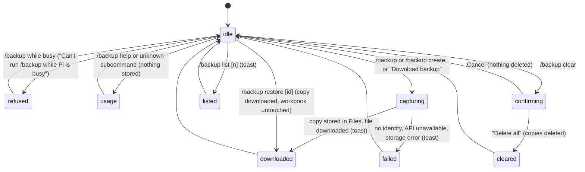

# `/backup`

## Summary

A [manual backup](../glossary.md#the-workbook) is a complete copy of the workbook file, taken when the user asks for it. It is the coarse safety net next to the fine-grained automatic [backups](backups-and-revert.md): it covers everything in the file (including what Pi's tools cannot back up, such as deleted charts, tables or direct Office.js changes, and the user's own edits), it is not cleared when the workbook is saved, and it is restored not by Pi but by opening the downloaded file in Excel. The command is `/backup`, with the subcommands `create` (the default), `list`, `restore` and `clear`; the "Download backup" button in the Backups dialog does the same as `create`. Copies are stored in the [Files workspace](../files/the-files-workspace.md) under `manual-backups/` and are downloaded as `.xlsx` files. `/backup` is refused while the active tab is busy, needs no provider, and only works for a workbook that has been saved at least once.

## The simple case

Before asking Pi to restructure a model, the user types `/backup` and presses Enter. After a moment, the browser opens or downloads a file named like `2026-10-26T14-03-12-511Z_budget.xlsx_1a2b3c4d.xlsx`, and a toast says "Manual backup created: #2026-10-26T14-03-12-511Z… (184 KB)." The same file is kept in the Files workspace.

Later, the user wants to see the workbook as it was. They type `/backup restore`. The latest copy is downloaded again and the toast says "Downloaded backup #2026-10-26T14-03-12-511Z…. Open the file in Excel to restore." The current workbook is not touched: the user opens the downloaded file in Excel as a separate workbook and copies back what they need, or keeps it instead of the original.

## The interaction, event by event

### Typing the command

`/backup` takes one word, case-insensitive, and for `list` and `restore` an optional second one:

| Typed | Does |
| --- | --- |
| `/backup`, `/backup create` | Takes a copy, stores it, downloads it. |
| `/backup list`, `/backup list 8` | Shows the newest copies in a toast: 5 by default, 1 to 10. A non-number falls back to 5. |
| `/backup restore` | Downloads the newest copy for this workbook. |
| `/backup restore {id}` | Downloads the copy with exactly that id. |
| `/backup clear` | Asks, then deletes every copy for this workbook. |
| `/backup help`, or any other word | Shows "Usage: /backup [create|list [limit]|restore [id]|clear]". |

Before anything else, the workbook must have an identity, which a workbook gets when it is saved (see [the workbook](../foundations/the-workbook.md#workbook-identity)). Copies belong to the workbook identity that was current when they were taken.

### Ends at once

Nothing is stored, downloaded or deleted when:

- the active tab is busy ("Can't run /backup while Pi is busy"; the composer is cleared, confirmed in Excel on the web);
- the subcommand is `help` or unknown (the usage toast);
- `list` finds no copies ("No manual full-workbook backups for this workbook.");
- `restore` finds no copy, or none with that id ("Could not find backups for this workbook.");
- `clear` is cancelled in its confirmation;
- the workbook has no identity (never saved on desktop, or opened through an anonymous sharing link on Excel on the web): `create` and `restore` fail with "Backup command failed: Current workbook identity is unavailable; cannot create or restore manual full-workbook backups safely."; `list` reports "No manual full-workbook backups for this workbook."; `clear` still opens its confirmation and only fails with the same message after "Delete all" (all confirmed in Excel on the web).

### Capturing

`/backup create` asks Excel for the whole workbook file and reads it in 1 MB pieces. This is the only slow step; for a large workbook it can take seconds, with no progress shown in the transcript. (The Backups dialog's "Download backup" button shows "Capturing…" in its status.) Once Excel has handed over the file, the copy is written into the Files workspace at `manual-backups/full-workbook/v1/{workbook}/{id}.xlsx`, tagged with the current workbook, and then downloaded.

The id is the capture time, the workbook's file name and a short random suffix: `2026-10-26T14-03-12-511Z_budget.xlsx_1a2b3c4d`. The file name is the id plus `.xlsx`.

### While capturing

The command runs in the taskpane, not as part of a turn: the tab does not become busy, no tool card appears, and the [workbook lock](../foundations/the-workbook.md#the-workbook-lock) is not taken. Pi can therefore be writing to the workbook in another tab while the copy is taken, and the copy may include some of those changes and not others.

### Finishes

- **Create.** Toast "Manual backup created: #{id} ({size})." From the Backups dialog: "Backup downloaded: #{id} ({size})". The download opens in a new browser window or tab, or, when that is blocked, as a file download.
- **List.** Toast "Manual backups (showing {count}): {preview}", where the preview is the first three ids, each cut after 24 characters with "…", followed by ", …" when more were found.
- **Restore.** The copy is downloaded again; toast "Downloaded backup #{id}. Open the file in Excel to restore." Nothing in the current workbook changes. Restoring means opening the file in Excel, where it is a separate workbook with a different name and location; to replace the original, the user saves it over the original themselves.
- **Clear.** After the confirmation, every copy for this workbook is deleted from the Files workspace; toast "Deleted {count} manual backups." Copies already downloaded to the computer are not affected.

Any other failure shows "Backup command failed: {message}" (from the Backups dialog, "Backup failed: {message}"), for example "Manual full-workbook backup is unavailable: Office document file API is not available." or "Downloads are not available in this environment." A copy may have been stored even if its download then failed.

## Where copies live

Copies are files in the Files workspace, visible in the [Files dialog](../files/the-files-workspace.md) under `manual-backups/full-workbook/v1/`, tagged with their workbook. Where the Files workspace keeps them depends on its storage: a folder on disk if the user connected one, otherwise the browser's private storage for the add-in. If neither is available, the workspace keeps files in memory only and the copies are lost when the taskpane closes.

There is no size or count limit beyond what the storage allows; copies are never cleared automatically, including when the workbook is saved. They do not count against the 120 automatic backups.

## The confirmation for clear

`/backup clear` opens an overlay titled "Delete all manual full-workbook backups?", with the message "This will delete all manual full-workbook backups for the active workbook." and the buttons "Cancel" and "Delete all" (red). Escape, the header close and a click on the backdrop cancel. Focus returns to the composer.

## Modifiers

| Modifier | Set before | Changed while busy |
| --- | --- | --- |
| Model and provider | No effect. `/backup` needs no provider. | Refused while the active tab is busy. |
| Thinking level | No effect. | No effect. |
| Execution mode | No effect. Taking or downloading a copy never asks for approval. | No effect. |
| Files in the workspace, or an overlay open | Copies are stored in the Files workspace; a connected folder means they are written there. An open overlay prevents typing the command; "Download backup" in the Backups dialog is the overlay path. | A capture in progress continues if an overlay opens. |
| Tab state (new, restored, another tab busy) | Works from any idle tab. Another tab being busy does not block it, and that tab's writes are not paused. | Refused while this tab is busy. |
| Host (desktop or web) | Requires the host's whole-file API. Workbooks without an identity (never saved on desktop; opened through an anonymous link on the web) cannot be backed up. How the download appears differs by host (see [Open questions](#open-questions-and-verification)). | No effect. |

A capture uses the state of the workbook at the moment Excel produces the file.

## Cancel and interrupt

| Event | Before sent | While busy |
| --- | --- | --- |
| Stop (button or Escape) | Escape in the composer moves focus out; nothing runs. Escape in the clear confirmation cancels. | A capture cannot be stopped; Stop applies only to turns. |
| The user sends something else | Not applicable. | The capture continues; the user can send a message, which starts a turn in parallel. |
| Tab switched, created, closed or reopened | The command acts on the workbook, not the tab. | The capture continues; its toast appears on whatever tab is active. |
| An overlay or menu opens | Not applicable. | The capture continues. |
| Model or thinking level changes | No effect. | No effect. |
| The provider fails | No effect. | No effect. |
| The taskpane goes away | Nothing happens. | A copy not yet written to the Files workspace is lost; one written but not downloaded stays in the workspace. |
| The workbook changes underneath | Not applicable. | Edits made while Excel is producing the file may or may not be in the copy. Saving does not delete copies. |
| Focus moves to the grid or another window | Not applicable. | The capture continues. The download window may take focus away from Excel. |
| The context window fills | No effect. | No effect. |

After any interrupt the current workbook is unchanged: `/backup` never writes to it.

## Interactions with other systems

**Persistence.** Copies persist in the Files workspace independently of sessions and of automatic backups. See [persistence and restore](../cross-cutting/persistence-and-restore.md).

**Workbook changes and recovery.** Manual backups never change the workbook. They complement automatic backups: use them before large or structural work, or before saving if the automatic backups will be needed later.

**Other tabs and sessions.** All tabs share the same copies. Pi can read the files through its files tool like any workspace file, but has no tool to create or restore manual backups.

**Execution mode and approvals.** None.

**Models and providers.** None.

**Offline and provider errors.** None.

**Notifications.** Toasts only. The download itself appears as a new browser window or tab, or a download.

**Settings and preferences.** None. Connecting a folder in the Files workspace changes where copies are written.

**Host differences.** See [Modifiers](#modifiers) and [host differences](../cross-cutting/host-differences.md).

**Language.** The toasts, usage text and confirmation are translated; ids, paths and error messages from Excel or the workspace are not.

**Accessibility and keyboard.** Entirely keyboard-driven through the composer. The clear confirmation takes focus and returns it to the composer.

## Edge cases

- The toast after `create` and the `list` preview cut the id after 24 characters, which is exactly its timestamp, so the full id needed by `/backup restore {id}` is not shown anywhere except the file name in the Files dialog or the download.
- Two copies taken in the same millisecond still differ by their random suffix.
- After "Save As" or renaming the file, `/backup list` no longer shows copies taken under the old name; they remain in the Files workspace.
- A copy of a workbook with unsaved changes: whether those changes are included depends on what Excel returns (see [Open questions](#open-questions-and-verification)).
- `/backup create` downloads the file every time; there is no way to store a copy without downloading it.

## Open questions and verification

- Checked by hand in Excel on the web (orb session, `ec453df`), 26 October 2026, but only on an anonymous-link workbook, which has no identity: the refusals, the usage toast, the clear confirmation and the busy refusal were confirmed; creating, listing, restoring and clearing real copies could not be run. See [the workbook checklist](../verification/workbook.md#workbookmanual-backupsmd). Those items need desktop Excel or a signed-in workbook on the web.
- `/backup clear` asks for confirmation before checking the workbook identity, so on a workbook without one the user confirms a deletion that then fails (`src/commands/builtins/session.ts:180-193`). Minor bug. BACKUP-06.
- Typing `/backup list` and pressing Enter while the command menu is still open runs the highlighted command with no arguments, that is `/backup create`; the menu must be closed first (see [the command menu](../commands/the-command-menu.md)).
- The ids shown in toasts are cut to 24 characters (`src/commands/builtins/session.ts:80-81`), which is the timestamp part only, so `/backup restore {id}` cannot be used with an id copied from a toast. Looks like a bug. Confirmed in Excel for Mac (BACKUP-09): the id from the toast and from `/backup list` gives "Could not find backups for this workbook.", while the full id works.
- The download opens a blank window first to keep the user's click "active" (`src/files/workspace.ts:1450`), but after a slash command the capture runs first; confirmed in Excel for Mac that neither works in WKWebView: `/backup` and `/backup restore` show their toasts ("Manual backup created: #… (11 KB).", "Downloaded backup #…. Open the file in Excel to restore.") but no file, window or save dialog appears, with Excel in front or not (BACKUP-08, BACKUP-10, BACKUP-11). The copy is still stored in Files. WebView2 (Windows) and the browser (Excel on the web) have not been checked. DECISIONS notes that WKWebView ignores programmatic link clicks.
- Whether Excel's whole-file API returns unsaved changes on each host has not been checked.
- Whether "Download backup" in the Backups dialog should be reachable when there are no automatic backups (the toolbar is hidden then, `src/commands/builtins/settings-pages/backups-page.ts`, `syncVisibility`) is a product call. Confirmed hidden in the empty state.
- `/backup` does not take the workbook lock, so a copy taken while Pi writes in another tab may capture a half-finished change. Read from code.
- Very large workbooks are held in memory several times (bytes, base64) during capture; the size at which this fails has not been measured.

Verified against pi-for-excel commit `ec453df`.
