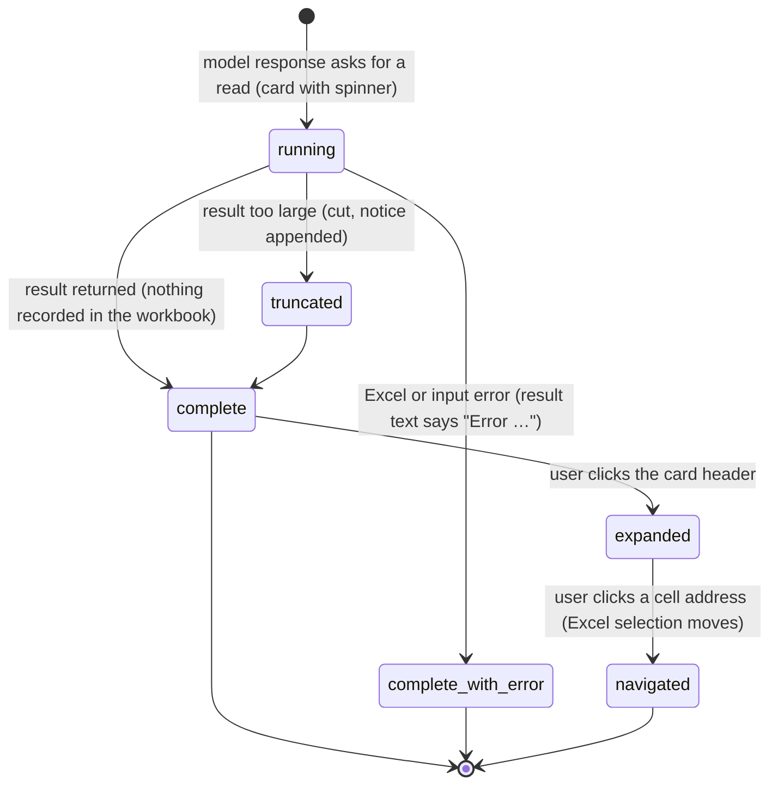

# Reading the workbook

## Summary

Reading is how Pi learns what is in the workbook before it answers or changes anything. Five tools do it: the workbook overview, reading a range, searching, tracing dependencies, and explaining a formula. The user never starts a read directly; Pi decides to read in the middle of a [turn](../foundations/turns.md), and each read appears in the transcript as a [tool card](../glossary.md#the-turn) with a short header ("Read Sheet1!A1:D20", "Trace precedents D10") that can be expanded to show the input and the result. Reads never change the workbook, never ask for [approval](confirm-mode-and-approvals.md), never wait for the [workbook lock](../foundations/the-workbook.md#the-workbook-lock), and take no backup. Cell addresses on the cards are links: clicking one selects that range in Excel. Reading works the same on Excel desktop and Excel on the web, and needs a provider only because a turn does.

## The simple case

The user asks "What's in this workbook?" A card headed "Overview" appears with a spinner, and a moment later completes. Expanded, its "Result" section lists every sheet with its size ("120 rows × 8 cols"), its first header row, its tables and object counts, and the workbook's named ranges. Pi then reads part of a sheet: a card "Read Summary!A1:F30" appears and completes; expanded, it shows the cells as a grid with column letters and row numbers.

Pi writes its answer using what it read. The user clicks "Summary!A1:F30" in the card header, and Excel switches to the Summary sheet and selects A1:F30. Nothing in the workbook changed.

## The interaction, event by event

### What Pi reads

Each read tool targets something different, and its card header says what:

- **Overview** (`get_workbook_overview`). Header "Overview", followed by a sheet name when Pi asks about one sheet. The whole-workbook overview lists, for each sheet in tab order: its name, "(Hidden)" or "(VeryHidden)" when it is not visible, its used size or "empty", up to 8 non-empty values from row 1 as headers ("… (+N more)" beyond that), each table with its size, and counts of charts, pivot tables and shapes; then the visible named ranges with their formulas. The one-sheet version adds a data preview. The same overview is what Pi is given automatically before its first request; see [auto-context](../turn/auto-context.md).
- **Read** (`read_range`). Header "Read {address}", or "Export {address} (CSV)" for the CSV form. Three forms: a compact grid of values with column letters and row numbers (the default); CSV, shown in the card as a table under the label "Data" with a "Copy CSV" button; and a detailed form that adds formulas, number formats (with readable labels such as "currency (£, 2dp)" for formats Pi recognizes) and the comments inside the range. A range with no values, formulas or errors shows "_All cells are empty._" instead of a grid. Cells showing an Excel error (`#REF!`, `#DIV/0!`, …) are listed under "⚠️ Errors".
- **Search** (`search_workbook`). Header built from the first line of the result: "**3** match(es) for "Revenue":". Searches values by default, formula text on request, plain text or a regular expression, case-insensitive. It returns up to 20 matches unless Pi asks for more, with "(limit reached)" when there were more, and can include up to 10 rows of surrounding context per match. Each match shows the qualified address, the value cut at 60 characters, and the formula. With no match: "No matches for "{query}" in any sheet (searched values)."
- **Trace** (`trace_dependencies`). Header "Trace precedents {cell}" or "Trace dependents {cell}". The result, labeled "Precedents" or "Dependents", is a tree of cells with their formulas; each address is a link and deeper branches can be expanded and collapsed. Two levels deep by default, at most five. A cell with no formula gives "{cell} has no formula — it's a direct value or empty."
- **Explain formula** (`explain_formula`). Header "Explain formula {cell}". The result, labeled "Formula explanation", has a one-paragraph explanation, the formula after "Formula:", and "Direct references (N)" with each reference as a link and a preview of its value ("→ 1,250"). Up to 8 references are previewed by default and 20 at most ("Showing the first N reference(s)."). A cell without a formula gets a sentence saying it holds a static value.

> Technical note: the explain-formula explanation is assembled by Pi from fixed English phrases for common functions ("adds values", "looks up a matching value and returns a related result"), not written by the model. It reads the same every time and is not translated.

### Ends at once

Some reads finish immediately without reading anything useful. The card completes normally (not in the error style) and the result text says why:

- the address is malformed or the sheet does not exist ("Error reading "{range}": …", "Error searching: …");
- trace or explain was given a range instead of a single cell ("Error: trace_dependencies expects a single cell, not a range.");
- a regular expression does not compile ("Invalid regex "{query}": …").

The model sees the text and usually retries with a corrected input. Nothing is recorded anywhere.

### The read runs

A read is committed the moment the tool call arrives: it goes straight to Excel. It is not queued behind another tab's mutation and is not shown in the approval flow even in Confirm mode. It may run at the same time as other reads in the same model response; each has its own card.

### While Pi reads

The card shows a spinner in its header, and its input section is available if the user expands it. Large reads (thousands of rows) take visibly longer, and search and dependents-tracing scan every used cell of every visible sheet. The user can keep scrolling, switch tabs, or stop; see [Cancel and interrupt](#cancel-and-interrupt).

### Finishes

The card completes collapsed: the header says what happened. Expanding it shows "Input" (the tool's inputs in plain words) and the result. What the model receives is the same text, subject to the size limit below. Nothing is saved to the workbook; the result is saved with the session as part of the transcript once the session is saved (see [persistence and restore](../cross-cutting/persistence-and-restore.md)).

**Size limit.** Every tool result, reads included, is cut when it exceeds 50 KB or 2,000 lines, whichever comes first. For models whose context window is under 128k tokens, both limits shrink in proportion (but never below 8 KB and 200 lines). The first part is kept and a notice is appended: "[Output truncated: showing first N of M lines (…); limits: … lines / …]". When the full result is 512 KB or smaller, it is also saved in the [Files workspace](../files/the-files-workspace.md) under `.tool-output/`, and the notice ends "; full output saved to Files workspace: {path}". Pi can then read the rest from there.

## Cell links

Addresses on tool cards are links: the card header's address, the cells in a "Changes" table, references in a formula explanation, nodes in a dependency tree, and citations under "Explain these changes". Clicking one:

- activates the sheet named in the address (or the active sheet if none) and selects the range, so Excel scrolls to it and draws its normal selection;
- for a list of ranges, selects only the first one;
- is ignored if it comes within 0.3 seconds of the previous click.

Selecting is not a mutation: it takes no lock, asks for no approval, and records no backup. It does change the user's selection, which Pi will see as the current selection at the next send (see [auto-context](../turn/auto-context.md)). Cell addresses written in Pi's own prose are plain text, not links; see [message rendering](../ui/message-rendering.md).

## Hidden sheets

Hidden and very hidden sheets are listed in the overview with their state. Pi can read, trace and explain cells on them when it names the sheet. Search skips every sheet that is not visible unless Pi names the sheet; a search "in any sheet" says nothing about hidden ones.

## Modifiers

| Modifier | Set before | Changed while busy |
| --- | --- | --- |
| Model and provider | The model decides which reads to make. Models with a context window under 128k tokens get smaller result limits. | Model changes are refused while the tab is busy. |
| Thinking level | No effect on the read itself. | No effect. |
| Execution mode | No effect. Reads never ask, in Auto or Confirm. | No effect. |
| Files in the workspace, or an overlay open | No effect on reads. Truncated results are saved to the Files workspace when small enough. | An overlay does not pause a read in progress. |
| Tab state (new, restored, another tab busy) | No effect. Another tab holding the workbook lock does not delay a read. | No effect. |
| Host (desktop or web) | No known difference. | No effect. |

Nothing changed mid-read affects that read; it affects the next tool call.

## Cancel and interrupt

| Event | Before sent | While busy |
| --- | --- | --- |
| Stop (button or Escape) | Not applicable: the user cannot start a read. | The turn ends as aborted; a read already sent to Excel finishes but its result is not used. A read not yet started reports "Operation aborted". |
| The user sends something else | Not applicable. | A steer waits until the running reads finish. |
| Tab switched, created, closed or reopened | Not applicable. | The read continues in its tab. Closing the tab asks "Stop and close this tab?" while it is responding. |
| An overlay or menu opens | Not applicable. | The read continues. |
| Model or thinking level changes | Not applicable. | Model change refused; thinking level applies to the next model response. |
| The provider fails | Not applicable. | The read itself does not use the provider and finishes; the turn may then fail. |
| The taskpane goes away | Not applicable. | The read and its result are lost unless the session had already saved that message. |
| The workbook changes underneath | Not applicable. | The read sees the grid as it is when it runs. An address without a sheet name reads from whichever sheet is active at that moment. |
| Focus moves to the grid or another window | Not applicable. | The read continues. Clicking a cell link moves Excel's selection but not the taskpane's focus. |
| The context window fills | Not applicable. | The result is cut to the size limit before it joins the conversation; older results may later be summarized by [compaction](../turn/context-and-compaction.md). |

After an interrupt the cards that completed stay in the transcript with their results; nothing in the workbook needs undoing.

## Interactions with other systems

**Persistence.** Read results are part of the session's messages and are saved with it. Truncated full results saved under `.tool-output/` stay in the Files workspace until removed. See [persistence and restore](../cross-cutting/persistence-and-restore.md).

**Workbook changes and recovery.** None. Reads make no backup and no audit entry.

**Other tabs and sessions.** Reads in different tabs run independently and do not wait for each other or for mutations.

**Execution mode and approvals.** None; see [the execution mode](../foundations/the-workbook.md#the-execution-mode).

**Models and providers.** Result size limits scale down for small context windows.

**Offline and provider errors.** Reads talk only to Excel and work offline; the turn that uses them does not.

**Notifications.** None beyond the tool card. No toast.

**Settings and preferences.** None. Formatting conventions change the readable labels in the detailed read form; see [conventions](../guidance/conventions.md).

**Host differences.** None known. Dependency tracing uses Excel's own precedent and dependent lookup when the host offers it and falls back to reading formulas otherwise, which can give different trees on different hosts.

**Language.** Card headers other than "Overview", the section labels ("Input", "Result", "Data", "Precedents", "Formula explanation"), result text and the formula explanation are English in every UI language.

**Accessibility and keyboard.** Cards and cell links are buttons and links reachable with Tab; Ctrl/Cmd+O shows or hides tool details (see [tool calls](../turn/tool-calls.md)). The selection a link makes in Excel is not announced by the taskpane.

## Edge cases

- Reading a whole column ("A:A") reads the full sheet height and is likely to be truncated.
- Search values are shown cut at 60 characters, context cells at 20.
- A dependents trace scans at most 50,000 formula cells and lists at most 80 children per cell, then adds "_Trace output was truncated to keep the result responsive._".
- Named ranges marked invisible in Excel are left out of the overview.
- A cell link whose sheet has since been renamed or deleted does nothing visible.
- The CSV "Copy CSV" button copies the whole CSV the card holds, not only the visible part.

## Open questions and verification

- Read from code; none of the card wording has been checked in the running product.
- `foundations/turns.md` describes the overview card as "Workbook Overview"; the header shown is "Overview" (`tools.action.overview`), with "Workbook Overview" only as the tool's label. One of the two documents should change in the consistency pass.
- Whether a failed read should render in the error style: tool errors are returned as normal text ("Error reading …"), so the card looks successful. Probably intentional (the model handles it), but the user cannot tell at a glance.
- Whether the truncated-output copy is written to the Files workspace when the Files workspace has never been opened has not been checked.
- Clicking a cell link while Excel is in cell-edit mode: behavior not checked.

Verified against pi-for-excel commit `ec453df`.
