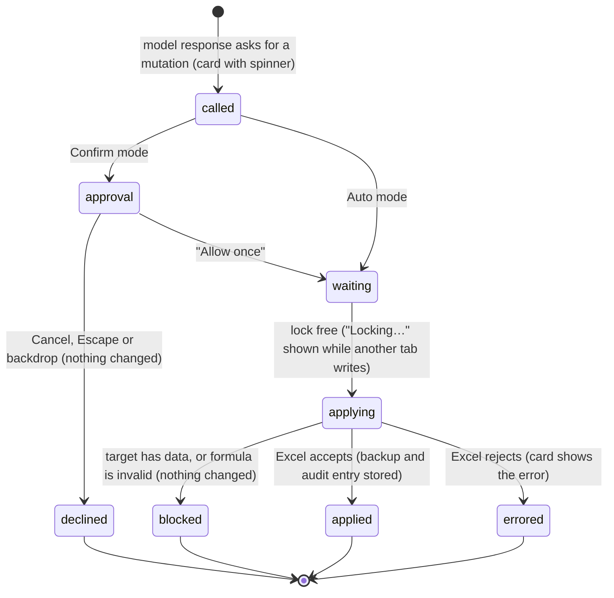

# Writing to the workbook

## Summary

Writing is how Pi changes the workbook: entering values and formulas, filling a formula down a range, inserting and deleting rows, columns and sheets, formatting, conditional formatting, view settings, comments and charts. Every one of these is a [mutation](../glossary.md#the-workbook). Like reads, mutations are chosen by Pi during a [turn](../foundations/turns.md) and shown as [tool cards](../turn/tool-calls.md); unlike reads, each one runs under the [workbook lock](../foundations/the-workbook.md#the-workbook-lock), asks for [approval](confirm-mode-and-approvals.md) first when the execution mode is Confirm, and, for most tools, leaves a [backup](backups-and-revert.md) the user can revert. The change appears in the grid as soon as the card completes. The card header carries a short receipt ("Edit Sheet1!D2:D20 — 19 changed"), and the expanded card shows a before-and-after table for cell writes and an "Explain these changes" drawer for every mutation. Writing works on Excel desktop and Excel on the web; it needs a provider only because a turn does.

## The simple case

The user asks Pi to add a "Margin" column. In Auto mode, the default, Pi first reads the sheet, then a card "Edit Sheet1!E1:E20 — 20 changed" appears and the values and formulas land in column E. Pi then formats the new column: a card "Format Sheet1!E2:E20" completes and the cells show as percentages.

Expanding the first card shows the inputs as a small preview table, Pi's verification of what Excel now holds, and a "Changes (20)" section listing the first 12 cells with their "Before" and "After" values. Clicking "Explain these changes" opens a short description of what changed, with links to the cells.

Pi finishes its answer. The workbook now has the new column, unsaved. Each of the two changes has a backup, and either can be reverted from the Backups dialog until the workbook is saved.

## The interaction, event by event

### What Pi can change

Each tool, with its card header and the details the user can see:

- **Write cells** (`write_cells`). Writes a rectangle of values from a start cell; text starting with "=" is a formula. Header "Edit {address}" followed by the receipt (" — 4 changed", " — 4 changed, 1 error"). Before writing, Pi checks the formulas' syntax; a bad formula blocks the whole write ("⛔ Write blocked — invalid formula syntax detected:").
- **Fill formula** (`fill_formula`). Puts one formula in the top-left cell of a single contiguous range and lets Excel fill it across, adjusting references as Excel's fill handle would. Header "Filled {address}" with the same receipt. The result shows "**Formula pattern:**" and "**Example formulas:** top-left …, bottom-right …".
- **Modify structure** (`modify_structure`). Insert or delete rows or columns, add, delete, rename, duplicate, hide or unhide a sheet. The header is the result sentence, for example "Inserted 3 row(s) at row 5 in "Sheet1"." or "Deleted sheet "Old"." There is no confirmation in Auto mode, including for deletes.
- **Format cells** (`format_cells`). Font, fill, number format (including named styles such as "currency" or "header"), borders, alignment, wrap, column width in Excel's character units, row height, auto-fit, merge and unmerge, on one range or several ranges of the same sheet. Header "Format {address}". When nothing needs saying, the result is replaced by "✓ Done"; warnings (for example a column width that may differ because the font is not Arial 10) are shown instead.
- **Conditional format** (`conditional_format`). Adds a rule (formula, cell value, text, top/bottom, data bar, color scale, icon set and others) or clears all rules in a range. Header "Cond. format {address}", result "✓ Done" when clean.
- **View settings** (`view_settings`). Gridlines and headings on or off, freeze rows, columns or at a cell, unfreeze, tab color, hide, show or very-hide a sheet, standard column width, and switching the active sheet. Headers such as "Hide gridlines (Sheet1)", "Freeze Sheet1!B2", "Activate Sheet2". These changes have no backup, so the header always ends " — no backup".
- **Comments** (`comments`). Add, edit, reply to, delete, resolve or reopen the comment on one cell. Headers "Add comment {cell}", "Reply {cell}", "Resolve {cell}", and so on.
- **Charts** (`charts`). Create a column, bar, line, area, pie, doughnut, scatter or radar chart from a source range; update a chart's type, title, legend, position or source; delete a chart. Headers "Chart 'Sales' created — Sheet1!A1:B13", "Chart 'Sales' updated", "Chart 'Sales' deleted — no backup". Pi can also capture a chart as a picture to check its work ("Chart image 'Sales' (600×360px)"), which is a read; the picture appears in the card.

There is no tool for named ranges, Excel tables, pivot tables or data validation. Pi can only create or change those with direct Office.js, which has its own approval rules and no backup; see [experimental](../extensions/experimental.md) and [confirm mode and approvals](confirm-mode-and-approvals.md#risky-actions-ask-in-any-mode).

### Ends at once

A mutation can end without changing anything:

- **Overwrite protection.** `write_cells` and `fill_formula` refuse to write over cells that already hold a value or a formula, unless Pi explicitly set the overwrite flag. Formatting, conditional formats and validation rules alone do not count as data. The card header ends " — blocked" ("Write {address} — blocked"), and the result shows "⛔ Write blocked — {address} contains N non-empty cell(s).", the existing data as a table, and the instruction to Pi: "To overwrite, confirm with the user and retry with `allow_overwrite: true`." Pi usually stops and asks the user in its reply; the user answers in a new message. Nothing was written, but the call still counted as a mutation: in Confirm mode the user was asked to approve a write that then did not happen.
- **Invalid input.** An empty value array, a start cell that is a range, a fill formula that does not start with "=", a multi-area fill range, a sheet that does not exist: the card completes with "Error: …" text, and Pi usually corrects itself.
- **Approval declined.** In Confirm mode, Cancel fails the call; see [confirm mode and approvals](confirm-mode-and-approvals.md).
- **Stopped while waiting.** A mutation still waiting for approval or the lock when the user stops the turn does nothing.

### Applied

A mutation commits when Excel accepts it. At that moment:

- The grid changes. Excel's selection does not move, except when Pi switches the active sheet on purpose.
- For write cells and fill formula, Pi reads the target back at once and reports what Excel now holds: "Written to **{address}** (r×c)", any cells showing an Excel error ("⚠️ **N formula error(s):**" with each address, error and formula), and a preview of the verified values limited to 8 rows by 6 columns ("_Showing preview only (N more rows and M more columns)._").
- A backup of what was there is stored (see [backups and revert](backups-and-revert.md)), unless the tool has none or the change was larger than 20,000 cells, in which case the header ends ", no backup" or " — no backup" and the result says "ℹ️ Backup not created …".
- An audit entry is added to the local change log.

### While Pi writes

The card shows a spinner. Before the change, the tab may show "Locking…" while another tab's mutation runs. While this tab's mutation is applying, the tab cannot be closed ("Wait for workbook changes to complete"). The user can keep working in the grid; see [Cancel and interrupt](#cancel-and-interrupt).

### Finishes

The completed card, expanded, has up to four sections:

- **Input.** Pi's inputs in plain words: ranges as links, colors named with a colored dot ("Fill ● White"), and for write cells a mini table of up to 3 rows by 6 columns of the values written.
- **Result.** The tool's report, as described above.
- **Changes (N).** For write cells and fill formula only: a table with "Cell", "Before" and "After" columns for up to the first 12 changed cells, each address a link, an empty cell shown as "∅", formulas shown on a second line after "ƒ". When more cells changed: "Showing first N changed cell(s)."
- **Explain these changes.** A closed drawer on every mutation card. Opened, it shows a short explanation of what changed and "Citations:" with links to the affected ranges, or "No range citations available.". It may add "Limited metadata available; explanation is high-level." or "Explanation uses a bounded metadata sample." The explanation is built by Pi from the recorded change data, in English; it does not call the model and does not cost tokens.

The model receives the result text and continues the turn. If it wrote a formula that evaluates to an error, it usually notices from the verification and fixes it.

**Failure path.** If Excel rejects the change (a protected sheet, a merged area that cannot be partly written, an array formula in the way), the card completes with the error text ("Error writing cells: …") and nothing is recorded. If Excel applied part of a multi-step change before failing (some formatting properties but not others), that part stays and has no backup.

## Modifiers

| Modifier | Set before | Changed while busy |
| --- | --- | --- |
| Model and provider | The model decides what to change and whether to retry after a block. | Model changes are refused while the tab is busy. |
| Thinking level | No effect on the mutation itself. | No effect. |
| Execution mode | Auto: changes apply as Pi calls them. Confirm: each change, including one that will be blocked, waits for "Allow once"; Pi is also told to ask in chat before changing things. | Applies from the next mutation. |
| Files in the workspace, or an overlay open | No effect. An open overlay does not pause a mutation, but a second approval dialog replaces the first. | No effect. |
| Tab state (new, restored, another tab busy) | Another tab's mutation makes this one wait ("Locking…"). | No effect. |
| Host (desktop or web) | Same tools. On a never-saved desktop workbook, backups use a token stored in the document. | No effect. |

Mid-interaction changes take effect at the next tool call, never during one.

## Cancel and interrupt

| Event | Before sent | While busy |
| --- | --- | --- |
| Stop (button or Escape) | Not applicable: the user does not start a mutation. | A mutation waiting for approval or the lock does nothing. One already in Excel completes, keeps its backup, and its card shows the real result. Mutations in the same model response that had not started report "Operation aborted". |
| The user sends something else | Not applicable. | A steer is delivered after the running mutations finish. Telling Pi "don't overwrite that" does not stop a write already applying. |
| Tab switched, created, closed or reopened | Not applicable. | The mutation continues in its tab. The tab cannot be closed while its mutation holds the lock. |
| An overlay or menu opens | Not applicable. | The mutation continues. Opening Backups and restoring waits for the lock, then applies. |
| Model or thinking level changes | Not applicable. | Model change refused. |
| The provider fails | Not applicable. | A running mutation finishes and stays; the turn then fails. |
| The taskpane goes away | Not applicable. | A change already sent to Excel may be applied without its backup being stored. |
| The workbook changes underneath | Not applicable. | If the user types into the target range between Pi's read and its write, overwrite protection catches it only if Pi did not ask to overwrite. If the user switches sheets, addresses without a sheet name go to the new active sheet. |
| Focus moves to the grid or another window | Not applicable. | The mutation continues; if the user is editing a cell, Excel may hold it until the edit ends. |
| The context window fills | Not applicable. | No effect on the change. |

After any interrupt, changes already applied stay in the workbook; the transcript shows which cards completed. The user can revert them from Backups.

## Interactions with other systems

**Persistence.** The change is in the workbook, unsaved until the user saves in Excel. Backups and the audit log are in the add-in's browser storage. The cards are saved with the session. See [persistence and restore](../cross-cutting/persistence-and-restore.md).

**Workbook changes and recovery.** Every tool except view settings, chart delete and direct Office.js takes a backup when it can; see [the workbook](../foundations/the-workbook.md#backups) for what each captures and [backups and revert](backups-and-revert.md) for restoring.

**Other tabs and sessions.** Mutations from all tabs run one at a time under the workbook lock.

**Execution mode and approvals.** See [confirm mode and approvals](confirm-mode-and-approvals.md).

**Models and providers.** None beyond the model's choices.

**Offline and provider errors.** None: mutations talk only to Excel.

**Notifications.** The tool card, the "Locking…" label, and approval dialogs. No toast.

**Settings and preferences.** Formatting conventions (default font, preset number formats, header style) change what "currency", "header" and similar styles produce; see [conventions](../guidance/conventions.md). Rules may tell Pi how to write; see [rules](../guidance/rules.md).

**Host differences.** See [host differences](../cross-cutting/host-differences.md). Backups for never-saved workbooks exist only where the document can carry a token.

**Language.** Card headers, section labels ("Changes", "Before", "After", "Explain these changes", "Citations:") and results are English in every UI language.

**Accessibility and keyboard.** The "Explain these changes" drawer is a native disclosure that opens with Enter or Space. Cell links in the "Changes" table are keyboard-reachable. Ctrl/Cmd+O shows or hides tool details.

## Edge cases

- Writing the same values that are already there counts as a mutation with "0 changes" in its backup and no "Changes" section.
- A write whose rows are of different lengths is padded with empty strings; when overwriting, those padded cells are cleared.
- Deleting rows, columns or a sheet larger than 20,000 cells of data proceeds without a backup; the card says "no backup".
- Hiding a sheet with `modify_structure` has a backup; hiding it with `view_settings` does not.
- Updating a chart's source range cannot be reverted: "ℹ️ Chart property backup only. Excel does not expose the previous source range, so `workbook_history` cannot revert this update's data-source change."
- Filling a formula copies the top-left cell's formatting across the range, as Excel's fill does; the backup only covers values and formulas.
- Several mutations in one model response appear as several cards; consecutive cards of the same kind may be grouped ("3 edits"); see [tool calls](../turn/tool-calls.md).

## Open questions and verification

- Read from code; the grid behavior, card wording and timing have not been checked in the running product.
- A write that overwrite protection blocks still goes through Confirm mode's approval and the lock, so the user can approve a change that then does not happen. Probably a product call.
- When the user stops a turn while a mutation is already in Excel, whether the change lands and how the card shows it has not been confirmed.
- Whether `fill_formula` (Excel's AutoFill "FillDefault") also copies formats on every host, and whether reverting it leaves them, has not been checked.
- Partial failures inside `format_cells` (some properties applied before an error) leave changes with no backup. Read from code.

Verified against pi-for-excel commit `ec453df`.
